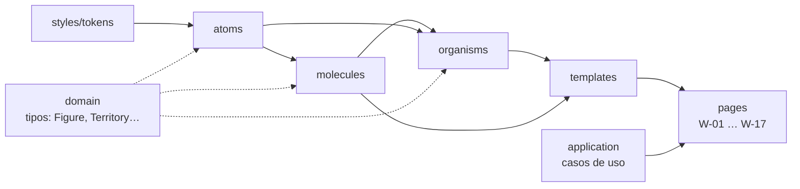

# presentation/components · Atomic Design

Componentes de UI de ReVoto organizados con **Atomic Design**. Es una parte de la capa de presentación (ADR-0003): los componentes son **presentacionales**, reciben datos por props y nunca ejecutan casos de uso. Las **páginas** (pantallas `W-NN`) están en `../pages`.



## Reglas

| # | Regla | Cómo se verifica |
| --- | --- | --- |
| 1 | Un nivel solo importa niveles inferiores (átomo → nada; molécula → átomos; organismo → átomos y moléculas; plantilla → todo lo anterior). | ESLint |
| 2 | Ningún componente importa `application`, `pages`, `providers`, `infrastructure` ni el contrato L4: recibe datos por props. Puede usar **tipos y funciones puras** del dominio (`Figure`, `ElectionType`, `territoryLabel`). | ESLint |
| 3 | Ningún valor visual literal: colores, tamaños y espacios salen de `../styles/tokens.css`. | Revisión par |
| 4 | Toda cifra se recibe como `Figure` del dominio y se muestra con `FigureWithContext` (territorio, periodo y fuente, RN-10). | Tipos + revisión par |
| 5 | Intermedias y presidenciales se distinguen por relleno (sólido vs. rayado) y etiqueta, nunca solo por color (RN-03, P5). | Prueba + revisión |
| 6 | Objetivos táctiles ≥ 44 px, foco visible, `aria-*` correcto y alternativa en tabla para toda gráfica (RNF-07). | `eslint-plugin-jsx-a11y` + auditoría |
| 7 | Cada componente tiene su prueba (`*.test.tsx`) con al menos el render y su nombre accesible. | `npm test` |
| 8 | Las páginas importan desde `@/presentation/components`, no desde rutas internas de un nivel. | Revisión par |

## Estructura de un componente

```text
presentation/components/<level>/<ComponentName>/
├─ ComponentName.tsx         # componente (export nombrado)
├─ ComponentName.module.css  # estilos con tokens
├─ ComponentName.test.tsx    # prueba de render y accesibilidad
└─ index.ts                     # re-exporta el componente y sus tipos
```

Créalo siempre con el generador, que también lo registra en el barril del nivel:

```powershell
npm run ui:nuevo -- atom Button
npm run ui:nuevo -- molecule TerritoryChip
npm run ui:nuevo -- organism TopBar
npm run ui:nuevo -- template NarrativeScreen
```

## Sistema de componentes v0.1 (fuente visual)

El aspecto y el movimiento de cada componente salen de la página **«Sistema de componentes»** del canvas de alta fidelidad: C-00 Tokens, C-01 Átomos, C-02 Moléculas, C-03 Organismos, C-04 Plantillas y C-05 Inventario. Cada componente cambia por breakpoint dentro de sí mismo; las páginas no tienen media queries de diseño.

| Nivel | Implementados |
| --- | --- |
| Átomos | `Button` (small 36 · medium 44 · large 52, íconos SVG, círculo ‹ › en móvil), `Chip`, `Icon`, `IconBubble`, `IconButton`, `Illustration`, `Logo`, `Pill`, `ProgressSegment`, `RadioMark`, `Slot`, `Switch`, `Text` (`figure`, `figureSmall`, `pending`), `VisuallyHidden` |
| Moléculas | `CheckList`, `ComparisonBar`, `DataList`, `Disclosure`, `FieldTable`, `Notice`, `OptionGroup`, `ProgressBar`, `SearchField`, `SegmentedControl`, `SelectableRow`, `SelectField`, `StatCard`, `SummaryRow`, `SwitchRow`, `TerritoryChip` |
| Organismos | `BarChart`, `ChartTable` (gráfica ↔ tabla en el mismo lugar), `BottomBar` (`secondaryAction`), `BottomSheet` (hoja · hoja con márgenes · panel lateral · `popover`), `IdentityCard` (`ArchetypeCard` A1–A5 y `BadgeCard` I1–I6 en formato historia, publicación y móvil), `ShareCard`, `StatusView`, `TopBar` (variante utilidad con `onBack`) |
| Plantillas | `LiteScreen`, `NarrativeScreen` (`visualFirst`), `SheetTemplate`, `UtilityScreen` (`aside`) |

Movimiento (M-01): los bloques de texto entran con *rise* (480 ms, desfase de 70 ms), el visual con *pop* (560 ms, resorte), las barras crecen (640 ms, desfase de 90 ms) y el segmento nuevo del progreso se llena (480 ms). Todo pasa a 0 ms con movimiento reducido o lectura fácil. Las tarjetas de arquetipo e insignia animan sus barras (grow), líneas (draw), piezas (pop), sol y luna. Pendiente: el `Tooltip` del mapa, la tarjeta de los 30 cruces (W-09c) y los mapas.

## Inventario planeado

Derivado del catálogo lo-fi (`docs/diseno/manual-de-diseno-wireframes.md` §6) y de los wireframes `W-01` a `W-17`. El esqueleto de US-09 ya implementa los de la barra, las hojas, los estados y las plantillas; los demás se construyen en las historias indicadas. El código está en inglés; los textos de la interfaz, en español.

### Átomos

| Componente | Clase lo-fi | Uso / requisito | Historia |
| --- | --- | --- | --- |
| `Button` | `.wf-btn`, `.wf-btn.primary` | Variantes primario, secundario, texto. Alto 48 px; uno primario por pantalla | US-09 |
| `IconButton` | `.wf-icon` | «Aa», ‹ ›, cerrar. Siempre con `aria-label` | US-09 |
| `Text` | — | Variantes `h1`, `h2`, `lead`, `body`, `meta`, `label`, `figure` de la escala §4 | US-09 |
| `Figure` | `.wf-figure` | Número protagonista (56/64 px) | US-11 |
| `Switch` | `.wf-toggle` | `role="switch"`: lectura fácil, movimiento reducido, versión ligera | US-15 |
| `Select` | `.wf-select` | `<select>` nativo con etiqueta visible | US-09 |
| `Skeleton` | `.wf-skel` | Estado de carga | US-11 |
| `ProgressSegment` | `.wf-progress span` | Un segmento de la barra de 10 | US-09 |
| `VisuallyHidden` | — | Texto solo para lector de pantalla («Pantalla 4 de 10») | US-09 |
| `Link` | `.wf-link` | Enlaces de texto y «‹ Volver» | US-09 |
| `SeriesSwatch` | rayado / sólido | Patrón de intermedia vs. presidencial (RN-03) | US-11 |

### Moléculas

| Componente | Compuesta de | Uso / requisito | Historia |
| --- | --- | --- | --- |
| `FigureWithContext` | `Figure` + `Text meta` | Cifra + territorio · periodo + referencia a fuente (RN-10) | US-11 |
| `TerritoryChip` | `Button` + `Text` | «Entidad · Municipio ▾»; abre W-02 (HU-28) | US-09 |
| `ProgressBar` | `ProgressSegment` × N + `VisuallyHidden` | 10 segmentos, texto oculto, se recalcula si se degrada la secuencia | US-09 |
| `SelectField` | `Text` + `Select` | Entidad y municipio con etiqueta asociada | US-09 |
| `SwitchRow` | `Text` + `Switch` | Ajuste con descripción (W-01, W-13) | US-15 |
| `Notice` | `Text` + icono | Umbral RN-05, error, periodo faltante (W-17) | US-11 |
| `BarRow` | `Text` + barra + valor | Una barra con etiqueta y valor visible | US-11 |
| `LegendItem` | `SeriesSwatch` + `Text` | Leyenda de series | US-11 |
| `SourceButton` | `IconButton` + `Text` | «ⓘ Fuente», abre W-11 (RF-12) | US-12 |

### Organismos

| Componente | Uso / requisito | Historia |
| --- | --- | --- |
| `TopBar` | Progreso + chip de territorio + «Aa» (zona de 56 px) | US-09 |
| `BottomBar` | Fuente · Compartir · ‹ › (zona de 72 px) | US-09 |
| `BottomSheet` | Bottom sheet con asa, título, cierre con Escape y foco atrapado (W-11, W-12, W-13) | US-09 |
| `BarChart` | Barras + tabla alternativa (RIU-04) + texto alternativo (RF-17) | US-11 |
| `ChartTable` | «Ver como tabla» por gráfica, sin cambiar a la versión ligera (DEF-24, RIU-04) | US-15 |
| `TimeSeries` | 2009–2024 sólido/rayado + tabla alternativa (RN-03) | US-11 |
| `TerritorySelector` | Entidad → municipio dependiente + «Continuar con cifras nacionales» (W-02) | US-09 |
| `SourceCard` | Fuente, año, corte, fórmula, % sin dato, liga (W-11) | US-12 |
| `CardPreview` | Tarjeta 9:16 / 1:1 para compartir (W-12, RN-08) | US-14 |
| `ReadingSettingsPanel` | Contenido de W-13 | US-15 |
| `StatusView` | Carga, error con reintento, umbral, periodo faltante (W-17) | US-11 |
| `AlternativeTable` | Tabla accesible de cualquier visualización | US-11 |

### Plantillas

| Plantilla | Uso | Manual |
| --- | --- | --- |
| `NarrativeScreen` | Zona superior 56 px · contenido 632 px sin scroll · zona inferior 72 px | §7.1 |
| `SheetTemplate` | Hoja al ~70 % del alto, fondo atenuado | §7.2 |
| `UtilityScreen` | «‹ Volver» + título, scroll vertical, acción fija abajo (W-02, W-10, W-16) | §7.3 |
| `LiteScreen` | Solo texto y tablas (W-15, RF-18) | — |

### Páginas (fuera de `components`)

`W-01` a `W-17` viven en `presentation/pages` y se construyen en US-09 y US-11.
