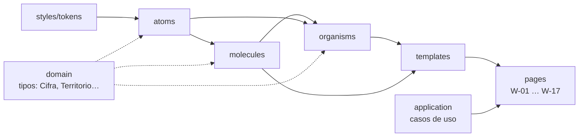

# presentation/components · Atomic Design

Componentes de UI de ReVoto organizados con **Atomic Design**. Es una parte de la capa de presentación (ADR-0003): los componentes son **presentacionales**, reciben datos por props y nunca ejecutan casos de uso. Las **páginas** (pantallas `W-NN`) están en `../pages`.



## Reglas

| # | Regla | Cómo se verifica |
| --- | --- | --- |
| 1 | Un nivel solo importa niveles inferiores (átomo → nada; molécula → átomos; organismo → átomos y moléculas; plantilla → todo lo anterior). | ESLint |
| 2 | Ningún componente importa `application`, `pages`, `providers`, `infrastructure` ni el contrato L4: recibe datos por props. Puede usar **tipos y funciones puras** del dominio (`Cifra`, `TipoEleccion`, `etiquetaTerritorio`). | ESLint |
| 3 | Ningún valor visual literal: colores, tamaños y espacios salen de `../styles/tokens.css`. | Revisión par |
| 4 | Toda cifra se recibe como `Cifra` del dominio y se muestra con `CifraConContexto` (territorio, periodo y fuente, RN-10). | Tipos + revisión par |
| 5 | Intermedias y presidenciales se distinguen por relleno (sólido vs. rayado) y etiqueta, nunca solo por color (RN-03, P5). | Prueba + revisión |
| 6 | Objetivos táctiles ≥ 44 px, foco visible, `aria-*` correcto y alternativa en tabla para toda gráfica (RNF-07). | `eslint-plugin-jsx-a11y` + auditoría |
| 7 | Cada componente tiene su prueba (`*.test.tsx`) con al menos el render y su nombre accesible. | `npm test` |
| 8 | Las páginas importan desde `@/presentation/components`, no desde rutas internas de un nivel. | Revisión par |

## Estructura de un componente

```text
presentation/components/<nivel>/<NombreComponente>/
├─ NombreComponente.tsx         # componente (export nombrado)
├─ NombreComponente.module.css  # estilos con tokens
├─ NombreComponente.test.tsx    # prueba de render y accesibilidad
└─ index.ts                     # re-exporta el componente y sus tipos
```

Créalo siempre con el generador, que también lo registra en el barril del nivel:

```powershell
npm run ui:nuevo -- atomo Boton
npm run ui:nuevo -- molecula ChipTerritorio
npm run ui:nuevo -- organismo BarraSuperior
npm run ui:nuevo -- plantilla PantallaNarrativa
```

## Inventario planeado

Derivado del catálogo lo-fi (`docs/diseno/manual-de-diseno-wireframes.md` §6) y de los wireframes `W-01` a `W-17`. **Ninguno está implementado todavía.** Se construyen en las historias indicadas.

### Átomos

| Componente | Clase lo-fi | Uso / requisito | Historia |
| --- | --- | --- | --- |
| `Boton` | `.wf-btn`, `.wf-btn.primary` | Variantes primario, secundario, texto. Alto 48 px; uno primario por pantalla | US-09 |
| `BotonIcono` | `.wf-icon` | «Aa», ‹ ›, cerrar. Siempre con `aria-label` | US-09 |
| `Texto` | — | Roles `h1`, `h2`, `cuerpo`, `meta`, `etiqueta` de la escala §4 | US-09 |
| `Cifra` | `.wf-figure` | Número protagonista (56/64 px) | US-11 |
| `Interruptor` | `.wf-toggle` | `role="switch"`: lectura fácil, movimiento reducido, versión ligera | US-15 |
| `Selector` | `.wf-select` | `<select>` nativo con etiqueta visible | US-09 |
| `Esqueleto` | `.wf-skel` | Estado de carga | US-11 |
| `SegmentoProgreso` | `.wf-progress span` | Un segmento de la barra de 10 | US-09 |
| `OcultoVisual` | — | Texto solo para lector de pantalla («Pantalla 4 de 10») | US-09 |
| `Enlace` | `.wf-link` | Enlaces de texto y «‹ Volver» | US-09 |
| `MuestraSerie` | rayado / sólido | Patrón de intermedia vs. presidencial (RN-03) | US-11 |

### Moléculas

| Componente | Compuesta de | Uso / requisito | Historia |
| --- | --- | --- | --- |
| `CifraConContexto` | `Cifra` + `Texto meta` | Cifra + territorio · periodo + referencia a fuente (RN-10) | US-11 |
| `ChipTerritorio` | `Boton` + `Texto` | «Entidad · Municipio ▾»; abre W-02 (HU-28) | US-09 |
| `BarraProgreso` | `SegmentoProgreso` × N + `OcultoVisual` | 10 segmentos, texto oculto, se recalcula si se degrada la secuencia | US-09 |
| `CampoSelector` | `Texto` + `Selector` | Entidad y municipio con etiqueta asociada | US-09 |
| `FilaInterruptor` | `Texto` + `Interruptor` | Ajuste con descripción (W-01, W-13) | US-15 |
| `Aviso` | `Texto` + icono | Umbral RN-05, error, periodo faltante (W-17) | US-11 |
| `FilaBarra` | `Texto` + barra + valor | Una barra con etiqueta y valor visible | US-11 |
| `ElementoLeyenda` | `MuestraSerie` + `Texto` | Leyenda de series | US-11 |
| `BotonFuente` | `BotonIcono` + `Texto` | «ⓘ Fuente», abre W-11 (RF-12) | US-12 |

### Organismos

| Componente | Uso / requisito | Historia |
| --- | --- | --- |
| `BarraSuperior` | Progreso + chip de territorio + «Aa» (zona de 56 px) | US-09 |
| `BarraInferior` | Fuente · Compartir · ‹ › (zona de 72 px) | US-09 |
| `HojaInferior` | Bottom sheet con asa, título, cierre con Escape y foco atrapado (W-11, W-12, W-13) | US-09 |
| `GraficaBarras` | Barras + tabla alternativa (RIU-04) + texto alternativo (RF-17) | US-11 |
| `SerieTemporal` | 2009–2024 sólido/rayado + tabla alternativa (RN-03) | US-11 |
| `SelectorTerritorio` | Entidad → municipio dependiente + «Continuar con cifras nacionales» (W-02) | US-09 |
| `FichaFuente` | Fuente, año, corte, fórmula, % sin dato, liga (W-11) | US-12 |
| `VistaPreviaTarjeta` | Tarjeta 9:16 / 1:1 para compartir (W-12, RN-08) | US-14 |
| `PanelAjustesLectura` | Contenido de W-13 | US-15 |
| `VistaEstado` | Carga, error con reintento, umbral, periodo faltante (W-17) | US-11 |
| `TablaAlternativa` | Tabla accesible de cualquier visualización | US-11 |

### Plantillas

| Plantilla | Uso | Manual |
| --- | --- | --- |
| `PantallaNarrativa` | Zona superior 56 px · contenido 632 px sin scroll · zona inferior 72 px | §7.1 |
| `PlantillaHoja` | Hoja al ~70 % del alto, fondo atenuado | §7.2 |
| `PantallaUtilitaria` | «‹ Volver» + título, scroll vertical, acción fija abajo (W-02, W-10, W-16) | §7.3 |
| `PantallaLigera` | Solo texto y tablas (W-15, RF-18) | — |

### Páginas (fuera de `components`)

`W-01` a `W-17` viven en `presentation/pages` y se construyen en US-09 y US-11.
