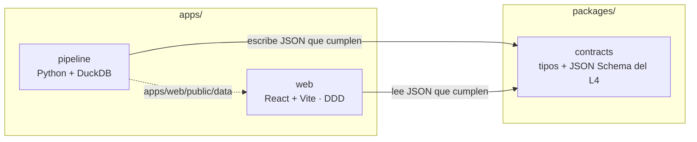
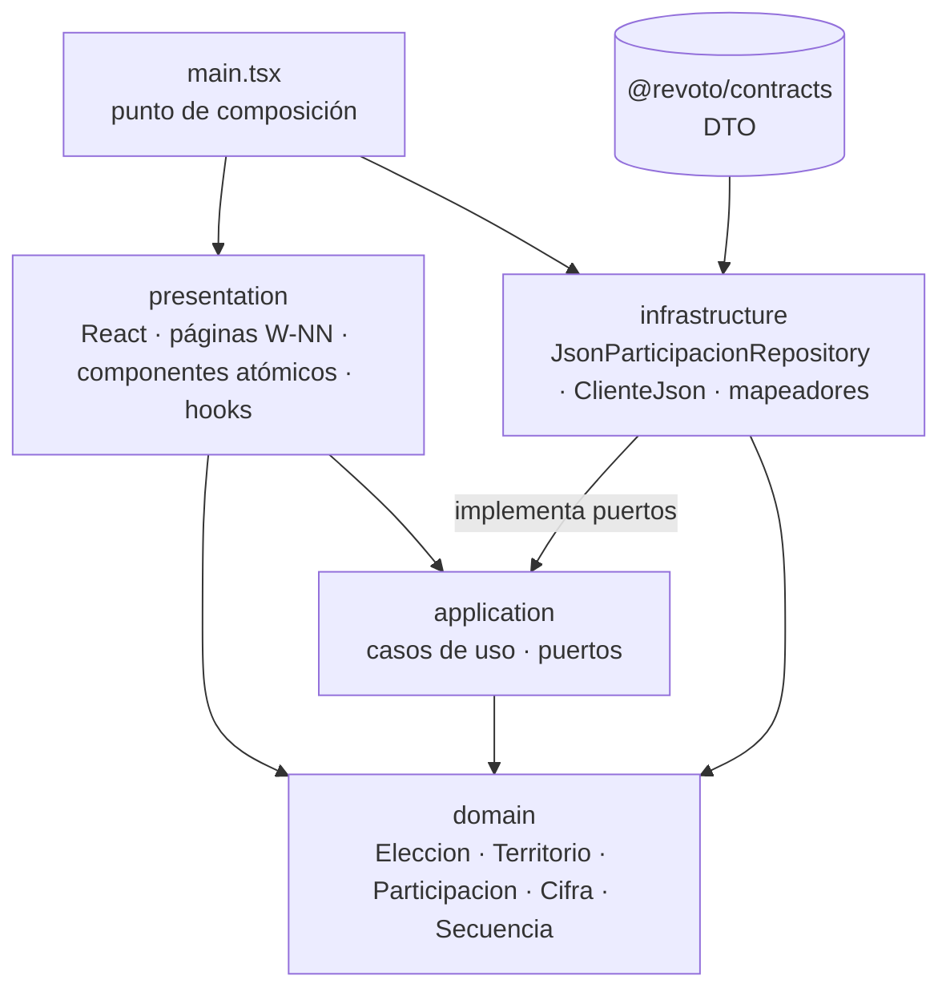
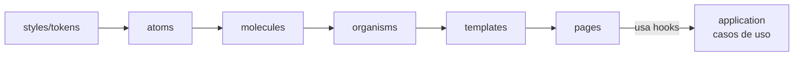
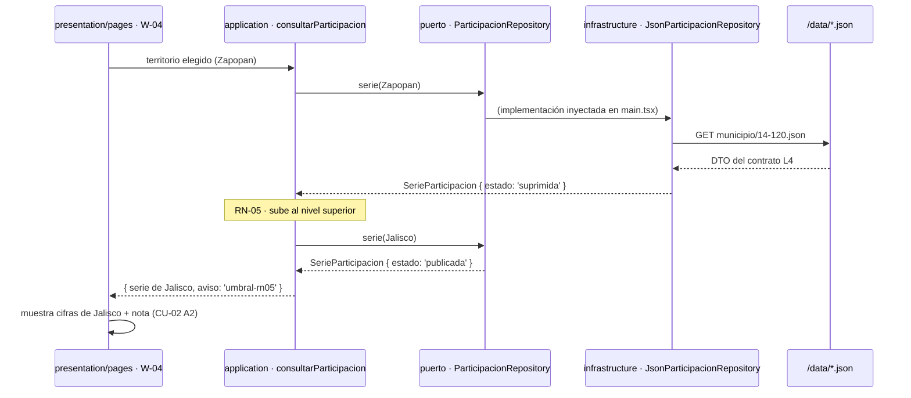

# ADR-0003 · DDD en la app web y monorepo mínimo

- **Estado:** Propuesta
- **Fecha:** 08/10/2026
- **Decisores:** Angel (Architecture owner), Kira
- **Reemplaza:** la organización en paquetes `@revoto/ui` y `@revoto/data` de [ADR-0002](./0002-monorepo-react-atomic-design.md)

## Contexto

La primera estructura separaba la app en paquetes por tipo técnico (`ui`, `data`) y dejaba las páginas en otro lado. Las reglas del dominio electoral (RN-01 participación, RN-03 tipo de elección, RN-05 umbral, RN-10 cifra con contexto) no tenían un lugar propio: quedaban repartidas entre el pipeline, los tipos del contrato y los componentes. Era difícil saber dónde poner código nuevo.

## Decisión

### 1. Monorepo mínimo

Solo existe un paquete compartido, y solo porque lo comparten dos aplicaciones:

| Carpeta | Qué es | Por qué está aquí |
| --- | --- | --- |
| `apps/web` | El micrositio | Es lo que se despliega en Vercel. |
| `apps/pipeline` | Pipeline de datos | Es otra aplicación: corre fuera de línea y produce los JSON. |
| `packages/contracts` | Contrato L4 | Lo único que las dos apps deben compartir para no desincronizarse. |

### 2. Capas DDD dentro de `apps/web/src`

Las flechas son dependencias permitidas: siempre apuntan hacia el dominio. Ninguna capa interna conoce a una externa.

| Capa | Contiene | Puede importar | No puede importar |
| --- | --- | --- | --- |
| `domain` | Reglas de negocio puras: tipos y funciones de elección (RN-03), territorio (RN-02), participación (RN-01, RN-04), cifra con contexto (RN-10), secuencia narrativa (RF-01 a RF-03) | Nada externo | React, `fetch`, `application`, `infrastructure`, `presentation`, contrato L4 |
| `application` | Casos de uso (`consultarParticipacion`, `listarEntidades`) y puertos (`ParticipacionRepository`) | `domain` | React, `fetch`, `infrastructure`, `presentation`, contrato L4 |
| `infrastructure` | Adaptadores que implementan los puertos: lectura de JSON del CDN y traducción DTO → dominio | `domain`, `application`, `@revoto/contracts` | React, `presentation` |
| `presentation` | React: páginas, componentes con Atomic Design, hooks, estilos, proveedor de dependencias | `domain`, `application` | `infrastructure`, contrato L4, `fetch` |
| `main.tsx` | Punto de composición: crea los adaptadores y los inyecta | Todo | — |

ESLint hace cumplir cada fila de la tabla (`eslint.config.js`).

### 3. Atomic Design solo en la presentación

Atomic Design organiza la **UI**, no la app. Vive en `presentation/components/{atoms,molecules,organisms,templates}`; el nivel *pages* es `presentation/pages`. Los componentes son presentacionales: no ejecutan casos de uso; las páginas sí.

### 4. Flujo de una consulta

## Consecuencias

- **Dónde va cada cosa** tiene una sola respuesta: regla → `domain`; flujo de negocio → `application`; acceso a datos → `infrastructure`; React → `presentation`.
- Las reglas de negocio se prueban sin navegador ni datos (`domain/**/*.test.ts`).
- Cambiar los JSON estáticos por una API (ADR-0001) es escribir otro adaptador en `infrastructure` y cambiar una línea en `main.tsx`.
- Los DTO del contrato no se filtran a la UI: un cambio de formato en los JSON solo toca `infrastructure/json-estatico/mapeadores.ts`.
- Costo: más carpetas y una capa de traducción. Para un equipo de dos personas se mantiene ligero: un solo puerto, sin entidades con identidad ni agregados complejos, sin bus de eventos.
