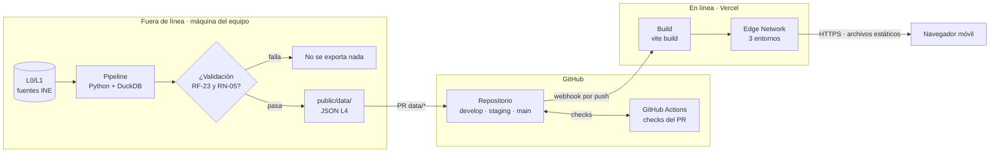
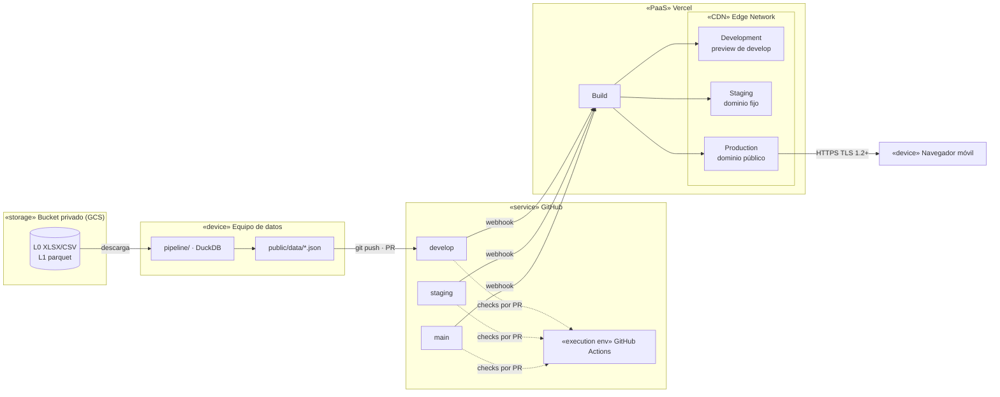
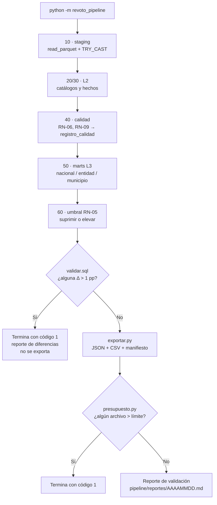
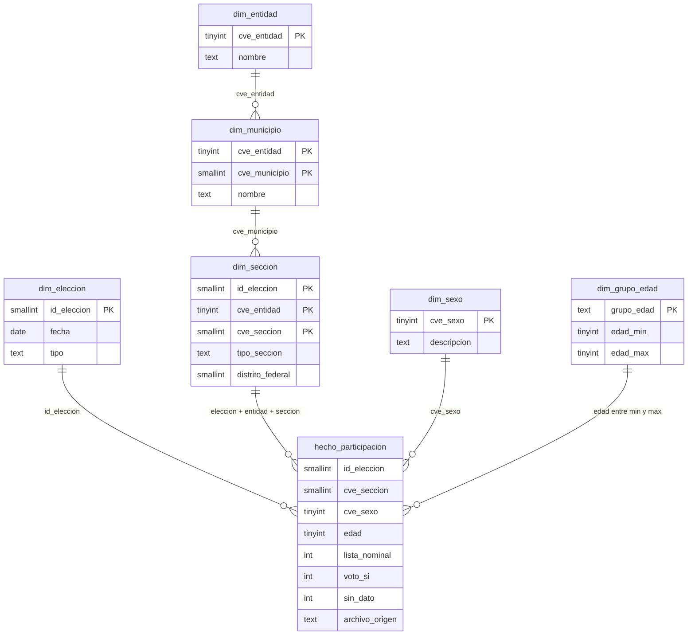
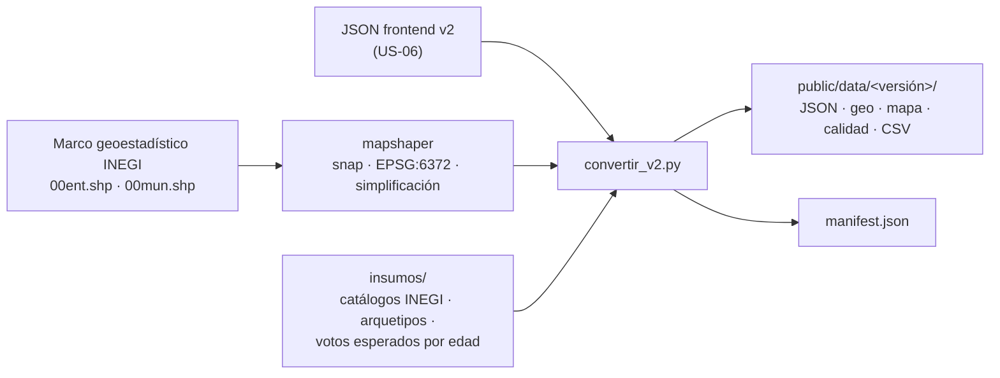
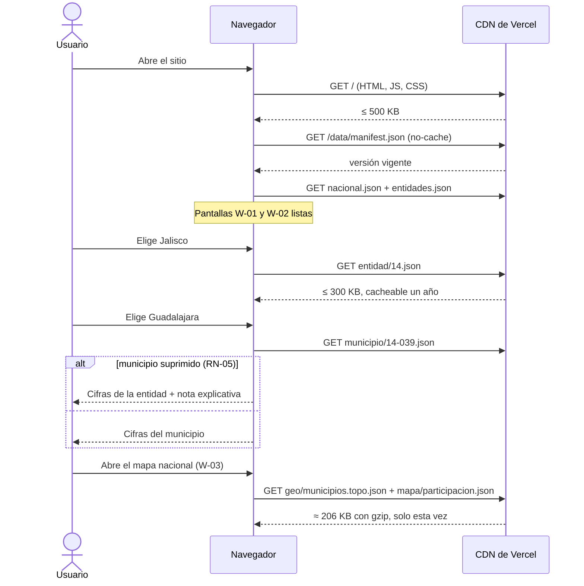
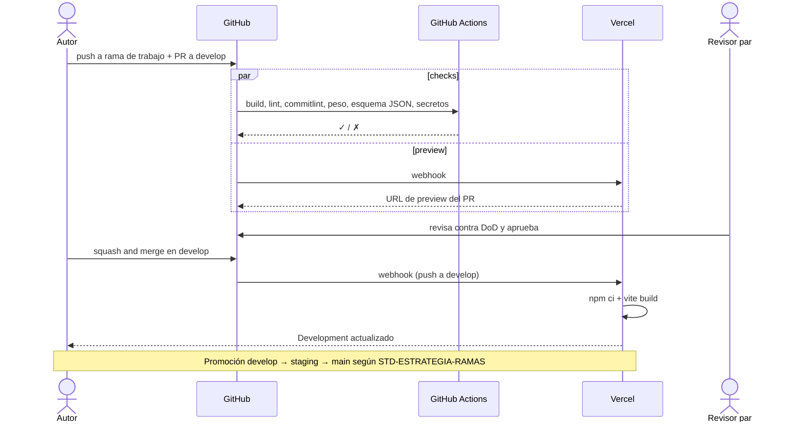
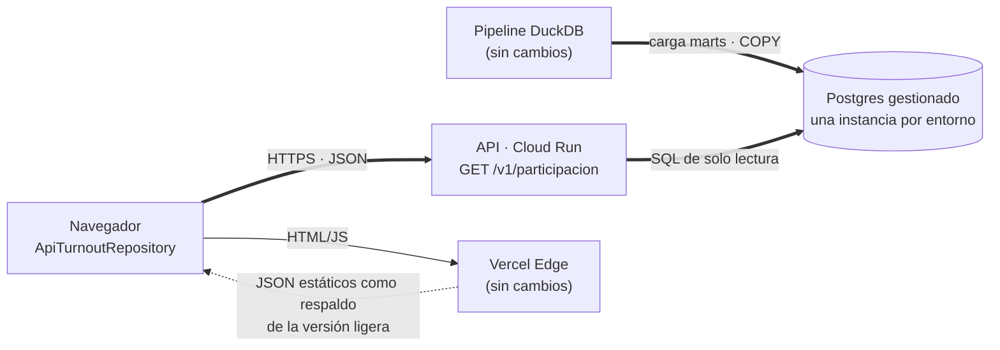

# 🏗️ Arquitectura y Despliegue de ReVoto

## 🎯 Propósito

Este documento explica cómo está construido y cómo se publica ReVoto, de punta a punta: de dónde salen los datos, cómo los transforma el pipeline, qué archivos llegan al navegador, cómo se organiza el repositorio y qué pasa desde un `git push` hasta que el sitio está en línea. Está escrito para que cualquier desarrollador que se integre al proyecto pueda entender el sistema, correrlo en su máquina y cambiarlo sin romper los requisitos del SRS.

> 🖼️ **Diagrama interactivo de despliegue:** [Despliegue de ReVoto](https://claude.ai/artifact/Dp7zaGb6k9yGcSFzhYczKZ) (vista del MVP y vista de evolución con backend).

---

## 🔍 Alcance

- **Cubre:** pipeline de datos (L0 a L4), contrato de los archivos JSON, frontend estático, repositorio, entornos, CI/CD, operación y la ruta de evolución hacia un backend.
- **No cubre:** diseño visual y de interacción (ver `docs/diseno/manual-de-diseno-wireframes.md` y `docs/diseno/arquitectura-informacion.md`), contenido narrativo ni reglas de negocio más allá de cómo se implementan (ver SRS).
- **Historias relacionadas:** US-06 (dataset homologado), US-07 (diccionario de datos), US-08 (esqueleto y despliegue continuo), US-09 (motor de secuencia), US-11 (pantallas de cifras y adaptadores), US-14 (tarjeta compartible), US-15 (versión ligera y mapas), US-22 (datos abiertos).

---

## 📖 Definiciones y Terminología

| Término | Definición |
| --- | --- |
| **L0 · Fuentes** | Archivos oficiales del INE por elección y entidad (XLSX/CSV). |
| **L1 · Staging** | Consolidado fiel a las fuentes: `conteos_censales_master.parquet`, 54.8 M filas, todo en texto. |
| **L2 · Normalizado** | Modelo dimensional con tipos correctos: 1 tabla de hechos y 6 catálogos (SRS §8.3). |
| **L3 · Marts** | Agregados publicables por territorio, elección y corte (edad, sexo, tipo de sección). |
| **L4 · Publicación** | Archivos JSON que consume el navegador, con su manifiesto. |
| **DuckDB** | Motor SQL analítico que corre como librería, sin servidor. Lee parquet directamente. |
| **Versión de datos** | Identificador de una corrida del pipeline (`AAAAMMDD-<hash corto>`), independiente de la versión SemVer del código. |
| **Manifiesto** | `public/data/manifest.json`: dice qué versión de datos está vigente y qué archivos contiene. |
| **Puertos de lectura** | `TurnoutRepository`, `GeographyRepository`, `QualityRepository` y `OpenDataRepository` en `application/ports`: toda lectura de datos pasa por ellos. Hoy los implementan adaptadores de JSON estáticos; mañana podría ser una API. |
| **CVEGEO** | Clave geoestadística INEGI de 5 dígitos (entidad + municipio). Une cifras con geometría; no siempre coincide con la clave INE. |
| **TopoJSON** | Formato de geometría que guarda una sola vez los límites compartidos entre polígonos. Más ligero que GeoJSON y permite calcular vecinos. |
| **Puente v2 → L4** | `convertir_v2.py`: convierte la salida *frontend v2* de US-06 al contrato L4 mientras `exportar.py` no esté listo (ADR-0005). |
| **CDN** | Red de distribución de Vercel que sirve los archivos estáticos cerca del usuario y por HTTPS. |

---

## 👥 Roles y Responsabilidades

| Rol | Responsabilidad en esta arquitectura |
| --- | --- |
| **Architecture owner (Angel)** | Mantener este documento, configurar Vercel y la protección de ramas, aprobar cambios de arquitectura. |
| **Responsable de datos (Kira, US-06)** | Ejecutar el pipeline, revisar el reporte de validación y abrir el PR `data/*` con los JSON. |
| **Revisor par** | Revisar cada PR contra el DoD; en PR de datos, revisar también el reporte de validación. |
| **Quality assurance (Kira)** | Probar en Staging y en dispositivos reales antes de promover a Production. |
| **CCB** | Aprobar líneas base y cualquier cambio que reemplace RNF-17 (por ejemplo, agregar backend). |

---

## 1. 🧭 Arquitectura en una página

ReVoto es un **sitio estático con datos precalculados**. Todo el trabajo pesado (leer 54.8 M filas, normalizar, agregar, validar) ocurre **antes** de publicar, en la máquina del equipo. A producción solo llegan archivos: HTML, JavaScript, CSS y JSON pequeños.



Tres consecuencias que conviene tener presentes al programar:

1. **No hay servidor ni base de datos en producción.** Si algo necesita "consultar", se precalcula en el pipeline (RNF-17).
2. **El navegador solo descarga lo que va a mostrar.** La carga inicial no incluye datos de territorios; cada entidad y municipio se pide al elegirlo (RNF-01, RNF-04).
3. **Los datos y el código viajan juntos.** Un JSON publicado siempre corresponde a un commit revisado, así que cualquier versión del sitio se puede reconstruir y revertir.

---

## 2. ⚖️ Decisión de arquitectura

| Opción | Descripción | Veredicto | Motivo |
| --- | --- | --- | --- |
| **A. Estático + pipeline fuera de línea** | DuckDB genera JSON; Vercel los sirve | ✅ **Elegida para el MVP** | Cumple RNF-17, cuesta $0, ninguna pieza puede caerse en la demo. RN-02 prohíbe publicar secciones, así que todo lo visible cabe precalculado por entidad y municipio. |
| B. Vercel + Postgres gestionado | API en funciones de Vercel con Supabase o Neon | Descartada por ahora | Contradice RNF-17; el plan gratuito no aloja L2 completo; agrega un punto de falla. |
| C. Google Cloud (BigQuery o Cloud SQL + Cloud Run) | API propia sobre los créditos de GCP | Descartada por ahora | Más piezas, credenciales y costos que vigilar, sin una historia Must que lo requiera. |
| D. DuckDB-WASM en el navegador | Consultas libres sobre parquet en el CDN | Descartada | El motor pesa varios MB y rompe RNF-01. |

**Cuándo se reabre la decisión:** si una historia requiere consultas que no se pueden precalcular, o si algún archivo L4 supera el presupuesto de la sección 5.3 aun después de dividirlo. En ese caso se hace una evaluación formal (DAR) y una solicitud de cambio a RNF-17 ante el CCB. La ruta está descrita en la sección 11.

---

## 3. 🚀 Diagrama de despliegue



| Nodo | Qué corre | Qué guarda | Notas |
| --- | --- | --- | --- |
| Equipo de datos | Python 3.12+ y DuckDB | `data/` local (ignorada por Git) | Windows 11 en ambas laptops; los comandos de este documento funcionan en PowerShell. |
| Bucket privado | Nada | L0 y L1 | El parquet de 193 MB excede el límite de 100 MB por archivo de GitHub. Acceso solo para el equipo. |
| GitHub | Actions (checks) | Código, SQL, JSON L4, reportes de validación | Ramas según `STD-ESTRATEGIA-RAMAS`. |
| Vercel build | `npm ci` + `vite build` | — | No ejecuta el pipeline: solo copia `public/data/`. |
| Vercel Edge | Archivos estáticos | `dist/` de cada despliegue | HTTPS automático, compresión, caché y encabezados de `vercel.json`. |
| Navegador | La app | Caché HTTP | Sin cookies ni almacenamiento de datos personales (RNF-13). |

---

## 4. 🗄️ Pipeline de datos

### 4.1 Capas y dónde vive cada una

| Capa | Formato | Dónde vive | ¿En Git? | ¿En producción? |
| --- | --- | --- | --- | --- |
| L0 · Fuentes | XLSX / CSV | Bucket privado → `data/raw/` local | ❌ | ❌ |
| L1 · Staging | Parquet (193 MB) | Bucket privado → `data/staging/` local | ❌ | ❌ |
| L2 · Normalizado | Tablas DuckDB | `data/revoto.duckdb` local | ❌ | ❌ |
| L3 · Marts | Tablas DuckDB + CSV de datos abiertos | `data/revoto.duckdb` y `public/data/<versión>/csv/` | Solo los CSV publicables | Solo los CSV (US-22) |
| L4 · Publicación | JSON | `public/data/` | ✅ | ✅ |

### 4.2 Estructura del pipeline

```text
apps/pipeline/
├─ config.toml                 # rutas, umbral RN-05, máximo de RF-23
├─ requirements.txt
├─ revoto_pipeline/
│  ├─ __main__.py              # punto de entrada: python -m revoto_pipeline
│  ├─ ejecutar.py              # corre los SQL en orden y la validación
│  ├─ sql/
│  │  ├─ 10_staging.sql        # vista sobre el parquet L1
│  │  ├─ 20_dimensiones.sql    # dim_eleccion, dim_grupo_edad, dim_sexo, dim_entidad, dim_municipio
│  │  ├─ 30_hechos.sql         # hecho_participacion (L2)
│  │  ├─ 40_calidad.sql        # RN-06, RN-09 → registro_calidad (RF-24)
│  │  ├─ 50_marts.sql          # mart_participacion con GROUPING SETS (L3)
│  │  └─ 60_umbral.sql         # RN-05: supresión (RF-22)
│  ├─ validacion/
│  │  ├─ cifras_oficiales.csv  # referencia publicada por el INE
│  │  └─ validar.sql           # RF-23: diferencias > 1 pp
│  ├─ exportar.py              # L3 → JSON L4 + manifiesto (US-06)
│  └─ presupuesto.py           # verifica pesos (RNF-04)
├─ reportes/                   # reportes de validación por corrida
└─ tests/                      # pruebas de RN-01, RN-05, RN-06, RN-09, RF-23
```

### 4.3 Flujo de una corrida



Cada paso es un archivo SQL que DuckDB ejecuta en orden sobre la misma base local. Si un paso falla, la corrida se detiene y `public/data/` no se toca.

> ⚠️ **Estado al 18/10/2026:** el L4 publicado no sale todavía de `exportar.py`, sino del puente transitorio de la sección 4.7.

### 4.4 Ejemplos de SQL

> La versión vigente está en `apps/pipeline/revoto_pipeline/sql/`. Respecto a estos ejemplos, el código separa RN-06 de RN-09: un registro con sexo fuera de catálogo sigue contando en los totales y solo se descarta del desglose por sexo.

**Staging tipado (L1 → L2).** Las columnas de la fuente llegan como texto; `TRY_CAST` convierte sin abortar y los valores inválidos quedan en `NULL` para que la regla de calidad los cuente.

```sql
-- sql/30_hechos.sql
CREATE OR REPLACE TABLE hecho_participacion AS
SELECT
    TRY_CAST(AELEC   AS SMALLINT) AS id_eleccion,
    TRY_CAST(EDOCVE  AS TINYINT)  AS cve_entidad,
    TRY_CAST(MPIOCVE AS SMALLINT) AS cve_municipio,
    TRY_CAST(SECCION AS SMALLINT) AS cve_seccion,
    TRY_CAST(SEXO    AS TINYINT)  AS cve_sexo,
    TRY_CAST(EDAD    AS TINYINT)  AS edad,
    TRY_CAST(LN      AS INTEGER)  AS lista_nominal,
    TRY_CAST(SV      AS INTEGER)  AS voto_si,
    TRY_CAST(NV      AS INTEGER)  AS voto_no,
    TRY_CAST(NS      AS INTEGER)  AS sin_dato,
    source_file                   AS archivo_origen,
    FALSE                         AS excluido      -- 40_calidad.sql lo marca (RN-06, RN-09)
FROM read_parquet('data/staging/conteos_censales_master.parquet');
```

**Participación (RN-01) y niveles territoriales en una sola pasada.** `GROUPING SETS` produce los niveles nacional, entidad y municipio con sus cortes sin escribir una consulta por nivel.

```sql
-- sql/50_marts.sql
CREATE OR REPLACE TABLE mart_participacion AS
SELECT
    h.id_eleccion,
    CASE WHEN GROUPING(h.cve_entidad) = 1 THEN 'nacional'
         WHEN GROUPING(h.cve_municipio) = 1 THEN 'entidad'
         ELSE 'municipio' END                         AS nivel,
    h.cve_entidad,
    h.cve_municipio,
    g.grupo_edad,                                      -- NULL = todas las edades
    h.cve_sexo,                                        -- NULL = ambos sexos
    SUM(h.lista_nominal)                               AS lista_nominal,
    SUM(h.voto_si)                                     AS voto_si,
    SUM(h.sin_dato)                                    AS sin_dato,
    SUM(h.voto_si) / NULLIF(SUM(h.lista_nominal) - SUM(h.sin_dato), 0)
                                                       AS participacion,  -- RN-01
    FALSE                                              AS suprimido       -- 60_umbral.sql
FROM hecho_participacion h
JOIN dim_grupo_edad g ON h.edad BETWEEN g.edad_min AND g.edad_max          -- RN-04
WHERE h.excluido = FALSE                                                   -- RN-06, RN-09
GROUP BY GROUPING SETS (
    (h.id_eleccion),
    (h.id_eleccion, g.grupo_edad), (h.id_eleccion, h.cve_sexo),
    (h.id_eleccion, h.cve_entidad),
    (h.id_eleccion, h.cve_entidad, g.grupo_edad), (h.id_eleccion, h.cve_entidad, h.cve_sexo),
    (h.id_eleccion, h.cve_entidad, h.cve_municipio),
    (h.id_eleccion, h.cve_entidad, h.cve_municipio, g.grupo_edad),
    (h.id_eleccion, h.cve_entidad, h.cve_municipio, h.cve_sexo)
);
```

**Umbral de publicación (RN-05, RF-22).** El valor del umbral vive en `config.toml` con el valor definido en el SRS, nunca escrito en el SQL. Un municipio que no lo alcanza se marca y el frontend muestra la cifra de la entidad con la nota de CU-02 A2.

```sql
-- sql/60_umbral.sql  ($umbral se inyecta desde config.toml)
UPDATE mart_participacion
SET suprimido = TRUE, participacion = NULL, voto_si = NULL
WHERE nivel = 'municipio' AND lista_nominal < $umbral;
```

**Validación contra cifras oficiales (RF-23).** Si la consulta regresa filas, el pipeline termina con error y no exporta.

```sql
-- validacion/validar.sql
SELECT m.id_eleccion, m.nivel, m.cve_entidad,
       ROUND(m.participacion * 100, 2) AS calculada,
       o.participacion_pct             AS oficial,
       ROUND(ABS(m.participacion * 100 - o.participacion_pct), 2) AS diferencia_pp
FROM mart_participacion m
JOIN read_csv('pipeline/validacion/cifras_oficiales.csv') o USING (id_eleccion, nivel, cve_entidad)
WHERE m.grupo_edad IS NULL AND m.cve_sexo IS NULL
  AND ABS(m.participacion * 100 - o.participacion_pct) > 1.0;
```

### 4.5 Modelo L2



`dim_seccion` lleva la elección en la clave porque la geografía electoral cambia entre procesos (SRS §8.4). La sección solo se usa para calcular: nunca sale en un JSON (RN-02).

### 4.6 Cómo correrlo

```powershell
cd apps/pipeline
python -m venv .venv
.venv\Scripts\Activate.ps1
pip install -r requirements.txt               # duckdb, pytest

# Descargar fuentes del bucket a data/ en la raíz del repo (credencial personal, nunca en el repo)
gcloud storage cp -r gs://<bucket-de-fuentes>/staging ../../data/

# Corrida completa (RNF-16: un solo comando)
python -m revoto_pipeline

# Solo pruebas de reglas de negocio
python -m pytest -q
```

La corrida completa sobre 54.8 M filas debe tardar minutos en una laptop con 16 GB de RAM, porque DuckDB procesa el parquet por columnas y en paralelo.

### 4.7 Puente transitorio v2 → L4 (ADR-0005)

Mientras `exportar.py` no esté listo, el L4 lo escribe `revoto_pipeline/convertir_v2.py` a partir de los JSON *frontend v2* de la rama `feat/US-06-dataset-pipeline`.



| Paso | Qué hace |
| --- | --- |
| Cruce INE → INEGI | `cruce_ine_inegi`: toma el `cvegeo` de `insumos/arquetipos_municipales.csv`; si falta, aplica reglas de respaldo y las reporta en `calidad.json`. Las claves difieren en 1 372 de 2 477 municipios; hoy hay 10 cruces por respaldo. |
| Geometría | mapshaper sobre el marco INEGI: `snap` para que los vecinos compartan arcos, proyección Lambert conforme cónica (EPSG:6372) y salida TopoJSON (ADR-0004). |
| Vecinos | `vecinos_de`: municipios de la misma entidad que comparten al menos un arco. |
| Mapa nacional | `mapa/participacion.json` en forma compacta: `cvegeo → [nombre, entidad, [participación por año]]` (166 KB, 54 KB con gzip). |
| Presupuesto | Falla si `geo/municipios.topo.json` supera `mapa_nacional_kb`; aplica RN-05 con `UMBRAL_RN05 = 50`. |
| Manifiesto | Nueva carpeta `AAAAMMDD-hash7` y `manifest.json` con `max_diferencia_pp = null` mientras RF-23 no tenga cifras oficiales. |

```bash
mkdir -p /tmp/v2 && git archive feat/US-06-dataset-pipeline apps/web/public/data | tar -x -C /tmp/v2
PYTHONPATH=apps/pipeline python3 -m revoto_pipeline.convertir_v2 \
  --v2 /tmp/v2/apps/web/public/data --marco <carpeta con 00mun.shp y 00ent.shp> \
  --salida apps/web/public/data [--mapshaper <ruta a mapshaper>]
npm run check:data && npm run check:budget
```

Cuando el PR de US-06 se fusione, la salida v2 no debe quedar dentro de `apps/web/public/data/` (allí solo vive el contrato L4) y este puente pasa a ser el último paso del pipeline o se retira en favor de `exportar.py` con la misma salida.

---

## 5. 📦 Contrato de datos (L4)

### 5.1 Estructura de archivos

```text
public/data/
├─ manifest.json                       # sin caché: apunta a la versión vigente
└─ 20261013-0e071d3/                   # versión de datos (inmutable)
   ├─ nacional.json                    # serie nacional por elección, edad y sexo
   ├─ catalogos/entidades.json         # 32 entidades, nombres INEGI
   ├─ entidad/14.json                  # serie, votos esperados por edad y lista de sus municipios
   ├─ municipio/14-039.json            # serie, cvegeo, vecinos y arquetipo de un municipio
   ├─ calidad.json                     # reglas verificadas, cruces por respaldo (W-20, RF-24)
   ├─ geo/entidades.topo.json          # 32 entidades (W-02)
   ├─ geo/14.topo.json                 # municipios de la entidad (W-04)
   ├─ geo/municipios.topo.json         # todos los municipios (W-03, solo se pide ahí)
   ├─ mapa/participacion.json          # cvegeo → participación por año (W-03)
   └─ csv/participacion.csv            # datos abiertos (US-22)
```

Los esquemas de todos estos archivos están en `packages/contracts/schemas/` (`comun`, `manifest`, `nacional`, `entidades`, `entidad`, `municipio`, `calidad`, `geo`, `mapa`).

El pipeline borra la versión anterior al exportar: en el repositorio solo existe la carpeta vigente, y las versiones anteriores quedan en el historial de Git.

### 5.2 Ejemplos

```json
// manifest.json
{
  "version_datos": "20261012-a1b2c3d",
  "generado": "2026-10-12T18:30:00-06:00",
  "fuente": "Conteos censales INE (DECEYEC), elecciones federales 2009–2024",
  "validacion": { "max_diferencia_pp": 0.31, "reporte": "pipeline/reportes/20261012.md" }
}
```

```json
// 20261012-a1b2c3d/entidad/14.json (recortado)
{
  "territorio": { "nivel": "entidad", "cve": 14, "nombre": "Jalisco" },
  "fuente": "Conteos censales INE (DECEYEC)",
  "elecciones": [
    { "anio": 2024, "tipo": "presidencial", "participacion": 0.612, "lista_nominal": 6512345,
      "por_edad": { "18-24": 0.551, "25-34": 0.563, "35-44": 0.601, "45-59": 0.652, "60+": 0.668 },
      "por_sexo": { "H": 0.589, "M": 0.634 } }
  ],
  "municipios": [
    { "cve": 39, "nombre": "Guadalajara", "participacion": { "2024": 0.598, "2021": 0.487 } },
    { "cve": 117, "nombre": "…", "suprimido": true }
  ]
}
```

> Las cifras del ejemplo son ilustrativas; los valores reales salen del pipeline.

Reglas del contrato:

- Cada archivo lleva **territorio, periodo y fuente** (RN-10) y el **tipo de elección** para distinguir intermedias de presidenciales (RN-03).
- Las proporciones van como decimales con 3 cifras; el formato de porcentaje lo aplica el frontend.
- Un municipio bajo el umbral lleva `"suprimido": true` y ninguna cifra (RN-05).
- Ningún archivo contiene secciones ni datos personales (RN-02, RNF-13, RNF-14).
- Cada municipio lleva su `cvegeo` (clave INEGI) para unirse con la geometría; los archivos se siguen nombrando por la clave INE (ADR-0005).
- `vecinos` lista claves INE de municipios de la misma entidad; `arquetipo` es `null` con menos de 5 elecciones o si el municipio está suprimido.
- `entidad/<cve>.json` lleva `votos_esperados_por_edad` (W-09b) y `nombreEntidad`.
- `validacion.max_diferencia_pp` es `null` mientras RF-23 no tenga cifras oficiales; W-20 lo muestra como «Pendiente».
- Cambiar el contrato de forma incompatible es un `BREAKING CHANGE` (`STD-MENSAJES-COMMIT`) y obliga a actualizar el frontend en el mismo PR.

### 5.3 Presupuesto de peso

| Archivo | Cuándo se descarga | Límite | Por qué cabe |
| --- | --- | --- | --- |
| App (HTML, JS, CSS, fuentes) | Primera visita | ≤ 500 KB en total (RNF-01) | No incluye datos territoriales. |
| `manifest.json` + `nacional.json` + `entidades.json` | Primera visita | Incluidos en los 500 KB | Decenas de filas. |
| `entidad/<cve>.json` | Al elegir entidad | ≤ 300 KB (RNF-04) | Serie de la entidad y solo el total por municipio. Oaxaca, con 570 municipios, es el caso más pesado. |
| `municipio/<ent>-<mun>.json` | Al elegir municipio | ≤ 20 KB | Un territorio, 6 elecciones, 5 grupos de edad y 2 sexos. |
| `geo/entidades.topo.json` y `geo/<cve>.topo.json` | W-02 / al elegir entidad | ≤ 300 KB | Geometría proyectada y simplificada (ADR-0004). |
| `geo/municipios.topo.json` + `mapa/participacion.json` | Solo en W-03 | ≤ 650 KB (`mapa_nacional_kb`, pendiente de aprobación) | 559 KB + 166 KB en disco; 152 KB + 54 KB con gzip. Nunca en la versión ligera. |
| Exportación de tarjetas (`html-to-image`) | Al pulsar «Descargar» en W-12 | Fuera de los 500 KB | Carga diferida (ADR-0006). La app inicial mide 398.3 KB. |

`presupuesto.py` mide cada archivo al exportar y el check de CI lo repite en cada PR. Vercel además comprime con gzip o brotli, así que lo transferido es menor que el tamaño en disco.

---

## 6. 🖥️ Frontend

**Propuesta:** Vite + TypeScript, sin framework pesado, para respetar los 500 KB. La elección final se confirma en US-08 y US-09 (decisión D-01).

### 6.1 Capas y acceso a datos

La app se organiza con DDD (ADR-0003): `domain` (reglas puras), `application` (casos de uso y puertos), `infrastructure` (adaptadores) y `presentation` (React, con Atomic Design en `presentation/components`). Ningún componente ni página hace `fetch`: toda lectura pasa por los puertos de `application/ports`.

```ts
// application/ports/TurnoutRepository.ts (recortado)
export interface TurnoutRepository {
  states(): Promise<Territory[]>;
  municipalities(stateCode: number): Promise<Territory[]>;
  series(territory: Territory): Promise<TurnoutSeries>;            // 'suppressed' bajo RN-05
  stateOverview(stateCode: number): Promise<StateOverview>;        // municipios + votos esperados
  municipalityProfile(m: Municipality): Promise<MunicipalityProfile>; // cvegeo, vecinos, arquetipo
}
// También: GeographyRepository (W-02, W-03, W-04), QualityRepository (W-20), OpenDataRepository (W-16)
```

| Capa | Piezas |
| --- | --- |
| `domain` | `turnout/Comparison`, `turnout/Insights`, `turnout/Scale` (cortes por cuantiles del mapa), `identity/ArchetypeProfile`, `quality/QualityReport` |
| `application/use-cases` | `getTerritoryStory`, `compareTerritory`, `municipalityInsights` (lugar en la entidad, arquetipo, votos esperados), `getQualityReport`, `chooseTerritory` |
| `infrastructure/static-json` | `JsonClient` (pide `manifest.json` sin caché y luego `/data/<version_datos>/…`; traduce fallas a error de datos, W-17), `mappers.ts` (DTO → dominio, RN-10), `topology.ts` (TopoJSON → anillos proyectados) y un repositorio `Json*Repository` por puerto |
| `presentation` | `providers/Story` y la navegación, páginas W-01 a W-20, `share/exportCard.ts` (ADR-0006), organismo `ChoroplethMap` |

`src/main.tsx` crea los cuatro repositorios con el mismo `JsonClient` y los inyecta. Si algún día hay backend, se agregan adaptadores que implementen los mismos puertos y solo cambia ese archivo (sección 11).

### 6.2 Secuencia de carga



---

## 7. 📁 Repositorio

Monorepo mínimo con npm workspaces (ADR-0003): dos aplicaciones y un solo paquete compartido.

```text
revoto/
├─ apps/
│  ├─ web/                   # @revoto/web · React + Vite · DDD
│  │  ├─ src/domain/         # reglas de negocio puras
│  │  ├─ src/application/    # casos de uso + puertos
│  │  ├─ src/infrastructure/ # adaptadores (JSON estáticos)
│  │  ├─ src/presentation/   # React: components (Atomic Design), pages, hooks, styles
│  │  ├─ src/main.tsx        # punto de composición
│  │  └─ public/data/        # L4, generado por el pipeline
│  └─ pipeline/              # Python + DuckDB (revoto_pipeline/)
├─ packages/contracts/       # @revoto/contracts · DTO + JSON Schema del L4
├─ docs/ · design/wireframes/
├─ scripts/                  # generador de componentes y checks de CI
├─ .github/workflows/ci.yml
├─ vercel.json               # Vercel Services: servicio «web» + encabezados
├─ budget.json               # presupuestos de peso compartidos por CI y pipeline
└─ AGENTS.md · CLAUDE.md
```

En Vercel, **Root Directory** = raíz del repositorio y el proyecto usa **Services**: `vercel.json` declara un único servicio público, `web` (`apps/web`, Vite). `apps/pipeline` no es un servicio: es un proceso por lotes fuera de línea (RNF-17, ADR-0001), así que no hay bindings. En este documento, `public/data/` se refiere a `apps/web/public/data/` y `pipeline/` a `apps/pipeline/revoto_pipeline/`. El pipeline se ejecuta con `python -m revoto_pipeline` desde `apps/pipeline`.

`.gitignore` mínimo para que nunca se suban fuentes ni bases locales:

```gitignore
data/
*.duckdb
*.parquet
*.shp
*.dbf
.venv/
node_modules/
dist/
.env*
```

> ⚠️ La carpeta actual del proyecto tiene `conjunto_de_datos/` (shapefiles), un notebook y `analisis_calidad/`. Al crear el repositorio, los shapefiles van al bucket y el análisis se mueve a `pipeline/` o a `docs/`, según lo que se conserve.

---

## 8. 🔁 Entornos y CI/CD

### 8.1 Entornos

| Entorno | Rama | URL | Para qué | Quién lo usa |
| --- | --- | --- | --- | --- |
| Development | `develop` | Preview de rama de Vercel | Verificar los criterios de aceptación tras integrar | Revisor par |
| Staging | `staging` | Dominio fijo asignado a la rama (`[por definir]`) | Release candidate, QA y revisión del domingo con stakeholders | QA, stakeholders |
| Production | `main` | Dominio público (`[por definir]`) | Sitio que evalúa el jurado | Público |

Configuración en Vercel: **Production Branch = `main`**, dominio de staging asignado a la rama `staging` y previews automáticos para el resto. Cada PR también recibe su propio preview.

### 8.2 Del push al sitio publicado



### 8.3 Checks de CI

| Job | Qué verifica | Requisito |
| --- | --- | --- |
| `web` | `npm ci`, lint, `vite build`, peso total de `dist/` sin `data/` ≤ 500 KB | RNF-01 |
| `datos` | Esquema de cada JSON, cada archivo dentro del presupuesto de 5.3, manifiesto válido | RNF-04, RN-10 |
| `commits` | Formato de commits y título del PR | `STD-MENSAJES-COMMIT` |
| `secretos` | Ningún secreto en el diff | POL CM, D7 |
| `a11y` (PR a `staging` y `main`) | 0 violaciones críticas con axe sobre el preview | RNF-07 |

El pipeline **no** corre en CI: necesitaría credenciales del bucket y descargar 193 MB en cada PR. En cambio, el PR `data/*` incluye el reporte de validación como evidencia y CI verifica la forma y el peso del resultado.

### 8.4 `vercel.json` (raíz del repositorio)

```json
{
  "$schema": "https://openapi.vercel.sh/vercel.json",
  "services": {
    "web": {
      "root": "apps/web",
      "framework": "vite",
      "buildCommand": "npm run build",
      "outputDirectory": "dist"
    }
  },
  "rewrites": [
    {
      "source": "/(.*)",
      "destination": { "service": "web" }
    }
  ],
  "headers": [
    {
      "source": "/data/manifest.json",
      "headers": [{ "key": "Cache-Control", "value": "no-cache" }]
    },
    {
      "source": "/data/:version/:path*",
      "headers": [{ "key": "Cache-Control", "value": "public, max-age=31536000, immutable" }]
    },
    {
      "source": "/(.*)",
      "headers": [
        { "key": "Strict-Transport-Security", "value": "max-age=63072000; includeSubDomains" },
        {
          "key": "Content-Security-Policy",
          "value": "default-src 'self'; img-src 'self' data: blob:; style-src 'self' 'unsafe-inline'; connect-src 'self'; upgrade-insecure-requests"
        },
        { "key": "X-Content-Type-Options", "value": "nosniff" },
        { "key": "Referrer-Policy", "value": "strict-origin-when-cross-origin" },
        { "key": "Permissions-Policy", "value": "camera=(), microphone=(), geolocation=()" }
      ]
    }
  ]
}
```

La carpeta de cada versión de datos nunca cambia de contenido, por eso se puede cachear un año. El manifiesto es lo único que se revalida, y así un cambio de datos se ve en la siguiente visita sin romper la caché. La política de seguridad de contenido y `upgrade-insecure-requests` cubren RNF-11 y el CA-03 de US-08; si se agrega analítica anónima (RNF-12), su dominio se suma a `connect-src`.

---

## 9. 🛠️ Operación

### 9.1 Actualizar los datos

1. Crear la rama `data/US-06-<slug>` desde `develop`.
2. Descargar las fuentes del bucket y correr `python -m revoto_pipeline` desde `apps/pipeline`.
3. Revisar `pipeline/reportes/<fecha>.md`: diferencias contra cifras oficiales, registros excluidos por regla y archivos fuera de presupuesto.
4. Commit con tipo `data` y fuente, cobertura y validación en el cuerpo, por ejemplo `data(US-06): regenera marts 2009-2024`.
5. Abrir el PR con el reporte como evidencia. El revisor par revisa el reporte y una muestra de cifras en el preview.

### 9.2 Revertir

| Qué falló | Cómo se revierte | Tiempo |
| --- | --- | --- |
| Despliegue roto en Production | Instant Rollback de Vercel al despliegue anterior, y después un hotfix por PR | Minutos |
| Datos incorrectos publicados | PR que revierte el commit `data`; el manifiesto vuelve a la versión anterior | Un ciclo de PR |
| Vercel no disponible (RIE-03) | Publicar el mismo `dist/` en un hosting estático alterno; no hay nada que migrar | Horas |

### 9.3 Disponibilidad durante la evaluación (RNF-05)

Del 30/10 al cierre de la evaluación: congelamiento de `main`, revisión manual diaria de la URL pública en los dos dispositivos de prueba, y registro de la revisión en la bitácora.

### 9.4 Costos

| Servicio | Plan | Costo esperado |
| --- | --- | --- |
| Vercel | Hobby | $0 |
| GitHub | Free | $0 |
| Google Cloud Storage | Créditos educativos | Centavos al mes por menos de 1 GB |

---

## 10. ✅ Cómo se cumple US-08

| # | Criterio | Cómo lo resuelve la arquitectura | Evidencia |
| --- | --- | --- | --- |
| CA-01 | Push a la rama principal publica automáticamente | Integración Git de Vercel con Production Branch = `main` | Log de despliegue de Vercel enlazado al commit |
| CA-02 | Carga sin errores de consola en un dispositivo externo | Sitio estático sin dependencias externas en tiempo de ejecución | Captura de consola en Motorola G82 y iPhone 17 Pro Max |
| CA-03 | HTTPS sin contenido mixto | HTTPS automático de Vercel + HSTS + `upgrade-insecure-requests` | Pestaña de red: 0 recursos HTTP |

Ajustes propuestos a la historia para alinearla con `STD-ESTRATEGIA-RAMAS`:

- **CA-01:** cambiar "rama principal" por "`main`" y agregar que `develop` y `staging` publican sus propios entornos.
- **CA-04 (nuevo):** **Dado** el repositorio, **cuando** se abra un PR hacia una rama permanente, **entonces** los checks de la sección 8.3 corren y bloquean la fusión si fallan.

---

## 11. 🔮 Evolución con backend

Si la decisión de la sección 2 se reabre, el cambio está acotado:



Las flechas gruesas son lo único nuevo. Lo que hay que hacer:

1. Evaluación formal DAR y solicitud de cambio que reemplace RNF-17, aprobada por el CCB.
2. Base de datos con migraciones versionadas y una instancia por entorno (`STD-ESTRATEGIA-RAMAS`, especificaciones 4 y 22).
3. API con contrato OpenAPI versionado en `/v1`, compatible con la versión anterior del frontend (especificación 23).
4. Adaptadores `Api*Repository` en `infrastructure`, que implementan los mismos puertos (`TurnoutRepository`, etc.); solo cambia `main.tsx`.
5. Nuevos checks: validación de migraciones y pruebas de contrato.

---

## 12. ⚠️ Riesgos

| Riesgo | Impacto | Mitigación |
| --- | --- | --- |
| Un `entidad/<cve>.json` supera 300 KB | Incumple RNF-04 | Mover más detalle a `municipio/*.json`; el check de CI lo detecta antes de fusionar. |
| El parquet o las fuentes se pierden | No se puede regenerar | Copia en el bucket con versionado de objetos y respaldo local en ambas laptops. |
| Diferencias contra cifras oficiales > 1 pp | Publicación bloqueada | Es el comportamiento esperado (RF-23); se corrige la regla y se vuelve a correr. |
| Plan Hobby de Vercel no admite el uso | Hay que cambiar de hosting | Verificar los términos de uso antes de la entrega; el sitio estático se mueve sin cambios (RIE-03). |
| Cruce INE → INEGI equivocado en un municipio | El mapa colorea o nombra mal un municipio | `calidad.json` lista los 10 cruces por respaldo; se verifican a mano antes de promover a `staging`. |
| La salida v2 de US-06 se fusiona dentro de `public/data/` | `check:data` falla o se publican archivos fuera de contrato | Mover la salida v2 fuera de `public/` al integrar el PR de US-06 (sección 4.7). |
| Datos actualizados sin que el sitio lo note | Usuarios ven datos viejos | El manifiesto se revalida en cada visita y cada versión de datos usa una carpeta nueva. |

---

## 13. 📌 Decisiones pendientes

| # | Decisión | Responsable | Para cuándo |
| --- | --- | --- | --- |
| D-01 | Framework del frontend (propuesta: Vite + TypeScript sin framework pesado) | Architecture owner | US-08 |
| D-02 | Bucket de fuentes: Google Cloud Storage (propuesta) o Google Drive del equipo | Architecture owner | US-06 |
| D-03 | Dominios de Staging y Production | Program manager | US-08 |
| D-04 | ✅ Resuelta: mapas por entidad y municipio como artefactos L4 (TopoJSON proyectado), ver ADR-0004 | Product owner | US-11 |
| D-06 | Aprobar `mapa_nacional_kb = 650` para el mapa municipal de W-03 | Equipo | Antes de promover a `staging` |
| D-07 | Retirar el puente `convertir_v2.py` o integrarlo al pipeline de US-06 | Responsable de datos | Al fusionar US-06 |
| D-05 | Ajustes a CA-01 y nuevo CA-04 de US-08 | Product owner | Antes de iniciar US-08 |

---

## ⚖️ Marco Normativo y Estándares de Referencia

- CMMI-DEV v1.3 — **TS** SP 2.1 (Diseñar el producto), SP 2.3 (Diseñar interfaces) · **PI** SP 1.2 (Establecer el entorno de integración) · **CM** SP 1.2 (Establecer un sistema de gestión de configuración) · **DAR** SP 1.1 a 1.6 (pendiente de formalizar para la decisión de la sección 2)
- SRS Hackathon INE: RN-01 a RN-05, RN-10 · RF-20 a RF-24 · RNF-01, RNF-04, RNF-05, RNF-11 a RNF-14, RNF-16, RNF-17 · RIE-03
- WCAG 2.2 nivel AA
- `STD-ESTRATEGIA-RAMAS` · `STD-MENSAJES-COMMIT` · `POL-GESTION-CONFIGURACION` · `POL-REVISION-TRABAJO`

---

## 🔗 Related Resources

- [Despliegue de ReVoto](https://claude.ai/artifact/Dp7zaGb6k9yGcSFzhYczKZ) — diagrama interactivo
- `docs/historias/US-06-dataset-homologado.md` · `docs/historias/US-08-esqueleto-despliegue.md` · `docs/historias/US-11-pantallas-cifras.md`
- `docs/adr/0004-mapas-proyectados-en-el-pipeline.md` · `docs/adr/0005-puente-v2-l4-y-clave-cvegeo.md` · `docs/adr/0006-exportacion-de-tarjetas-en-carga-diferida.md`
- `apps/web/public/data/README.md` · `packages/contracts/schemas/`
- `docs/diseno/arquitectura-informacion.md` · `docs/diseno/manual-de-diseno-wireframes.md`
- Documentación de DuckDB (https://duckdb.org/docs/) y de Vercel (https://vercel.com/docs)

---

## 🔄 Vigencia y Revisión

Este documento se revisa al cierre de cada sprint y cada vez que cambie una decisión de la sección 2 o de la sección 13. Los cambios de arquitectura los aprueba el Architecture owner; los que afecten requisitos del SRS pasan por el CCB.

---

## 📝 Control de Modificaciones

| # | Autor(es) | Modificación Realizada | Fecha |
| --- | --- | --- | --- |
| 1 | Angel Mauricio Ramirez | Creación inicial del documento | 08/10/2026 |
| 2 | Angel Mauricio Ramirez | Estructura de monorepo (§7) y nota sobre RN-06 en el SQL vigente (§4.4) | 08/10/2026 |
| 3 | Angel Mauricio Ramirez | Capas DDD en la app y monorepo mínimo (§6.1, §7, ADR-0003) | 08/10/2026 |
| 4 | Angel Mauricio Ramirez | v0.4: puente v2 → L4 (§4.7), contrato extendido con geometría, mapa y calidad (§5), puertos y capas reales de la app (§6.1), nuevos riesgos y decisiones; ADR-0004 a ADR-0006 | 18/10/2026 |
