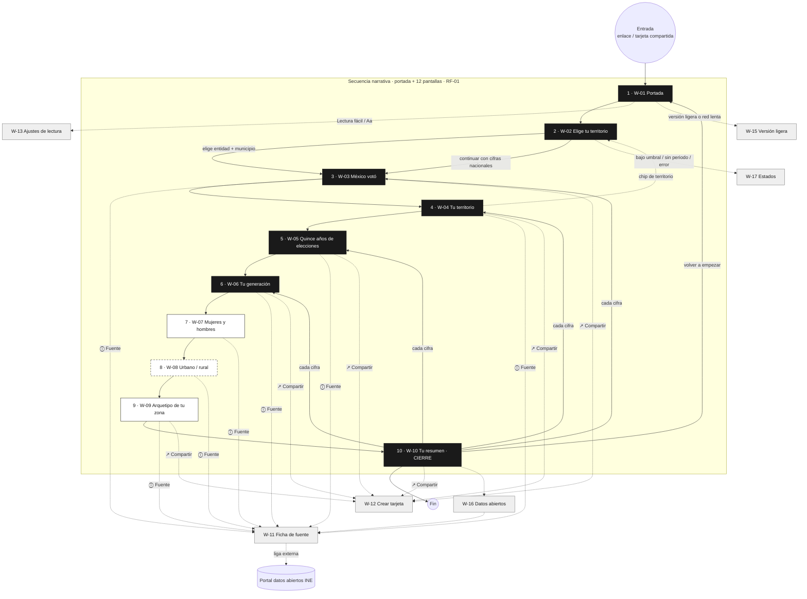

# Arquitectura de información y mapa de flujo · ReVoto

> **Historia:** US-04 · Diseñar la arquitectura de información y los wireframes
> **Versión:** 1.0 · **Fecha:** 05/10/2026 · **Estado:** Listo para revisión (REVISIÓN-TRABAJO)
> **Entregable:** este documento (mapa de flujo) + `design/wireframes/index.html` (wireframes)

---

## 1. Modelo de navegación

ReVoto es una **secuencia lineal tipo *stories*** (RF-01, HU-31 · CA-03): la portada y 12 pantallas que cuentan en el progreso (D-04), con tres tipos de salida lateral que **no rompen la secuencia** (al cerrar, se regresa a la pantalla de origen):

| Tipo | Pantallas | Cómo se abre | Cómo se cierra |
| --- | --- | --- | --- |
| **Secuencia** | W-01 a W-10 | ‹ › · deslizar · tocar mitades · ← → | — |
| **Hojas inferiores** | W-11 Fuente · W-12 Compartir · W-13 Ajustes de lectura | Botones de la zona inferior / «Aa» | «Cerrar», Escape, deslizar abajo |
| **Desvíos** | W-02 Selector (reabrible) · W-16 Datos abiertos | Chip de territorio · enlace en W-10 | «‹ Volver» a la pantalla de origen |
| **Variantes de modo** | W-14 Lector de pantalla · W-15 Versión ligera | Tecnología asistiva / interruptor o red lenta | Desactivar en W-13 |
| **Estados** | W-17 Carga · Error · Umbral | Automático | Reintentar / continuar |

## 2. Inventario de pantallas

| # sec. | ID | Pantalla | Componente SRS | Historias | Prioridad | Idea / contenido principal |
| --- | --- | --- | --- | --- | --- | --- |
| 1 | W-01 | Portada | RIU-01, RIU-10 | HU-31, HU-11, HU-10 | Must | Título, promesa, origen de los datos, autoría, «no pedimos datos personales», Lectura fácil, Versión ligera, Comenzar |
| 2 | W-02 | Elige tu territorio | RIU-02 | HU-28 | Must | Entidad → municipio dependiente · «Continuar con cifras nacionales» |
| 3 | W-03 | México votó | RIU-03 | HU-31 | Must | Participación nacional 2024 (59.7 %) |
| 4 | W-04 | Tu territorio | RIU-03, RIU-05 | HU-28 | Must | Territorio vs. nacional 2024 |
| 5 | W-05 | Quince años de elecciones | RIU-04 | HU-07 | Must | Serie 2009–2024, intermedia vs. presidencial |
| 6 | W-06 | Tu generación | RIU-05 | HU-01 | Must | 5 grupos de edad, territorio y nacional |
| 7 | W-07 | Mujeres y hombres | RIU-05 | HU-29 | Should | Participación por sexo |
| 8 | W-08 | Urbano, rural, mixto | RIU-05 | HU-30 | Could | Participación por tipo de sección |
| 9 | W-09 | El arquetipo de tu zona | RIU-03 | HU-03 | Should | Arquetipo + cifra que lo explica |
| 10 | W-10 | Tu resumen (cierre) | RIU-08 | HU-06, HU-02, HU-17, HU-11 | Must (cierre) / Should (resumen) | 5 cifras clave, compartir, datos abiertos, créditos, volver a empezar |
| — | W-11 | Ficha de fuente | RIU-06 | HU-18 | Must | Fuente, año, fecha de corte, fórmula, % sin dato, liga |
| — | W-12 | Crear tarjeta | RIU-07 | HU-02 | Must | Vista previa 9:16 / 1:1, descargar, compartir nativo |
| — | W-13 | Ajustes de lectura | RIU-10 | HU-10 | Must | Lectura fácil, movimiento reducido, versión ligera + vista de narrativa ampliada |
| — | W-14 | Vista para lector de pantalla | RIU-03, RIU-04 | HU-14 | Must | Orden de foco, texto alternativo, tabla alternativa, regiones vivas |
| — | W-15 | Versión ligera | — (RF-18) | HU-15 | Must | Solo texto y tablas, ≤ 500 KB |
| — | W-16 | Datos abiertos | RIU-09 | HU-17 | Should | Conjuntos CSV/JSON, diccionario, metodología |
| — | W-17 | Estados | RIU-02, RIU-03 | HU-31 ALT-01, HU-28 CA-04/ALT-01 | Must | Carga, error con reintento, umbral RN-05, periodo faltante |

> **Degradación prevista (SRS 10.3):** si W-07, W-08 o W-09 salen del MVP, la secuencia se acorta (mín. 7 pantallas) y la barra de progreso se recalcula; ninguna pantalla Must depende de ellas.

## 3. Mapa de navegación (portada → cierre)

**Leyenda:** relleno negro = Must · borde sólido = Should · borde punteado = Could · gris = auxiliar (hoja, modo o estado). Línea continua = avance de la secuencia; punteada = salida lateral que regresa a su origen.

**Elementos persistentes en W-03 a W-09:** barra de progreso (un segmento por pantalla después de la portada, 12 hoy), chip de territorio (abre W-02), botón «Aa» (abre W-13 y «Ver resumen»), «ⓘ Fuente», «↗ Compartir», ‹ ›.

## 4. Jerarquía de contenido por pantalla narrativa

Orden de lectura fijo (también orden de foco):

1. Progreso «Pantalla N de 12» (oculto visualmente, anunciado). La portada no cuenta.
2. Mensaje principal (h1) — una frase, verbo en presente, sin juicio.
3. Cifra protagonista.
4. Meta: **territorio · periodo** (RN-10).
5. Visualización con valores visibles + texto alternativo.
6. Texto de apoyo (≤ 2 líneas) que define cualquier tecnicismo.
7. Acciones: Fuente → Compartir → Anterior → Siguiente.

## 5. Matriz de trazabilidad · Historias Must → pantallas (US-04 · CA-2)

| Historia Must | Criterios que el wireframe representa | Pantalla(s) | ¿Cubierta? |
| --- | --- | --- | --- |
| HU-31 Recorrer la secuencia | CA-01 idea + cifra + avanzar · CA-02 gesto/control/teclado · CA-03 ≤ 10 · CA-04 progreso · ALT-01 error | W-01, W-03…W-10, W-17 | ✅ |
| HU-28 Elegir mi territorio | CA-01 municipio dependiente · CA-02 territorio + nacional · CA-03 continuar sin elegir · CA-04 umbral · ALT-01 periodo | W-02, W-04, W-17 | ✅ |
| HU-07 Comparar con elecciones anteriores | CA-01 seis elecciones · CA-02 año, fecha, valor · CA-03 tipo de elección | W-05 | ✅ |
| HU-01 Ver las cifras de mi generación | CA-01 grupos RN-04 · CA-02 territorio + nacional · CA-03 texto sin juicio | W-06 | ✅ |
| HU-18 Conocer la fuente | CA-01 fuente, año, corte, fórmula · CA-02 liga · CA-03 excluidos | W-11 | ✅ |
| HU-02 Compartir una tarjeta | CA-01 9:16 / 1:1 · CA-02 cifra, territorio, periodo, fuente, liga · CA-03 sin datos personales · CA-04 menú nativo | W-12 | ✅ |
| HU-10 Leer con comodidad | CA-01 opción visible en portada · CA-02 texto mayor, sin auto-avance, menos animación · CA-03 prefers-reduced-motion | W-01, W-13 | ✅ |
| HU-14 Navegar con lector de pantalla | CA-01 descripción con cifra · CA-02 teclado + foco · CA-03 anuncio de cambio | W-14 (+ notas en cada pantalla) | ✅ |
| HU-15 Consultar con conexión limitada | CA-01 ≤ 500 KB · CA-02 sin instalar app | W-15 | ✅ |

**Historias Should/Could también representadas:** HU-06 (W-10), HU-29 (W-07), HU-30 (W-08), HU-03 (W-09), HU-11 (W-01, W-10), HU-17 (W-16).

## 6. Verificación de los criterios de US-04

| # | Criterio | Evidencia | Resultado |
| --- | --- | --- | --- |
| 1 | Existe mapa de navegación completo de portada a cierre | §3 de este documento y pestaña «Mapa de flujo» de `index.html`: W-01 → W-10 con todas las salidas laterales | ✅ Cumple |
| 2 | Cada historia Must tiene al menos una pantalla | §5: 9 de 9 historias Must mapeadas a ≥ 1 wireframe | ✅ Cumple |
| 3 | Diseño parte de 360 px de ancho | Todos los marcos `.wf-frame` miden 360 px (verificado por script con Chromium, ver §7) | ✅ Cumple |

## 7. Evidencias para CMMI (RD / TS / PPQA)

| Práctica | Evidencia en este entregable |
| --- | --- |
| RD SP 3.1 Establecer conceptos operativos y escenarios | Mapa de navegación §3 y modelo §1 |
| RD SP 2.1 / REQM SP 1.4 Trazabilidad bidireccional | Matriz §5 (HU ↔ RIU ↔ W) |
| TS SP 2.1 Diseñar el producto | Wireframes W-01…W-17 + manual de diseño |
| VER SP 2.2 Revisión por pares | Pendiente: revisión de Kira conforme a REVISIÓN-TRABAJO |
| PPQA SP 1.2 Evaluar productos de trabajo | Lista DoD del manual §11 |

## 8. Decisiones y pendientes

| # | Decisión / pendiente | Impacto |
| --- | --- | --- |
| D-01 | ~~La portada y el selector cuentan dentro de las 10 pantallas.~~ Reemplazada por D-04. | — |
| D-02 | El resumen (HU-06) funciona como pantalla de cierre, no como vista aparte. | Una pantalla menos que construir. |
| D-03 | Las hojas inferiores no cuentan como pantallas de la secuencia. | El progreso no cambia al abrir Fuente/Compartir. |
| D-04 | El progreso cuenta cada pantalla después de la portada, subpantallas incluidas (W-02b, W-09b, W-09c), y el total sale de la secuencia (DEF-27, 23/10/2026). Cambia RF-01 / HU-31 · CA-03 de «máximo 10 pasos» a «cada pantalla cuenta». | La portada, el progreso y la versión ligera dicen 12 pantallas; quitar o agregar una pantalla actualiza todo. |
| AP-01 | ~~Nombre del producto: se usa «ReVoto» como provisional.~~ Cerrado: «ReVoto» es el nombre definitivo (23/10/2026). | Portada, tarjeta, logotipo e ícono de la pestaña. |
| AP-05 | Catálogo de arquetipos sin definir: W-09 usa texto de ejemplo. | Revisión de neutralidad. |
| AP-06 | Las 5 cifras del resumen son propuesta: nacional, territorio, cambio 2009→2024, brecha generacional, brecha por sexo. | W-10. |
