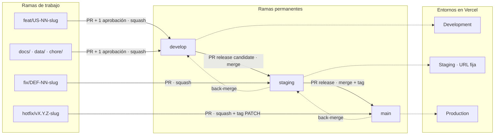
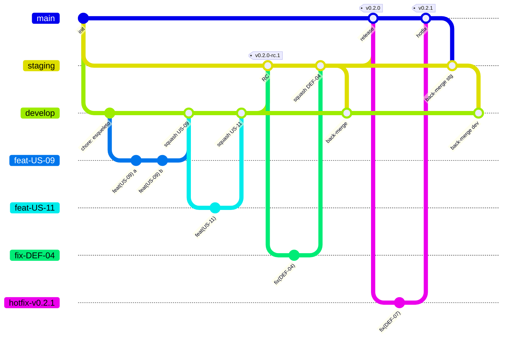
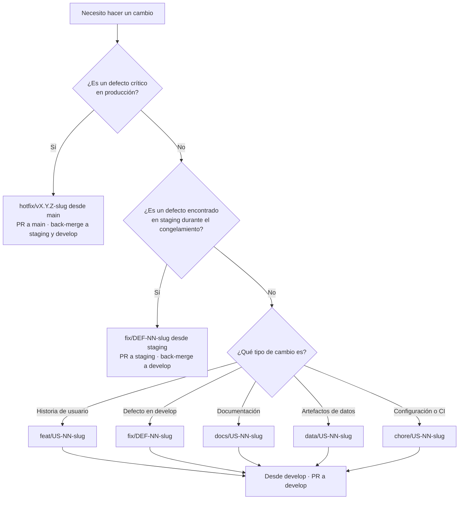
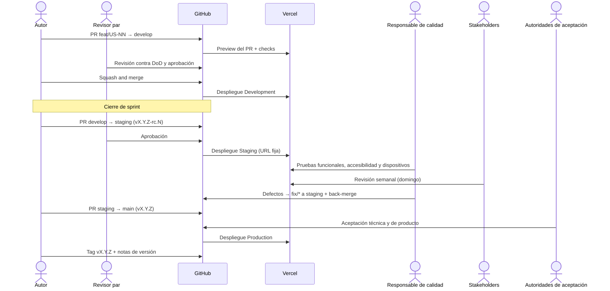
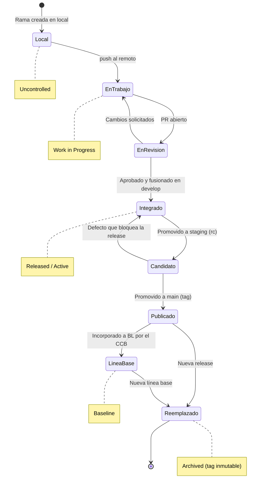
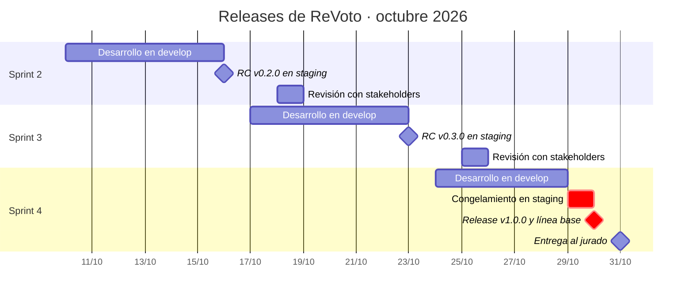

# 📐 Estándar de Estrategia de Ramas y Promoción entre Entornos

## 🪪 Ficha de Configuración

| Campo | Valor |
| --- | --- |
| **Código CM** | `STD-ESTRATEGIA-RAMAS-v0.1` |
| **Prefijo** | `STD` |
| **Nombre del Documento (Slug)** | `ESTRATEGIA-RAMAS` |
| **Versión** | `0.1` |
| **Estado del documento** | Borrador |
| **Nivel de control (POL CM)** | 🟡 Work in Progress |
| **Confidencialidad** | 🟡 Interna |
| **Propietario** | Angel (Architecture owner) |
| **Aprobador** | CCB |
| **Línea base** | No incorporado |
| **Fecha de vigencia** | Al aprobarse (v1.0) |
| **Repositorio oficial** | GitHub · `docs/gestion-configuracion/` · copia en Notion |

---

## 🎯 Propósito

Este estándar define las ramas permanentes, las ramas de trabajo, las reglas de integración y el camino obligatorio que recorre todo cambio de código o de datos publicados, desde el entorno de **desarrollo** hasta **staging** y **producción**. El objetivo es que el sitio publicado corresponda siempre a una versión revisada, probada e identificable, y que cada versión de producción se pueda reconstruir a partir del repositorio.

Adapta **GitFlow** a un equipo de dos personas con entregas semanales: conserva la separación entre integración (`develop`) y producción (`main`), sustituye las ramas `release/*` por una rama permanente `staging` con URL fija para QA y para la revisión con stakeholders, y mantiene `hotfix/*` para correcciones urgentes.

Operacionaliza, para los artefactos técnicos, la **Política de Gestión de Configuración** (`POL-GESTION-CONFIGURACION`) y la **Política de Revisión y Aceptación del Trabajo** (`POL-REVISION-TRABAJO`). En CMMI-DEV v1.3 soporta **CM SP 1.1, 1.2, 1.3, 2.1, 2.2 y 3.1**, **PI SP 1.2 y 3.1**, **VER SP 2.2** y la práctica genérica **GP 2.6 (Controlar productos de trabajo)**.

---

## 🔍 Alcance

- **Aplica a:** Todo repositorio Git de MIWA que publique un producto en uno o más entornos. Inicialmente, el repositorio de ReVoto en GitHub y su despliegue en Vercel.
- **Aplica también a:** Los artefactos de datos publicables (capas L3 · Marts y L4 · Publicación del SRS) que se versionan junto con el sitio.
- **No aplica a:** Documentos normativos que viven en Notion; se rigen por `STD-VERSIONAMIENTO`. Tampoco a ramas locales que nunca se suben al remoto.
- **Ámbito geográfico/organizacional:** Toda la organización MIWA.

---

## 📖 Definiciones y Terminología

| Término | Definición |
| --- | --- |
| **Rama permanente** | Rama que existe durante todo el ciclo de vida del proyecto y está ligada a un entorno: `develop`, `staging` y `main`. |
| **Rama de trabajo** | Rama de vida corta creada para un cambio específico (`feat/*`, `fix/*`, `docs/*`, `data/*`, `chore/*`, `hotfix/*`). Se elimina después de integrarse. |
| **Entorno** | Instancia publicada del sitio: Development, Staging o Production. |
| **Promoción** | Integración de una rama permanente en la siguiente (`develop` → `staging` → `main`) mediante pull request. |
| **Pull request (PR)** | Solicitud de integración en GitHub. Es la evidencia formal de la revisión por pares. |
| **Back-merge** | Integración de una corrección hecha en `staging` o `main` de vuelta a las ramas anteriores, para que no se pierda en la siguiente promoción. |
| **Release candidate (RC)** | Versión promovida a `staging` que aspira a producción. Se etiqueta `vX.Y.Z-rc.N`. |
| **Release** | Versión publicada en producción. Se etiqueta en `main` como `vX.Y.Z` (SemVer). |
| **Congelamiento (code freeze)** | Periodo en el que `staging` solo admite correcciones de defectos, no funcionalidad nueva. |
| **Verificación automática (check)** | Validación que corre en cada PR (build, lint, presupuesto de peso, búsqueda de secretos). |

---

## 👥 Roles y Responsabilidades

| Rol | Persona | Responsabilidad |
| --- | --- | --- |
| **Dueño del estándar** | Angel | Mantener, actualizar y difundir el estándar. Configurar la protección de ramas y los entornos. |
| **Aplicador** | Angel y Kira | Crear ramas, redactar commits y abrir PR conforme a este estándar y a `STD-MENSAJES-COMMIT`. |
| **Revisor par** | Quien no es autor del PR | Revisar el PR contra el DoD aplicable (`STD-READY-DONE`) y aprobarlo o rechazarlo. |
| **Autoridad de aceptación técnica** | Angel (Architecture owner) | Aprobar promociones `staging` → `main` en lo técnico: arquitectura, datos y despliegue. |
| **Autoridad de aceptación de producto** | Product owner (Kira o Angel, distinto del autor del cambio) | Aprobar el contenido y alcance de cada release. |
| **Responsable de calidad** | Kira (Quality assurance) | Ejecutar las pruebas en `staging` y registrar defectos en la bitácora. |
| **CCB** | Angel y Kira, con el Patrocinador para escalamientos | Aprobar la incorporación de una release a una línea base y los cambios sobre ella. |
| **Revisor/Auditor** | Rol asignado en el Plan de CM | Verificar el cumplimiento en el corte semanal. No audita PR propios. |

> ⚠️ **Regla de independencia.** Con dos integrantes, el autor de un PR nunca lo aprueba. Si el autor tiene la autoridad de aceptación de ese ámbito, la aprobación la da la otra persona y el autor conserva solo la decisión de fusionar.

---

## 📏 Especificaciones del Estándar

### A. Ramas permanentes y entornos

1. **Tres ramas permanentes.** El repositorio debe tener exactamente tres ramas permanentes, cada una ligada a un entorno:

| Rama | Entorno | Despliegue | Qué contiene | Nivel de control (POL CM) |
| --- | --- | --- | --- | --- |
| `develop` | **Development** | Automático en Vercel (preview de rama) | Trabajo integrado y revisado del sprint en curso | 🟢 Released / Active (interno) |
| `staging` | **Staging** | Automático en Vercel con URL fija `[URL de staging]` | Release candidate en pruebas y en revisión con stakeholders | 🟢 Released / Active |
| `main` | **Production** | Automático en Vercel (Production Branch) | Última release aceptada | 🟢 Released / Active · 🔴 Baseline cuando su tag se incorpora a una línea base |

2. **Rama por defecto.** La rama por defecto en GitHub es `develop`, para que todo PR nuevo apunte a integración y no a producción.
3. **Production Branch.** En Vercel, la Production Branch debe ser `main`. Ninguna otra rama puede publicar en el dominio de producción.
4. **Sin commits directos.** Ninguna rama permanente admite `push` directo, `force push` ni borrado. Todo cambio entra por PR.

### B. Ramas de trabajo

5. **Tipos permitidos y origen:**

| Prefijo | Uso | Nace de | Se integra en | Tipo de commit asociado |
| --- | --- | --- | --- | --- |
| `feat/` | Funcionalidad de una historia de usuario | `develop` | `develop` | `feat` |
| `fix/` | Defecto encontrado en `develop` o en `staging` | `develop` o `staging` | La rama de origen (+ back-merge si nació de `staging`) | `fix` |
| `docs/` | Documentación versionada en el repo | `develop` | `develop` | `docs` |
| `data/` | Regeneración o corrección de artefactos L3/L4 | `develop` | `develop` | `data` |
| `chore/` | Configuración, dependencias, CI | `develop` | `develop` | `chore`, `ci`, `build` |
| `hotfix/` | Defecto crítico en producción | `main` | `main` (+ back-merge a `staging` y `develop`) | `fix` |

6. **Nomenclatura de ramas de trabajo:** `<prefijo>/US-<NN>-<slug>`. Se toman las reglas de `STD-NOMENCLATURA` para el slug, ajustadas a Git:
   - Minúsculas, palabras separadas por guion medio, sin acentos, ñ, espacios ni guion bajo.
   - Sin artículos ni preposiciones; máximo 5 palabras.
   - Si el cambio no corresponde a una historia, se usa el número de defecto de la bitácora: `fix/DEF-<NN>-<slug>`.
   - Hotfix: `hotfix/v<X.Y.Z>-<slug>`, con la versión que se va a publicar.
   - ✅ `feat/US-09-motor-secuencia` · `fix/DEF-04-contraste-boton` · `hotfix/v1.0.1-cifra-jalisco`
   - ❌ `Feature/US09`, `angel-cambios`, `feat/us-09_motor_de_la_secuencia`
7. **Una rama, un propósito.** Una rama de trabajo contiene una sola historia o un solo defecto. Si un cambio crece, se divide en ramas.
8. **Vida corta.** Una rama de trabajo no debe vivir más de **3 días** sin integrarse. Si se excede, se actualiza desde su rama de origen y se registra el motivo en el PR.
9. **Eliminación tras integrar.** La rama de trabajo se elimina al fusionar el PR. La historia no se pierde: los commits, el PR y los tags conservan el registro, en cumplimiento de la regla de retención histórica de `STD-VERSIONAMIENTO`.

### C. Commits

10. **Formato obligatorio.** Todo commit sigue `STD-MENSAJES-COMMIT` (Conventional Commits 1.0.0 con referencia a historia o defecto). El título del PR también sigue ese formato, porque es el mensaje del commit resultante al hacer squash.

### D. Pull requests y revisión

11. **Requisitos de todo PR hacia una rama permanente:**
    - Al menos **1 aprobación** de alguien distinto del autor (`POL-REVISION-TRABAJO`, directriz 1).
    - Todas las verificaciones automáticas en verde (regla 12).
    - Conversaciones resueltas.
    - Rama actualizada con su destino antes de fusionar.
    - Descripción con: historia o defecto (`US-NN` / `DEF-NN`), criterios de aceptación cubiertos, evidencia (URL de preview, capturas a 360 px) y checklist DoD.
12. **Verificaciones automáticas mínimas:**

| Check | Criterio | Obligatorio en |
| --- | --- | --- |
| Build de Vercel | Despliegue de preview exitoso | Todos los PR |
| Lint / formato | 0 errores | Todos los PR |
| Formato de commits | Conforme a `STD-MENSAJES-COMMIT` | Todos los PR |
| Presupuesto de peso | Carga inicial ≤ 500 KB (RNF-01) | PR a `staging` y `main` |
| Secretos | 0 credenciales detectadas (D7, POL CM) | Todos los PR |
| Accesibilidad automatizada | 0 violaciones críticas WCAG 2.2 AA (RNF-07) | PR a `staging` y `main` |

13. **No conformidades.** Los hallazgos de revisión que incumplan el DoD se registran en la bitácora de defectos y se referencian en el comentario del PR antes de corregirse (`POL-REVISION-TRABAJO`, directriz 6).
14. **Estrategia de fusión por destino:**

| Origen → Destino | Estrategia | Motivo |
| --- | --- | --- |
| Rama de trabajo → `develop` | **Squash and merge** | Un commit por historia o defecto en `develop`, fácil de rastrear y revertir. |
| `develop` → `staging` | **Merge commit** | Conserva la historia y deja marcado el punto de promoción. |
| `fix/*` → `staging` | **Squash and merge** | Igual que en `develop`. |
| `staging` → `main` | **Merge commit** | El commit de fusión es el punto exacto de la release. |
| `hotfix/*` → `main` | **Squash and merge** | Una corrección = un commit. |
| Back-merge (`main` o `staging` → anteriores) | **Merge commit** | Evita reescribir la historia compartida. |

Se prohíbe `rebase` o `force push` sobre ramas permanentes.

### E. Promoción entre entornos

15. **Development (`develop`).** Una historia queda **integrada** cuando su PR se fusiona en `develop` y el preview despliega sin errores. Es el estado a partir del cual el revisor verifica los criterios de aceptación.
16. **Staging (`staging`).** Al cerrar el sprint, se abre un PR `develop` → `staging` titulado `chore(release): vX.Y.Z-rc.N`. Al fusionarse:
    - Se crea el tag `vX.Y.Z-rc.N` sobre `staging`.
    - Inicia el **congelamiento**: en `staging` solo entran `fix/*`, cada uno con back-merge a `develop`.
    - El Responsable de calidad ejecuta las pruebas funcionales, de accesibilidad y en dispositivos reales (Motorola G82 y iPhone 17 Pro Max) sobre la URL de staging.
    - La revisión semanal con stakeholders se hace **sobre la URL de staging**, nunca sobre un preview de rama de trabajo.
17. **Production (`main`).** Se abre un PR `staging` → `main` titulado `chore(release): vX.Y.Z` cuando:
    - No hay no conformidades críticas abiertas.
    - Las pruebas en staging están registradas.
    - Lo aprueban la autoridad técnica y la de producto (si el autor del PR es una de ellas, aprueba la otra persona; regla de independencia).
    
    Al fusionarse se crea el tag anotado `vX.Y.Z` sobre `main` y se publican las notas de versión en GitHub Releases.
18. **Back-merge obligatorio.** Todo cambio que entra directo a `staging` (`fix/*`) o a `main` (`hotfix/*`) debe integrarse de vuelta a las ramas anteriores en menos de **24 horas**. Nunca debe existir en `main` un commit que no esté en `develop`.
19. **Hotfix.** Solo procede ante una no conformidad crítica en producción: cifra incorrecta, sitio caído, contenido con sesgo político (RN-07) o exposición de datos. Requiere 1 aprobación, sube PATCH (`vX.Y.Z+1`) y se registra en la bitácora de defectos.

### F. Versionamiento y líneas base

20. **SemVer para código.** De acuerdo con `STD-VERSIONAMIENTO` (Elementos Afectados), el código usa `MAJOR.MINOR.PATCH`:
    - `0.Y.0` → releases semanales previas a la entrega (MINOR por sprint).
    - `1.0.0` → MVP entregado al jurado.
    - PATCH → hotfix o corrección sin funcionalidad nueva.
    - `-rc.N` → candidatos en staging.
21. **Tags inmutables.** Un tag publicado no se mueve ni se borra. Si una release falla, se publica una nueva versión.
22. **Relación con líneas base.** Una release se incorpora a una línea base `BL-AAAA.N` solo con aprobación del CCB. El registro de la línea base lista el tag de código y la versión de cada documento que la compone (SRS, diseño, diccionario de datos). Desde ese momento, cualquier cambio sobre esa release requiere una Solicitud de Cambio (CR) aprobada por el CCB.
23. **Proporcionalidad.** Durante el desarrollo, las releases semanales a `main` no requieren CCB; basta la aprobación del PR (regla 17). El CCB interviene solo al establecer líneas base y al modificarlas, conforme a la regla de proporcionalidad de `POL-GESTION-CONFIGURACION`.

### G. Seguridad y contenido del repositorio

24. **Sin secretos.** Credenciales, tokens y API keys viven en las variables de entorno de Vercel, separadas por entorno. Nunca se versionan.
25. **Sin datos crudos ni personales.** Solo se versionan los artefactos agregados L3/L4. Las fuentes L0–L2 (XLSX, shapefiles, parquet de staging) quedan fuera del repositorio y se listan en `.gitignore` (RNF-13, RNF-14).

---

## 🧭 Diagramas

### 1. Panorama: ramas y entornos

### 2. Historia de commits en un sprint

> En el diagrama, `/` se representa con `-` por limitaciones de Mermaid: `feat-US-09` equivale a `feat/US-09-motor-secuencia`.

### 3. ¿De dónde parto y a dónde abro el PR?

### 4. Promoción de una release

### 5. Ciclo de vida de un cambio y niveles de control

### 6. Calendario de releases hasta la entrega

---

## 🧩 Elementos Afectados

| Tipo de Elemento | Aplicación del Estándar |
| --- | --- |
| Código fuente del micrositio | Ramas, PR, fusión y tags SemVer conforme a las secciones A–F. |
| Artefactos de datos L3/L4 (JSON, CSV) | Ramas `data/*`; se promueven junto con el código; el reporte de validación (RF-23) va como evidencia en el PR. |
| Configuración de despliegue (Vercel, CI) | Ramas `chore/*`; variables de entorno separadas por entorno y fuera del repositorio. |
| Documentación técnica en el repo (`docs/`) | Ramas `docs/*`; el archivo conserva su Código CM y su versión documental (`STD-VERSIONAMIENTO`). |
| Mensajes de commit y títulos de PR | `STD-MENSAJES-COMMIT`. |
| Releases y tags | `vX.Y.Z` en `main`, `vX.Y.Z-rc.N` en `staging`; inmutables. |
| Líneas base | `BL-AAAA.N` referencia el tag de código de la release. |

---

## 📊 Criterios de Cumplimiento y Verificación

| Aspecto | Definición |
| --- | --- |
| **Método de verificación** | Reglas de protección de ramas en GitHub (verificación preventiva) y auditoría semanal del historial: PR fusionados, aprobaciones, tags y back-merges. |
| **Criterio de aceptación** | 0 commits directos en ramas permanentes · 100 % de PR fusionados con aprobación de alguien distinto del autor · 100 % de releases en `main` con tag y notas · 0 commits en `main` ausentes de `develop`. |
| **Métricas** | % de PR con aprobación independiente (meta 100 %) · Ramas de trabajo con más de 3 días (meta 0) · Back-merges pendientes con más de 24 h (meta 0) · Hotfixes por release (seguimiento). |
| **Frecuencia** | Por PR (automática) y en el corte semanal de los domingos, antes de la revisión con stakeholders. |
| **Responsable de verificación** | Revisor/Auditor del Plan de CM; para PR de Kira verifica Angel y viceversa. |
| **Evidencia** | Historial de PR en GitHub, tags y GitHub Releases, logs de despliegue en Vercel, bitácora de defectos. |

**Configuración mínima de protección (`develop`, `staging`, `main`):** PR obligatorio · 1 aprobación · invalidar aprobaciones con commits nuevos · checks obligatorios · conversaciones resueltas · sin force push ni borrado · la regla aplica también a administradores.

> ⚠️ En una organización con el plan Free de GitHub, las reglas de protección de ramas solo están disponibles en repositorios **públicos**. Si el repositorio es privado, la regla 4 se verifica por auditoría semanal y cada incumplimiento se registra como no conformidad.

---

## ⚠️ Excepciones y No Cumplimiento

- **Proceso de excepción:** Se solicita por escrito en el canal del proyecto en Discord indicando la regla que se omite, el motivo, el riesgo y la fecha de cierre. La aprueba el CCB; si compromete la fecha de entrega, decide el Program manager. Toda excepción se registra en el Control de Modificaciones de este estándar.
- **Excepción preautorizada por contingencia:** Si un integrante queda sin acceso por más de 24 horas, aplica la contingencia de `POL-REVISION-TRABAJO`: el otro integrante puede fusionar sin aprobación, dejando el registro en la bitácora y una revisión posterior obligatoria. No aplica a la promoción final a `main` de la entrega.
- **Consecuencias de incumplimiento:**

| Situación | Consecuencia |
| --- | --- |
| Commit directo en rama permanente | Se revierte por PR, se registra como no conformidad crítica y se recalcula el EV si afectó una actividad. |
| PR fusionado sin aprobación independiente | La actividad del PVG regresa a "En curso" hasta completar la revisión. |
| Release en `main` sin pasar por `staging` | Se trata como hotfix no autorizado: revisión inmediata y no conformidad crítica. |
| Back-merge omitido | Bloquea la siguiente promoción hasta resolverlo. |
| Secreto o dato personal versionado | Se rota la credencial, se limpia el historial y se registra como no conformidad crítica. |

---

## ⚖️ Marco Normativo y Estándares de Referencia

- CMMI-DEV v1.3 — **CM** SP 1.1, 1.2, 1.3, 2.1, 2.2, 3.1 · **PI** SP 1.2, 3.1 · **VER** SP 2.2 · **GP 2.6**
- ISO/IEC/IEEE 12207:2017 — Proceso de gestión de configuración
- Semantic Versioning 2.0.0 — https://semver.org/lang/es/
- Conventional Commits 1.0.0 — https://www.conventionalcommits.org/es/v1.0.0/
- GitFlow (Vincent Driessen), adaptado según este estándar
- `POL-GESTION-CONFIGURACION` · `POL-REVISION-TRABAJO` · `STD-VERSIONAMIENTO` · `STD-NOMENCLATURA` · `STD-READY-DONE`

---

## 🔗 Related Resources

- `STD-MENSAJES-COMMIT` — Estándar de Mensajes de Commit (`STD-MENSAJES-COMMIT-v0.1.md`)
- `POL-GESTION-CONFIGURACION` — Política de Gestión de Configuración
- `POL-REVISION-TRABAJO` — Política de Revisión y Aceptación del Trabajo
- `STD-VERSIONAMIENTO` — Estándar de Versionamiento
- `STD-NOMENCLATURA` — Estándar de Nomenclatura
- `STD-READY-DONE` — Definition of Ready y Definition of Done
- `US-08` — Levantar el esqueleto del proyecto y el despliegue continuo
- Bitácora de defectos

---

## 🔄 Vigencia y Revisión

Este estándar será revisado al cierre de cada sprint mientras dure el proyecto, y en la retrospectiva final, o antes si cambian la plataforma de despliegue (RIE-03), la composición del equipo o las bases de la convocatoria. Los cambios menores los aprueba el Propietario; las versiones mayores, el CCB.

---

## 📝 Control de Modificaciones

| # | Versión | Tipo | Autor(es) | Modificación Realizada | Aprobó | Fecha |
| --- | --- | --- | --- | --- | --- | --- |
| 1 | 0.1 | Creación | Angel Mauricio Ramirez | Creación inicial del documento | — | 08/10/2026 |
