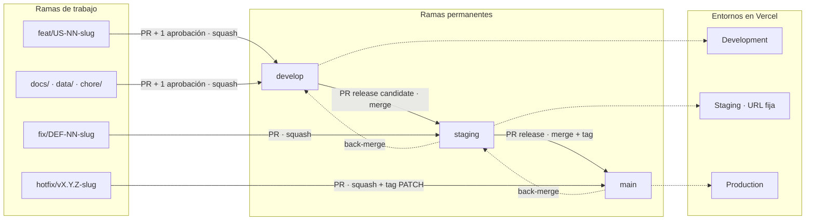
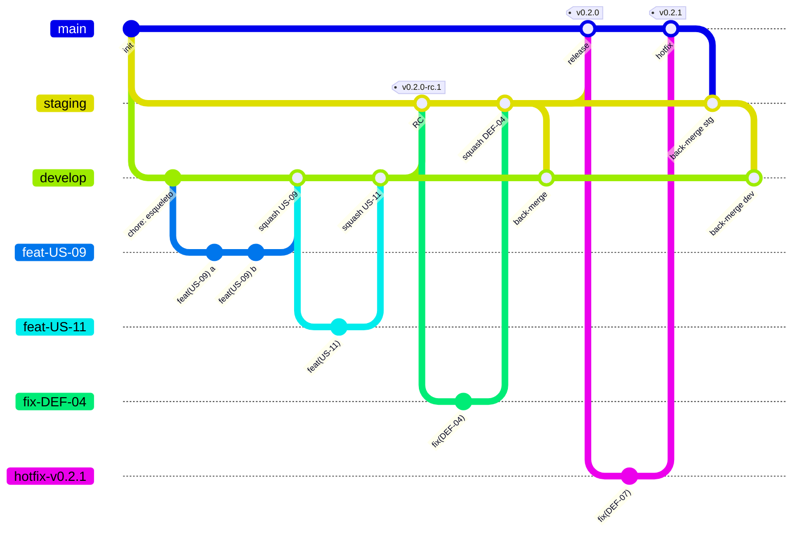
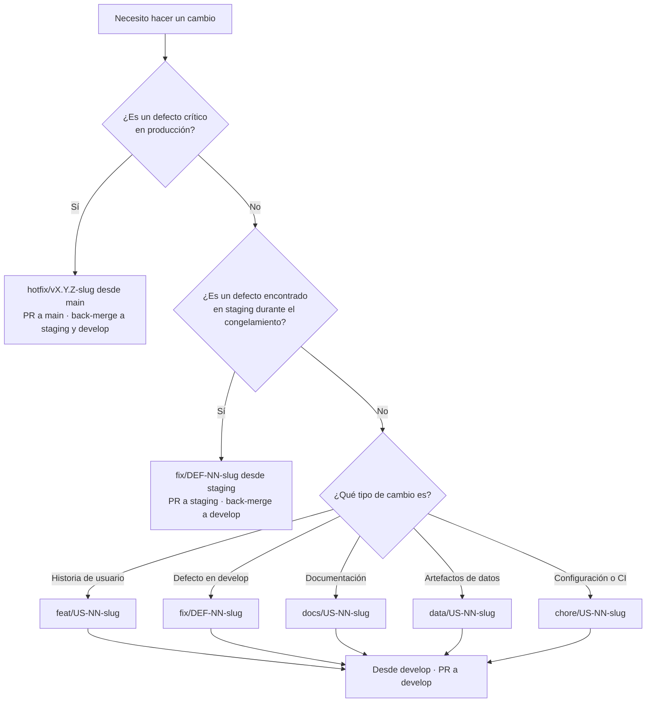
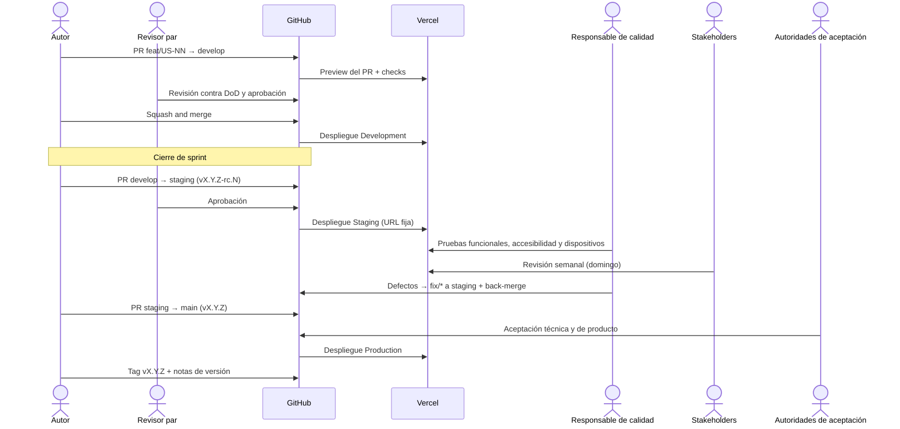
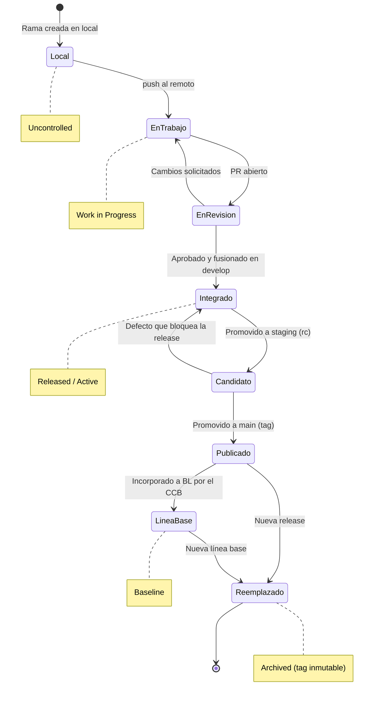
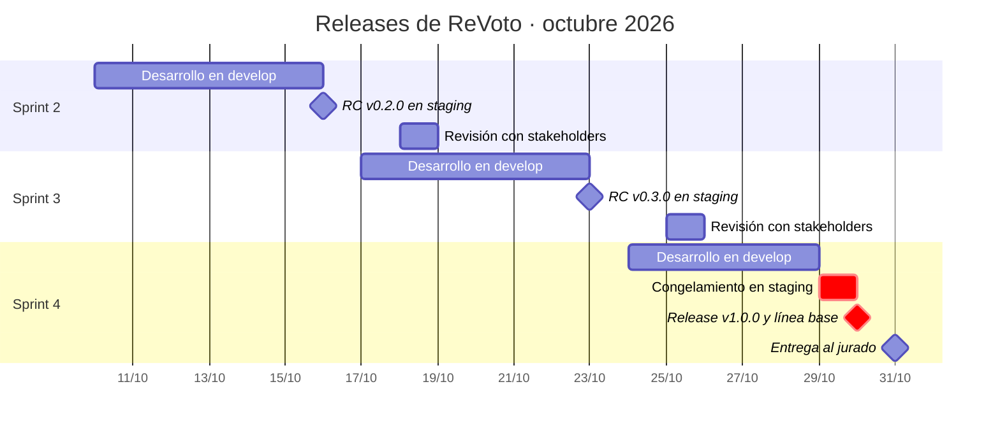

# 📐 Estándar de Estrategia de Ramas y Promoción entre Entornos

## 🎯 Propósito

Este estándar define las ramas permanentes, las ramas de trabajo, las reglas de integración y el camino obligatorio que recorre todo cambio de código o de datos publicados, desde el entorno de **desarrollo** hasta **staging** y **producción**. Su objetivo es que el sitio publicado corresponda siempre a una versión revisada, probada e identificable, y que cada versión de producción pueda reconstruirse a partir del repositorio.

Adapta **GitFlow** a un equipo de dos personas con entregas semanales: conserva la separación entre integración (`develop`) y producción (`main`), sustituye las ramas `release/*` por una rama permanente `staging` con URL fija para QA y para la revisión con stakeholders, y mantiene `hotfix/*` para correcciones urgentes.

> *Este estándar operacionaliza, para los artefactos técnicos, la Política de Gestión de Configuración y la Política de Revisión y Aceptación del Trabajo.*

---

## 🔍 Alcance

- **Aplica a:** Todo repositorio Git de MIWA que publique un producto en uno o más entornos, incluidos los artefactos de datos publicables (capas L3 · Marts y L4 · Publicación del SRS) que se versionan junto con el sitio. Inicialmente, el repositorio de ReVoto en GitHub y su despliegue en Vercel.
- **No aplica a:** Documentos normativos que viven en Notion, que se rigen por `STD-VERSIONAMIENTO`, ni a ramas locales que nunca se suben al remoto.
- **Ámbito geográfico/organizacional:** Toda la organización MIWA.

---

## 📖 Definiciones y Terminología

| Término | Definición |
| --- | --- |
| **Rama permanente** | Rama que existe durante todo el ciclo de vida del proyecto y está ligada a un entorno: `develop`, `staging` y `main`. |
| **Rama de trabajo** | Rama de vida corta creada para un cambio específico (`feat/*`, `fix/*`, `docs/*`, `data/*`, `chore/*`, `hotfix/*`). Se elimina después de integrarse. |
| **Entorno** | Instancia publicada del sitio: Development, Staging o Production. |
| **Promoción** | Integración de una rama permanente en la siguiente (`develop` → `staging` → `main`) mediante pull request. |
| **Pull request (PR)** | Solicitud de integración en GitHub. Es la evidencia formal de la revisión por pares. |
| **Back-merge** | Integración de una corrección hecha en `staging` o `main` de vuelta a las ramas anteriores, para que no se pierda en la siguiente promoción. |
| **Release candidate (RC)** | Versión promovida a `staging` que aspira a producción. Se etiqueta `vX.Y.Z-rc.N`. |
| **Release** | Versión publicada en producción. Se etiqueta en `main` como `vX.Y.Z` (SemVer). |
| **Congelamiento (code freeze)** | Periodo en el que `staging` solo admite correcciones de defectos, no funcionalidad nueva. |
| **Verificación automática (check)** | Validación que corre en cada PR: build, lint, presupuesto de peso, búsqueda de secretos. |

---

## 👥 Roles y Responsabilidades

| Rol | Responsabilidad |
| --- | --- |
| **Dueño del estándar** | Angel (Architecture owner). Mantener, actualizar y difundir el estándar; configurar la protección de ramas y los entornos en GitHub y Vercel. |
| **Aplicador** | Angel y Kira. Crear ramas, redactar commits y abrir PR conforme a este estándar y a `STD-MENSAJES-COMMIT`. |
| **Revisor/Auditor** | Rol asignado en el Plan de CM. Verificar el cumplimiento en el corte semanal; nunca audita PR propios. |
| **Revisor par** | Integrante que no es autor del PR. Revisar contra el DoD aplicable (`STD-READY-DONE`) y aprobar o rechazar. |
| **Autoridad de aceptación técnica** | Angel (Architecture owner). Aprobar en lo técnico las promociones `staging` → `main`: arquitectura, datos y despliegue. |
| **Autoridad de aceptación de producto** | Product owner distinto del autor del cambio (Kira o Angel). Aprobar el contenido y alcance de cada release. |
| **Responsable de calidad** | Kira (Quality assurance). Ejecutar las pruebas en `staging` y registrar defectos en la bitácora. |
| **CCB** | Angel y Kira, con el Patrocinador para escalamientos. Aprobar la incorporación de una release a una línea base y los cambios sobre ella. |

---

## 📏 Especificaciones del Estándar

1. **Ramas permanentes:** El repositorio tiene exactamente tres ramas permanentes, cada una ligada a un entorno: `develop` → Development, `staging` → Staging (URL fija `[URL de staging]`) y `main` → Production (ver Tabla 1 y Diagrama 1).
2. **Rama por defecto:** La rama por defecto en GitHub es `develop`, para que todo PR nuevo apunte a integración y no a producción.
3. **Rama de producción en Vercel:** La Production Branch de Vercel es `main`. Ninguna otra rama publica en el dominio de producción.
4. **Protección de ramas permanentes:** `develop`, `staging` y `main` no admiten `push` directo, `force push` ni borrado. La protección exige PR, 1 aprobación, invalidar aprobaciones con commits nuevos, checks obligatorios y conversaciones resueltas, y aplica también a administradores. Si el repositorio es privado en el plan Free de GitHub (sin protección de ramas disponible), esta regla se verifica por auditoría semanal.
5. **Tipos de rama de trabajo:** Solo se permiten los prefijos `feat/`, `fix/`, `docs/`, `data/`, `chore/` y `hotfix/`, cada uno con el origen y destino de la Tabla 2 (ver Diagrama 3).
6. **Nomenclatura de ramas de trabajo:** `<prefijo>/US-<NN>-<slug>`. El slug va en minúsculas, con guion medio, sin acentos, ñ, espacios ni guion bajo, sin artículos ni preposiciones y con máximo 5 palabras (reglas de `STD-NOMENCLATURA` ajustadas a Git). Un defecto sin historia usa `fix/DEF-<NN>-<slug>`; un hotfix usa `hotfix/v<X.Y.Z>-<slug>` con la versión que va a publicar.
7. **Una rama, un propósito:** Cada rama de trabajo contiene una sola historia o un solo defecto. Si el cambio crece, se divide en varias ramas.
8. **Vida corta:** Una rama de trabajo no vive más de **3 días** sin integrarse. Si se excede, se actualiza desde su rama de origen y se registra el motivo en el PR.
9. **Eliminación tras integrar:** La rama de trabajo se elimina al fusionar el PR. Los commits, el PR y los tags conservan el registro, en cumplimiento de la retención histórica de `STD-VERSIONAMIENTO`.
10. **Formato de commits:** Todo commit y todo título de PR siguen `STD-MENSAJES-COMMIT` (Conventional Commits 1.0.0 con referencia a historia o defecto).
11. **Independencia de la revisión:** El autor de un PR nunca lo aprueba. Si el autor tiene la autoridad de aceptación de ese ámbito, aprueba la otra persona (`POL-REVISION-TRABAJO`, directriz 1).
12. **Contenido mínimo del PR:** Todo PR hacia una rama permanente indica la historia o defecto (`US-NN` / `DEF-NN`), los criterios de aceptación cubiertos, la evidencia (URL de preview y capturas a 360 px) y el checklist de DoD, y está actualizado con su rama destino antes de fusionarse.
13. **Verificaciones automáticas:** Ningún PR se fusiona con un check en rojo. Los checks mínimos y en qué PR son obligatorios están en la Tabla 3.
14. **Registro de no conformidades:** Los hallazgos de revisión que incumplan el DoD se registran en la bitácora de defectos y se referencian en el PR antes de corregirse (`POL-REVISION-TRABAJO`, directriz 6).
15. **Estrategia de fusión:** Cada combinación origen → destino usa la estrategia de la Tabla 4. Se prohíbe `rebase` o `force push` sobre ramas permanentes.
16. **Integración en Development:** Una historia queda integrada cuando su PR se fusiona en `develop` y el preview despliega sin errores. A partir de ese estado el revisor verifica los criterios de aceptación.
17. **Promoción a Staging:** Al cerrar el sprint se abre un PR `develop` → `staging` titulado `chore(release): vX.Y.Z-rc.N`. Al fusionarse se crea el tag `vX.Y.Z-rc.N` y comienza el congelamiento: solo entran ramas `fix/*` nacidas de `staging`, cada una con back-merge a `develop`. El Responsable de calidad prueba sobre la URL de staging (funcional, accesibilidad, Motorola G82 e iPhone 17 Pro Max), y la revisión semanal con stakeholders se hace sobre esa misma URL, nunca sobre un preview de rama de trabajo.
18. **Promoción a Production:** Se abre un PR `staging` → `main` titulado `chore(release): vX.Y.Z` solo si no hay no conformidades críticas abiertas, las pruebas en staging están registradas y lo aprueban la autoridad técnica y la de producto (aplicando la especificación 11). Al fusionarse se crea el tag anotado `vX.Y.Z` en `main` y se publican las notas de versión en GitHub Releases (ver Diagramas 2 y 4).
19. **Back-merge obligatorio:** Todo cambio que entra directo a `staging` o a `main` se integra de vuelta a las ramas anteriores en menos de **24 horas**. Nunca existe en `main` un commit ausente de `develop`.
20. **Hotfix:** Solo procede ante una no conformidad crítica en producción (cifra incorrecta, sitio caído, contenido con sesgo político según RN-07 o exposición de datos). Nace de `main`, requiere 1 aprobación, incrementa PATCH y se registra en la bitácora de defectos.
21. **Versionamiento SemVer del código:** El código usa `MAJOR.MINOR.PATCH` conforme a la tabla de Elementos Afectados de `STD-VERSIONAMIENTO`: `0.Y.0` para releases semanales previas a la entrega (MINOR por sprint), `1.0.0` para el MVP entregado al jurado, PATCH para hotfix o correcciones sin funcionalidad nueva y `-rc.N` para candidatos en staging.
22. **Tags inmutables:** Un tag publicado no se mueve ni se borra. Si una release falla, se publica una versión nueva.
23. **Relación con líneas base:** Una release se incorpora a una línea base `BL-AAAA.N` solo con aprobación del CCB. El registro de la línea base lista el tag del código y la versión de cada documento que la integra (SRS, diseño, diccionario de datos). A partir de ese momento, cualquier cambio sobre esa release requiere una Solicitud de Cambio (CR) aprobada por el CCB (ver Diagrama 5).
24. **Proporcionalidad del control:** Durante el desarrollo, las releases semanales a `main` no requieren CCB; basta la aprobación del PR (especificación 18). El CCB interviene solo al establecer o modificar líneas base, según la regla de proporcionalidad de `POL-GESTION-CONFIGURACION`.
25. **Calendario de releases:** Cada sprint cierra con un RC en staging; la versión `1.0.0` y su línea base se publican el 30/10/2026, después de un día de congelamiento, para la entrega del 31/10/2026 (ver Diagrama 6).
26. **Sin secretos en el repositorio:** Credenciales, tokens y API keys viven en las variables de entorno de Vercel, separadas por entorno, y nunca se versionan.
27. **Sin datos crudos ni personales:** Solo se versionan los artefactos agregados L3/L4. Las fuentes L0–L2 (XLSX, shapefiles, parquet de staging) quedan fuera del repositorio y se listan en `.gitignore` (RNF-13, RNF-14).

> 💡 *Ejemplos de nombres de rama. Correctos: `feat/US-09-motor-secuencia` · `fix/DEF-04-contraste-boton` · `hotfix/v1.0.1-cifra-jalisco`. Incorrectos: `Feature/US09` · `angel-cambios` · `feat/us-09_motor_de_la_secuencia`.*
>

**Tabla 1 · Ramas permanentes y entornos**

| Rama | Entorno | Despliegue | Qué contiene | Nivel de control (POL CM) |
| --- | --- | --- | --- | --- |
| `develop` | Development | Automático en Vercel (preview de rama) | Trabajo integrado y revisado del sprint en curso | 🟢 Released / Active (interno) |
| `staging` | Staging | Automático en Vercel con URL fija | Release candidate en pruebas y en revisión con stakeholders | 🟢 Released / Active |
| `main` | Production | Automático en Vercel (Production Branch) | Última release aceptada | 🟢 Released / Active · 🔴 Baseline cuando su tag se incorpora a una línea base |

**Tabla 2 · Ramas de trabajo**

| Prefijo | Uso | Nace de | Se integra en | Tipo de commit asociado |
| --- | --- | --- | --- | --- |
| `feat/` | Funcionalidad de una historia de usuario | `develop` | `develop` | `feat` |
| `fix/` | Defecto encontrado en `develop` o en `staging` | `develop` o `staging` | Su rama de origen (+ back-merge si nació de `staging`) | `fix` |
| `docs/` | Documentación versionada en el repositorio | `develop` | `develop` | `docs` |
| `data/` | Regeneración o corrección de artefactos L3/L4 | `develop` | `develop` | `data` |
| `chore/` | Configuración, dependencias, CI | `develop` | `develop` | `chore`, `ci`, `build` |
| `hotfix/` | Defecto crítico en producción | `main` | `main` (+ back-merge a `staging` y `develop`) | `fix` |

**Tabla 3 · Verificaciones automáticas mínimas**

| Check | Criterio | Obligatorio en |
| --- | --- | --- |
| Build de Vercel | Despliegue de preview exitoso | Todos los PR |
| Lint / formato | 0 errores | Todos los PR |
| Formato de commits | Conforme a `STD-MENSAJES-COMMIT` | Todos los PR |
| Presupuesto de peso | Carga inicial ≤ 500 KB (RNF-01) | PR a `staging` y `main` |
| Secretos | 0 credenciales detectadas (D7, POL CM) | Todos los PR |
| Accesibilidad automatizada | 0 violaciones críticas WCAG 2.2 AA (RNF-07) | PR a `staging` y `main` |

**Tabla 4 · Estrategia de fusión**

| Origen → Destino | Estrategia | Motivo |
| --- | --- | --- |
| Rama de trabajo → `develop` | Squash and merge | Un commit por historia o defecto, fácil de rastrear y revertir. |
| `develop` → `staging` | Merge commit | Conserva la historia y marca el punto de promoción. |
| `fix/*` → `staging` | Squash and merge | Igual que en `develop`. |
| `staging` → `main` | Merge commit | El commit de fusión es el punto exacto de la release. |
| `hotfix/*` → `main` | Squash and merge | Una corrección = un commit. |
| Back-merge (`main` o `staging` → anteriores) | Merge commit | Evita reescribir la historia compartida. |

**Diagrama 1 · Ramas y entornos**

**Diagrama 2 · Historia de commits en un sprint** (en el diagrama, `/` se representa con `-` por limitaciones de Mermaid: `feat-US-09` equivale a `feat/US-09-motor-secuencia`)

**Diagrama 3 · ¿De dónde parto y a dónde abro el PR?**

**Diagrama 4 · Promoción de una release**

**Diagrama 5 · Ciclo de vida de un cambio y niveles de control**

**Diagrama 6 · Calendario de releases hasta la entrega**

---

## 🧩 Elementos Afectados

| Tipo de Elemento | Aplicación del Estándar |
| --- | --- |
| Código fuente del micrositio | Ramas, PR, estrategia de fusión y tags SemVer. |
| Artefactos de datos L3/L4 (JSON, CSV) | Ramas `data/*`; se promueven junto con el código; el reporte de validación (RF-23) se adjunta como evidencia en el PR. |
| Configuración de despliegue (Vercel, CI) | Ramas `chore/*`; variables de entorno separadas por entorno y fuera del repositorio. |
| Documentación técnica en el repositorio (`docs/`) | Ramas `docs/*`; el archivo conserva su Código CM y su versión documental (`STD-VERSIONAMIENTO`). |
| Mensajes de commit y títulos de PR | `STD-MENSAJES-COMMIT`. |
| Releases y tags | `vX.Y.Z` en `main` y `vX.Y.Z-rc.N` en `staging`; inmutables. |
| Líneas base | `BL-AAAA.N` referencia el tag de código de la release. |

---

## 📊 Criterios de Cumplimiento y Verificación

- **Método de verificación:** Reglas de protección de ramas en GitHub (verificación preventiva) y auditoría del historial: PR fusionados, aprobaciones, tags, notas de versión, back-merges y logs de despliegue en Vercel.
- **Criterio de aceptación:** 0 commits directos en ramas permanentes · 100 % de PR fusionados con aprobación de alguien distinto del autor · 100 % de releases en `main` con tag y notas de versión · 0 commits en `main` ausentes de `develop` · 0 ramas de trabajo con más de 3 días · 0 back-merges pendientes con más de 24 horas.
- **Frecuencia:** Por PR (automática) y en el corte semanal de los domingos, antes de la revisión con stakeholders.
- **Responsable de verificación:** Revisor/Auditor del Plan de CM; los PR de Kira los verifica Angel y viceversa.

---

## ⚠️ Excepciones y No Cumplimiento

- **Proceso de excepción:** Se solicita por escrito en el canal del proyecto en Discord, indicando la especificación que se omite, el motivo, el riesgo y la fecha de cierre. La aprueba el CCB; si compromete la fecha de entrega, decide el Program manager. Toda excepción se registra en el Control de Modificaciones. Como excepción preautorizada, si un integrante queda sin acceso por más de 24 horas, aplica la contingencia de `POL-REVISION-TRABAJO`: el otro integrante puede fusionar sin aprobación, con registro en la bitácora y revisión posterior obligatoria; no aplica a la promoción final a `main` de la entrega.
- **Consecuencias de incumplimiento:**
  - Commit directo en rama permanente: se revierte por PR, se registra como no conformidad crítica y se recalcula el EV si afectó una actividad.
  - PR fusionado sin aprobación independiente: la actividad del PVG regresa a "En curso" hasta completar la revisión.
  - Release en `main` sin pasar por `staging`: se trata como hotfix no autorizado, con revisión inmediata y no conformidad crítica.
  - Back-merge omitido: bloquea la siguiente promoción hasta resolverlo.
  - Secreto o dato personal versionado: se rota la credencial, se limpia el historial y se registra como no conformidad crítica.

---

## ⚖️ Marco Normativo y Estándares de Referencia

- CMMI-DEV v1.3, Nivel de Madurez 2 y 3 — **CM** SP 1.1, 1.2, 1.3, 2.1, 2.2, 3.1 · **PI** SP 1.2, 3.1 · **VER** SP 2.2 · **GP 2.6** (Controlar productos de trabajo)
- ISO/IEC/IEEE 12207:2017 — Proceso de gestión de configuración · Semantic Versioning 2.0.0 (https://semver.org/lang/es/) · GitFlow (Vincent Driessen), adaptado según este estándar
- Normativa legal/regulatoria aplicable: bases de la convocatoria del Hackathon INE 2026 (REF-03)
- Políticas y estándares internos relacionados: `POL-GESTION-CONFIGURACION` · `POL-REVISION-TRABAJO` · `STD-VERSIONAMIENTO` · `STD-NOMENCLATURA` · `STD-READY-DONE` · `STD-MENSAJES-COMMIT`

---

## 🔗 Related Resources

- `POL-GESTION-CONFIGURACION` — Política de Gestión de Configuración, y `POL-REVISION-TRABAJO` — Política de Revisión y Aceptación del Trabajo
- `TPL-ESTANDAR` — Plantilla de Estándar · `STD-MENSAJES-COMMIT` — Estándar de Mensajes de Commit (`STD-MENSAJES-COMMIT-v0.2.md`)
- Reglas de protección de ramas de GitHub · commitlint · logs de despliegue de Vercel
- Diagramas 2 y 3 y ejemplos de nombres de rama de este documento · `US-08` — Levantar el esqueleto del proyecto y el despliegue continuo

---

## 🔄 Vigencia y Revisión

Este estándar será revisado **al cierre de cada sprint mientras dure el proyecto y en la retrospectiva final** o ante cambios significativos en la tecnología, el proceso o el marco normativo aplicable. Toda modificación debe ser aprobada por el CCB antes de su publicación.

---

## 📝 Control de Modificaciones

| # | Autor(es) | Modificación Realizada | Fecha |
| --- | --- | --- | --- |
| 1 | Angel Mauricio Ramirez | Creación inicial del documento | 08/10/2026 |
| 2 | Angel Mauricio Ramirez | Reestructuración conforme a la plantilla de estándar | 08/10/2026 |
