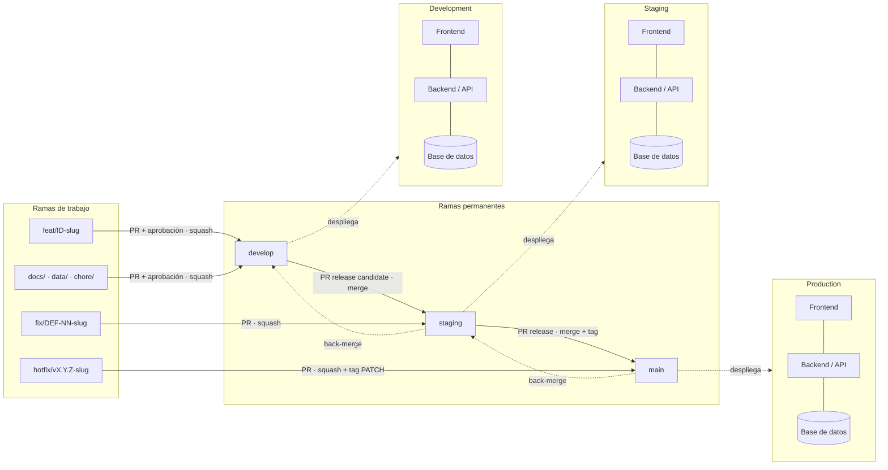
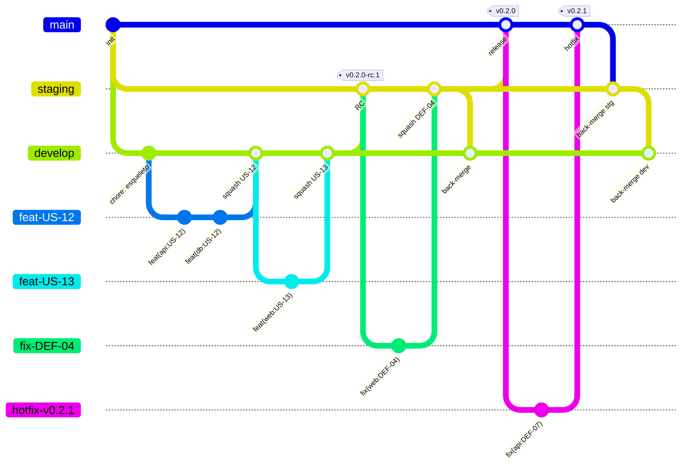
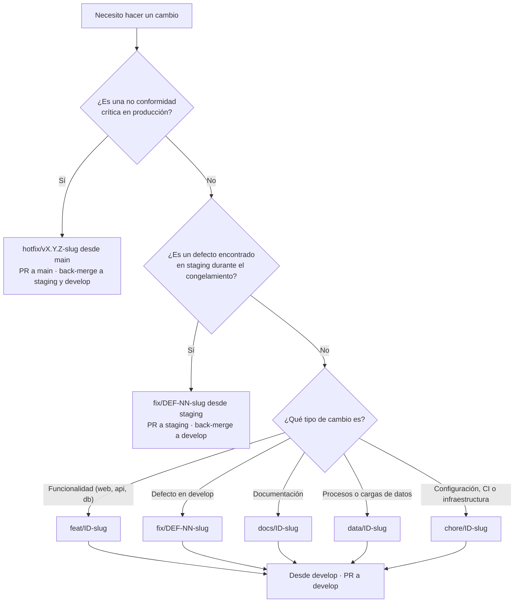
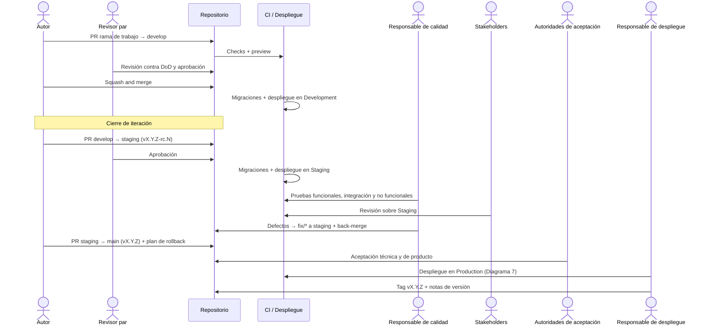
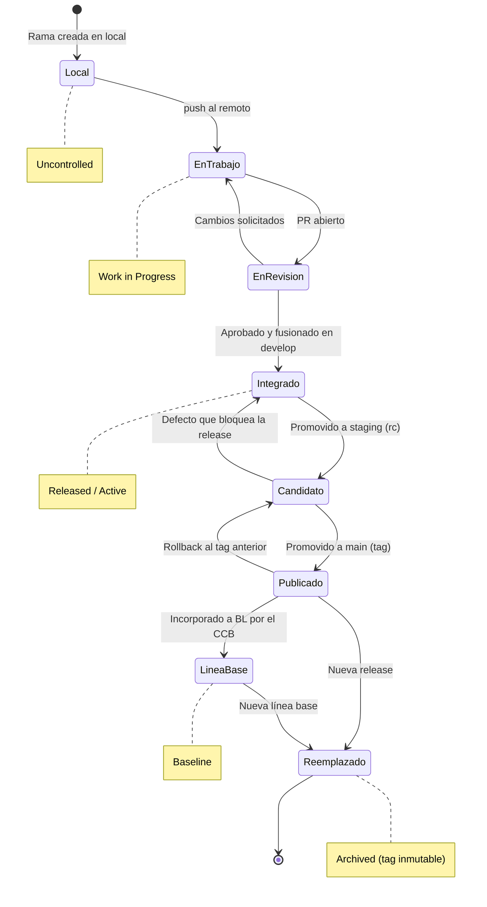
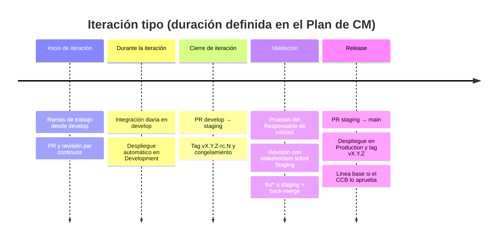
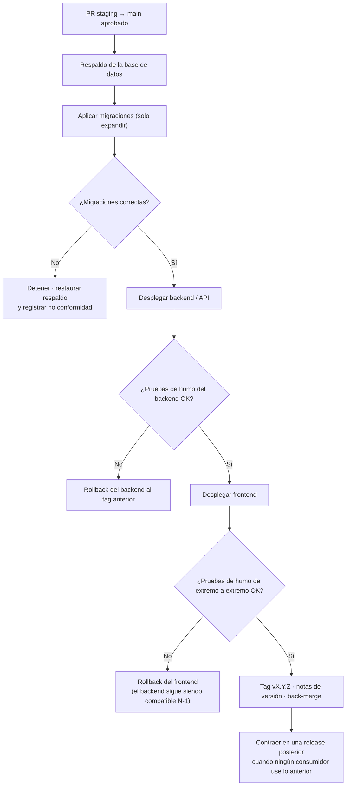

# 📐 Estándar de Estrategia de Ramas y Promoción entre Entornos

## 🎯 Propósito

Este estándar define las ramas permanentes, las ramas de trabajo, las reglas de integración y el camino obligatorio que recorre todo cambio, desde el entorno de **desarrollo** hasta **staging** y **producción**, en cualquier proyecto de MIWA. Aplica por igual a productos solo de frontend y a productos con backend, base de datos y procesos de datos.

Es necesario para que lo que se publica en producción corresponda siempre a una versión revisada, probada e identificable; para que cada versión pueda reconstruirse a partir del repositorio; y para que los componentes que se despliegan por separado (frontend, backend, base de datos, datos) avancen de forma coordinada sin romperse entre sí.

Adapta **GitFlow**: conserva la separación entre integración (`develop`) y producción (`main`), sustituye las ramas `release/*` por una rama permanente `staging` ligada a un entorno estable de preproducción, y mantiene `hotfix/*` para correcciones urgentes.

> *Este estándar define los criterios obligatorios de ramificación, integración, promoción y etiquetado que deben cumplir todos los repositorios de código de MIWA, y operacionaliza la Política de Gestión de Configuración y la Política de Revisión y Aceptación del Trabajo para los artefactos técnicos.*
>

---

## 🔍 Alcance

- **Aplica a:** Todos los integrantes de MIWA que contribuyan a un repositorio Git de la organización, y a todo repositorio que se despliegue en uno o más entornos: frontend, backend/API, migraciones y esquema de base de datos, procesos de datos (ETL, pipelines, cargas), infraestructura como código y configuración de despliegue. Cubre repositorios únicos por componente y monorepos.
- **No aplica a:** Documentos normativos y organizacionales que viven en Notion, que se rigen por `STD-VERSIONAMIENTO`; repositorios personales de experimentación que no se despliegan; y ramas locales que nunca se suben al remoto.
- **Ámbito geográfico/organizacional:** Toda la organización MIWA y todos sus proyectos, actuales y futuros.

---

## 📖 Definiciones y Terminología

| Término | Definición |
| --- | --- |
| **Rama permanente** | Rama que existe durante todo el ciclo de vida del repositorio y está ligada a un entorno: `develop`, `staging` y `main`. |
| **Rama de trabajo** | Rama de vida corta creada para un cambio específico (`feat/*`, `fix/*`, `docs/*`, `data/*`, `chore/*`, `hotfix/*`). Se elimina después de integrarse. |
| **Elemento de trabajo** | Unidad registrada en el backlog o en la bitácora del proyecto: historia de usuario (`US-NN`), tarea (`TSK-NN`) o defecto (`DEF-NN`). El formato exacto lo fija el Plan de CM del proyecto. |
| **Componente** | Parte del producto que se construye y despliega como unidad: por ejemplo `web` (frontend), `api` (backend), `db` (esquema y migraciones), `data` (procesos de datos), `infra` (infraestructura). |
| **Entorno** | Conjunto aislado de instancias de todos los componentes (frontend, backend, base de datos, almacenamiento) en un nivel: Development, Staging o Production. |
| **Promoción** | Integración de una rama permanente en la siguiente (`develop` → `staging` → `main`) mediante pull request, que despliega en el entorno correspondiente. |
| **Pull request (PR)** | Solicitud de integración en la plataforma de repositorio. Es la evidencia formal de la revisión por pares. |
| **Back-merge** | Integración de una corrección hecha en `staging` o `main` de vuelta a las ramas anteriores, para que no se pierda en la siguiente promoción. |
| **Release candidate (RC)** | Versión promovida a `staging` que aspira a producción. Se etiqueta `vX.Y.Z-rc.N`. |
| **Release** | Versión publicada en producción. Se etiqueta en `main` como `vX.Y.Z` (SemVer). |
| **Migración** | Script versionado que cambia el esquema o los datos de referencia de una base de datos. Se aplica en orden y una sola vez por entorno. |
| **Expandir y contraer (expand/contract)** | Técnica para cambios incompatibles de esquema o de API: primero se agrega lo nuevo manteniendo lo anterior (expandir), se migran los consumidores y, en una release posterior, se retira lo anterior (contraer). |
| **Contrato de API** | Especificación versionada de la interfaz del backend (por ejemplo, OpenAPI) de la que depende el frontend u otros consumidores. |
| **Rollback** | Regreso de un entorno a la release anterior cuando una release falla. |
| **Congelamiento (code freeze)** | Periodo en el que `staging` solo admite correcciones de defectos, no funcionalidad nueva. |
| **Verificación automática (check)** | Validación que corre en cada PR en el sistema de integración continua (CI): build, pruebas, lint, análisis de seguridad, validación de migraciones. |
| **Plan de CM del proyecto** | Documento del proyecto que fija los valores que este estándar deja abiertos: componentes, plataformas, URLs de entornos, formato de IDs, umbrales y responsables. |

---

## 👥 Roles y Responsabilidades

| Rol | Responsabilidad |
| --- | --- |
| **Dueño del estándar** | Architecture owner de MIWA. Mantener, actualizar y difundir el estándar; resolver dudas de interpretación entre proyectos. |
| **Aplicador** | Todo integrante que contribuya al repositorio. Crear ramas, redactar commits y abrir PR conforme a este estándar y a `STD-MENSAJES-COMMIT`. |
| **Revisor/Auditor** | Rol de aseguramiento de calidad de procesos asignado en el Plan de CM del proyecto. Verificar el cumplimiento en cada corte; nunca audita trabajo propio. |
| **Revisor par** | Integrante distinto del autor del PR. Revisar contra la Definition of Done aplicable (`STD-READY-DONE`) y aprobar o rechazar. |
| **Administrador del repositorio** | Rol de Gestión de Configuración del proyecto. Configurar la protección de ramas, los entornos, los secretos por entorno y los checks obligatorios. |
| **Autoridad de aceptación técnica** | Architecture owner del proyecto. Aprobar en lo técnico las promociones a `main`: arquitectura, contratos de API, migraciones, datos y despliegue. |
| **Autoridad de aceptación de producto** | Product owner del proyecto. Aprobar el contenido y el alcance de cada release. |
| **Responsable de calidad** | Quality assurance del proyecto. Ejecutar las pruebas en `staging` y registrar los defectos en la bitácora. |
| **Responsable de despliegue** | Integrante designado en el Plan de CM. Ejecutar la promoción a producción, vigilar el despliegue y ejecutar el rollback si es necesario. |
| **CCB** | Comité de Control de Cambios del proyecto. Aprobar la incorporación de una release a una línea base y los cambios sobre ella. |

---

## 📏 Especificaciones del Estándar

1. **Ramas permanentes:** Todo repositorio desplegable tiene exactamente tres ramas permanentes, cada una ligada a un entorno: `develop` → Development, `staging` → Staging y `main` → Production (ver Tabla 1 y Diagrama 1).
2. **Rama por defecto:** La rama por defecto del repositorio es `develop`, para que todo PR nuevo apunte a integración y no a producción.
3. **Despliegue ligado a rama:** Cada entorno se despliega automáticamente desde su rama permanente y solo desde ella. Ninguna otra rama puede desplegar en Production. Las plataformas y URLs de cada entorno se registran en el Plan de CM del proyecto.
4. **Aislamiento de entornos:** Cada entorno tiene sus propias instancias de backend, base de datos, almacenamiento y secretos. Ningún entorno comparte base de datos con otro. Los datos de producción no se copian a Development ni a Staging salvo anonimizados y sin datos personales.
5. **Protección de ramas permanentes:** `develop`, `staging` y `main` no admiten `push` directo, `force push` ni borrado. La protección exige PR, aprobaciones según la especificación 11, invalidar aprobaciones con commits nuevos, checks obligatorios y conversaciones resueltas, y aplica también a administradores. Si el plan de la plataforma no permite proteger ramas en un repositorio, esta regla se verifica por auditoría en cada corte.
6. **Tipos de rama de trabajo:** Solo se permiten los prefijos `feat/`, `fix/`, `docs/`, `data/`, `chore/` y `hotfix/`, cada uno con el origen y destino de la Tabla 2 (ver Diagrama 3).
7. **Nomenclatura de ramas de trabajo:** `<prefijo>/<ID>-<slug>`, donde `<ID>` es el identificador del elemento de trabajo (`US-12`, `TSK-30`, `DEF-04`). El slug va en minúsculas, con guion medio, sin acentos, ñ, espacios ni guion bajo, sin artículos ni preposiciones y con máximo 5 palabras (reglas de `STD-NOMENCLATURA` ajustadas a Git). En un monorepo, el componente puede anteponerse al slug (`feat/US-12-api-participacion-entidad`). Un hotfix usa `hotfix/v<X.Y.Z>-<slug>` con la versión que va a publicar.
8. **Una rama, un propósito:** Cada rama de trabajo contiene un solo elemento de trabajo. Si el cambio crece o toca componentes que se pueden integrar por separado, se divide en varias ramas.
9. **Vida corta:** Una rama de trabajo no vive más de **3 días hábiles** sin integrarse, salvo que el Plan de CM del proyecto fije otro límite. Si se excede, se actualiza desde su rama de origen y se registra el motivo en el PR.
10. **Eliminación tras integrar:** La rama de trabajo se elimina al fusionar el PR. Los commits, el PR y los tags conservan el registro, en cumplimiento de la retención histórica de `STD-VERSIONAMIENTO`.
11. **Aprobaciones e independencia:** Todo PR a una rama permanente requiere al menos **1 aprobación** de alguien distinto del autor; los PR a `main` requieren además la aprobación de las autoridades de aceptación técnica y de producto. Si el autor es una de esas autoridades, aprueba otro integrante con el mismo nivel de conocimiento. El Plan de CM puede elevar el número de aprobaciones según el tamaño del equipo (`POL-REVISION-TRABAJO`, directriz 1).
12. **Formato de commits:** Todo commit y todo título de PR siguen `STD-MENSAJES-COMMIT`.
13. **Contenido mínimo del PR:** Todo PR indica el elemento de trabajo, los componentes afectados, los criterios de aceptación cubiertos, la evidencia (entorno de preview, capturas, resultados de pruebas) y el checklist de DoD. Si incluye migraciones o cambios de contrato de API, describe además el impacto en otros componentes y el plan de rollback. El PR se actualiza con su rama destino antes de fusionarse.
14. **Verificaciones automáticas:** Ningún PR se fusiona con un check obligatorio en rojo. Los checks mínimos por componente están en la Tabla 3; los umbrales concretos (cobertura, peso de carga, tiempo de respuesta) los fija el Plan de CM o la especificación de requisitos del proyecto.
15. **Registro de no conformidades:** Los hallazgos de revisión que incumplan el DoD se registran en la bitácora de defectos y se referencian en el PR antes de corregirse (`POL-REVISION-TRABAJO`, directriz 6).
16. **Estrategia de fusión:** Cada combinación origen → destino usa la estrategia de la Tabla 4. Se prohíbe `rebase` o `force push` sobre ramas permanentes.
17. **Integración en Development:** Un elemento de trabajo queda integrado cuando su PR se fusiona en `develop` y el despliegue en Development termina sin errores. A partir de ese estado el revisor verifica los criterios de aceptación en ese entorno.
18. **Promoción a Staging:** Al cerrar cada iteración se abre un PR `develop` → `staging` titulado `chore(release): vX.Y.Z-rc.N`. Al fusionarse se crea el tag `vX.Y.Z-rc.N`, se despliegan todos los componentes en Staging (incluidas las migraciones) y comienza el congelamiento: solo entran ramas `fix/*` nacidas de `staging`, cada una con back-merge a `develop`. El Responsable de calidad prueba sobre Staging, y las revisiones con stakeholders se hacen sobre Staging, nunca sobre el preview de una rama de trabajo.
19. **Promoción a Production:** Se abre un PR `staging` → `main` titulado `chore(release): vX.Y.Z` solo si no hay no conformidades críticas abiertas, las pruebas en Staging están registradas, existe un plan de rollback y lo aprueban las autoridades de la especificación 11. El Responsable de despliegue sigue el orden del Diagrama 7, crea el tag anotado `vX.Y.Z` en `main` y publica las notas de versión (ver Diagramas 2 y 4).
20. **Back-merge obligatorio:** Todo cambio que entra directo a `staging` o a `main` se integra de vuelta a las ramas anteriores en menos de **24 horas**. Nunca existe en `main` un commit ausente de `develop`.
21. **Hotfix:** Solo procede ante una no conformidad crítica en producción: servicio caído, datos incorrectos publicados, vulnerabilidad de seguridad, exposición de datos o incumplimiento legal o normativo. Nace de `main`, requiere 1 aprobación independiente, incrementa PATCH, se despliega con el mismo orden de la especificación 19 y se registra en la bitácora de defectos.
22. **Migraciones de base de datos:** Las migraciones viven en el repositorio junto con el código que las requiere, se aplican automáticamente en cada entorno al desplegar y nunca se editan una vez fusionadas en `develop`; un error se corrige con una migración nueva. Cada migración se valida en CI sobre una base de datos vacía y se prueba en Staging antes de llegar a Production.
23. **Compatibilidad entre componentes:** Un cambio de esquema o de contrato de API que rompa a sus consumidores se implementa con expandir y contraer: la release N agrega lo nuevo sin retirar lo anterior, y lo anterior se retira en una release posterior, cuando ningún consumidor lo usa. El backend en Production es compatible con la versión del frontend en Production y con la anterior (N-1). Un cambio incompatible de API pública incrementa su versión mayor en la ruta (`/v1` → `/v2`).
24. **Rollback:** Toda release a Production debe poder revertirse a la release anterior sin pérdida de datos. Si una migración no es reversible, el PR a `main` lo declara y el plan de rollback describe la alternativa (respaldo previo, migración correctiva). El rollback se ejecuta desplegando el tag anterior, nunca reescribiendo la historia de `main`.
25. **Versionamiento SemVer del código:** El código usa `MAJOR.MINOR.PATCH` conforme a la tabla de Elementos Afectados de `STD-VERSIONAMIENTO`: `0.Y.Z` antes de la primera release estable, `1.0.0` en la primera release estable, MINOR por iteración con funcionalidad nueva, PATCH para hotfix o correcciones y `-rc.N` para candidatos en Staging. En un monorepo con componentes que se despliegan de forma independiente, cada componente lleva su propio tag `<componente>/vX.Y.Z`; si se despliegan juntos, comparten un solo tag.
26. **Tags inmutables:** Un tag publicado no se mueve ni se borra. Si una release falla, se publica una versión nueva.
27. **Relación con líneas base:** Una release se incorpora a una línea base `BL-AAAA.N` solo con aprobación del CCB. El registro de la línea base lista el tag de cada componente y la versión de cada documento que la integra (requisitos, diseño, diccionario de datos). A partir de ese momento, cualquier cambio sobre esa release requiere una Solicitud de Cambio (CR) aprobada por el CCB (ver Diagrama 5).
28. **Proporcionalidad del control:** Las releases periódicas a `main` no requieren CCB; basta la aprobación del PR (especificación 19). El CCB interviene al establecer o modificar líneas base y en los hitos que el Plan de CM defina como contractuales, según la regla de proporcionalidad de `POL-GESTION-CONFIGURACION`.
29. **Cadencia de releases:** Cada proyecto define en su Plan de CM la duración de su iteración y el día de promoción a Staging. Cada iteración cierra con un RC en Staging, y la promoción a Production ocurre después de las pruebas y la revisión con stakeholders (ver Diagrama 6).
30. **Gestión de secretos:** Credenciales, cadenas de conexión, tokens y API keys viven en el gestor de secretos o en las variables de entorno de la plataforma, separadas por entorno, y nunca se versionan. Cada entorno usa credenciales propias.
31. **Contenido del repositorio:** No se versionan datos personales, datos crudos de gran volumen ni respaldos de base de datos. Las fuentes de datos voluminosas viven en el almacenamiento definido por el Plan de CM y se referencian desde el repositorio; solo se versionan los scripts que las procesan y los artefactos derivados que el producto necesita para funcionar.

> 💡 *Ejemplos de nombres de rama. Correctos: `feat/US-12-endpoint-participacion` · `feat/US-15-db-indice-seccion` · `fix/DEF-04-contraste-boton` · `data/TSK-30-carga-conteos-2024` · `hotfix/v1.4.1-timeout-api`. Incorrectos: `Feature/US12` · `cambios-angel` · `feat/us-12_endpoint_de_la_participacion` · `test`.*
>

**Tabla 1 · Ramas permanentes y entornos**

| Rama | Entorno | Qué contiene | Despliegue | Nivel de control (POL CM) |
| --- | --- | --- | --- | --- |
| `develop` | Development | Trabajo integrado y revisado de la iteración en curso | Automático: todos los componentes y migraciones en Development | 🟢 Released / Active (interno) |
| `staging` | Staging | Release candidate en pruebas y en revisión con stakeholders | Automático: todos los componentes y migraciones en Staging, con URL estable | 🟢 Released / Active |
| `main` | Production | Última release aceptada | Automático o con aprobación manual, según el Plan de CM, siguiendo el orden del Diagrama 7 | 🟢 Released / Active · 🔴 Baseline cuando su tag se incorpora a una línea base |

**Tabla 2 · Ramas de trabajo**

| Prefijo | Uso | Nace de | Se integra en | Tipo de commit asociado |
| --- | --- | --- | --- | --- |
| `feat/` | Funcionalidad nueva en cualquier componente, incluidas migraciones que la soportan | `develop` | `develop` | `feat` |
| `fix/` | Defecto encontrado en `develop` o en `staging` | `develop` o `staging` | Su rama de origen (+ back-merge si nació de `staging`) | `fix` |
| `docs/` | Documentación versionada en el repositorio | `develop` | `develop` | `docs` |
| `data/` | Procesos de datos, cargas, datos de referencia o artefactos derivados | `develop` | `develop` | `data` |
| `chore/` | Configuración, dependencias, CI, infraestructura como código | `develop` | `develop` | `chore`, `ci`, `build` |
| `hotfix/` | No conformidad crítica en producción | `main` | `main` (+ back-merge a `staging` y `develop`) | `fix` |

**Tabla 3 · Verificaciones automáticas mínimas**

| Check | Componente | Criterio | Obligatorio en |
| --- | --- | --- | --- |
| Build | Todos | Construcción exitosa | Todos los PR |
| Pruebas unitarias | Todos | 100 % de pruebas en verde; cobertura mínima según Plan de CM | Todos los PR |
| Lint / formato | Todos | 0 errores | Todos los PR |
| Formato de commits | Todos | Conforme a `STD-MENSAJES-COMMIT` | Todos los PR |
| Secretos | Todos | 0 credenciales detectadas | Todos los PR |
| Vulnerabilidades de dependencias | Todos | 0 vulnerabilidades críticas o altas sin excepción aprobada | PR a `staging` y `main` |
| Validación de migraciones | `db` | Todas las migraciones se aplican sobre una base vacía sin errores | PR que incluyan migraciones |
| Pruebas de contrato o integración | `api` | Contrato de API vigente sin cambios incompatibles no declarados | PR que toquen el backend |
| Presupuesto de rendimiento | `web`, `api` | Peso de carga y tiempo de respuesta dentro del umbral de los requisitos del proyecto | PR a `staging` y `main` |
| Accesibilidad automatizada | `web` | 0 violaciones críticas del nivel de accesibilidad exigido por el proyecto | PR a `staging` y `main` |

**Tabla 4 · Estrategia de fusión**

| Origen → Destino | Estrategia | Motivo |
| --- | --- | --- |
| Rama de trabajo → `develop` | Squash and merge | Un commit por elemento de trabajo, fácil de rastrear y revertir. |
| `develop` → `staging` | Merge commit | Conserva la historia y marca el punto de promoción. |
| `fix/*` → `staging` | Squash and merge | Igual que en `develop`. |
| `staging` → `main` | Merge commit | El commit de fusión es el punto exacto de la release. |
| `hotfix/*` → `main` | Squash and merge | Una corrección = un commit. |
| Back-merge (`main` o `staging` → anteriores) | Merge commit | Evita reescribir la historia compartida. |

**Diagrama 1 · Ramas y entornos**

**Diagrama 2 · Historia de commits en una iteración** (en el diagrama, `/` se representa con `-` por limitaciones de Mermaid: `feat-US-12` equivale a `feat/US-12-endpoint-participacion`)

**Diagrama 3 · ¿De dónde parto y a dónde abro el PR?**

**Diagrama 4 · Promoción de una release**

**Diagrama 5 · Ciclo de vida de un cambio y niveles de control**

**Diagrama 6 · Cadencia de una iteración**

**Diagrama 7 · Orden de despliegue en Production con backend**

---

## 🧩 Elementos Afectados

| Tipo de Elemento | Aplicación del Estándar |
| --- | --- |
| Código fuente de frontend | Ramas, PR, estrategia de fusión, checks de rendimiento y accesibilidad, tags SemVer. |
| Código fuente de backend / API | Ramas, PR, pruebas de contrato, compatibilidad N-1, versionamiento de la API pública. |
| Esquema y migraciones de base de datos | Versionadas con el código, inmutables tras integrarse, expandir y contraer, respaldo previo en Production. |
| Procesos y artefactos de datos (ETL, cargas, datos de referencia) | Ramas `data/*`; los scripts y derivados se promueven con el código; las fuentes voluminosas viven fuera del repositorio. |
| Infraestructura como código y configuración de despliegue | Ramas `chore/*`; secretos y variables separados por entorno y fuera del repositorio. |
| Documentación técnica en el repositorio | Ramas `docs/*`; el archivo conserva su Código CM y su versión documental (`STD-VERSIONAMIENTO`). |
| Mensajes de commit y títulos de PR | `STD-MENSAJES-COMMIT`. |
| Releases y tags | `vX.Y.Z` en `main` y `vX.Y.Z-rc.N` en `staging` (o `<componente>/vX.Y.Z` en monorepos con despliegue independiente); inmutables. |
| Líneas base | `BL-AAAA.N` referencia el tag de cada componente incluido en la release. |

---

## 📊 Criterios de Cumplimiento y Verificación

- **Método de verificación:** Reglas de protección de ramas y checks obligatorios en la plataforma de repositorio (verificación preventiva), y auditoría del historial con un checklist: PR fusionados y sus aprobaciones, tags, notas de versión, back-merges, migraciones, planes de rollback y registros de despliegue.
- **Criterio de aceptación:** 0 commits directos en ramas permanentes · 100 % de PR fusionados con aprobación de alguien distinto del autor · 100 % de releases en `main` con tag, notas de versión y plan de rollback · 0 commits en `main` ausentes de `develop` · 0 migraciones editadas después de integrarse · 0 secretos en el repositorio · 0 back-merges pendientes con más de 24 horas.
- **Frecuencia:** Por PR (automática) y en cada corte de seguimiento del proyecto, con al menos una auditoría antes de establecer cada línea base.
- **Responsable de verificación:** Revisor/Auditor asignado en el Plan de CM del proyecto, siempre distinto del autor de los cambios auditados.

---

## ⚠️ Excepciones y No Cumplimiento

- **Proceso de excepción:** Se solicita por escrito en el canal oficial del proyecto, indicando la especificación que se omite, el motivo, el riesgo, las medidas de mitigación y la fecha de cierre. La aprueba el CCB del proyecto; si compromete una fecha contractual o de entrega, decide el Program manager. Toda excepción se registra en el Plan de CM del proyecto. Como excepción preautorizada, si el equipo queda con un solo integrante disponible por más de 24 horas, aplica la contingencia de `POL-REVISION-TRABAJO`: ese integrante puede fusionar sin aprobación en `develop` y `staging`, con registro en la bitácora y revisión posterior obligatoria; nunca aplica a `main` ni a migraciones irreversibles.
- **Consecuencias de incumplimiento:**
  - Commit directo en rama permanente: se revierte por PR, se registra como no conformidad crítica y se corrige el avance reportado si afectó una actividad.
  - PR fusionado sin aprobación independiente: el elemento de trabajo regresa a "En curso" hasta completar la revisión.
  - Release en `main` sin pasar por `staging`: se trata como hotfix no autorizado, con revisión inmediata y no conformidad crítica.
  - Migración editada después de integrarse o sin respaldo previo en Production: no conformidad crítica y revisión del estado de la base de datos en todos los entornos.
  - Back-merge omitido: bloquea la siguiente promoción hasta resolverlo.
  - Secreto o dato personal versionado: se rota la credencial, se limpia el historial y se registra como no conformidad crítica.

---

## ⚖️ Marco Normativo y Estándares de Referencia

- CMMI-DEV v1.3, Niveles de Madurez 2 y 3 — **CM** SP 1.1, 1.2, 1.3, 2.1, 2.2, 3.1, 3.2 · **PI** SP 1.2, 2.1, 3.1 · **VER** SP 2.2 · **TS** SP 2.3 (Diseñar interfaces) · **GP 2.6** (Controlar productos de trabajo)
- ISO/IEC/IEEE 12207:2017 — Procesos de gestión de configuración y de transición · Semantic Versioning 2.0.0 (https://semver.org/lang/es/) · GitFlow (Vincent Driessen), adaptado según este estándar
- Normativa legal y regulatoria de protección de datos personales aplicable a cada proyecto (en México, la Ley Federal de Protección de Datos Personales en Posesión de los Particulares) y las condiciones contractuales de cada cliente o convocatoria
- Políticas y estándares internos relacionados: `POL-GESTION-CONFIGURACION` · `POL-REVISION-TRABAJO` · `STD-VERSIONAMIENTO` · `STD-NOMENCLATURA` · `STD-READY-DONE` · `STD-MENSAJES-COMMIT`

---

## 🔗 Related Resources

- `POL-GESTION-CONFIGURACION` — Política de Gestión de Configuración, y `POL-REVISION-TRABAJO` — Política de Revisión y Aceptación del Trabajo
- `TPL-ESTANDAR` — Plantilla de Estándar · Plan de CM de cada proyecto · `STD-MENSAJES-COMMIT` — Estándar de Mensajes de Commit (`STD-MENSAJES-COMMIT-v0.3.md`)
- Reglas de protección de ramas de la plataforma de repositorio · commitlint · escáner de secretos y de vulnerabilidades de dependencias · herramienta de migraciones del proyecto
- Ejemplos de nombres de rama y Diagramas 2, 3 y 7 de este documento

---

## 🔄 Vigencia y Revisión

Este estándar será revisado **cada seis meses y al cierre de cada proyecto** o ante cambios significativos en la tecnología, el proceso o el marco normativo aplicable. Toda modificación debe ser aprobada por el CCB antes de su publicación.

---

## 📝 Control de Modificaciones

| # | Autor(es) | Modificación Realizada | Fecha |
| --- | --- | --- | --- |
| 1 | Angel Mauricio Ramirez | Creación inicial del documento | 08/10/2026 |
| 2 | Angel Mauricio Ramirez | Reestructuración conforme a la plantilla de estándar | 08/10/2026 |
| 3 | Angel Mauricio Ramirez | Generalización a toda la organización MIWA y a proyectos con backend, base de datos y procesos de datos: entornos aislados, migraciones, compatibilidad entre componentes, rollback y tags por componente | 08/10/2026 |
