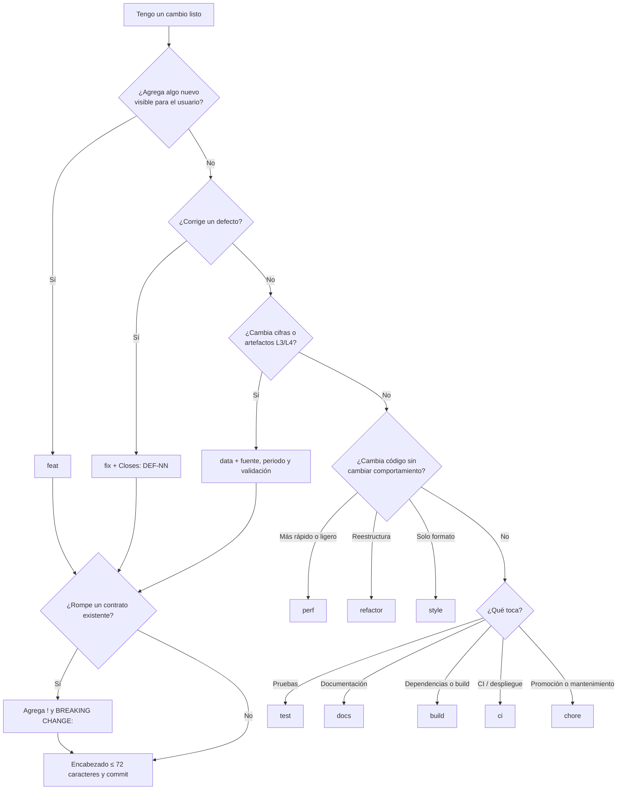

# 📐 Estándar de Mensajes de Commit

## 🎯 Propósito

Este estándar define el formato obligatorio de los mensajes de commit y de los títulos de pull request en los repositorios de MIWA, con base en **Conventional Commits 1.0.0**.

Es necesario por tres razones: **trazabilidad**, porque cada cambio en el código o en los datos publicados debe poder rastrearse hasta la historia de usuario o el defecto que lo originó; **versionamiento predecible**, porque el tipo de commit determina qué parte de la versión SemVer se incrementa en cada release; y **revisión eficiente**, porque un historial uniforme permite al revisor par entender qué cambió y por qué sin abrir cada archivo, y permite generar las notas de versión automáticamente.

> *Este estándar define los criterios obligatorios de formato y contenido mínimo que deben cumplir todos los mensajes de commit y títulos de pull request que llegan a un repositorio remoto de MIWA.*

---

## 🔍 Alcance

- **Aplica a:** Angel, Kira y cualquier colaborador futuro que haga commits en un repositorio de MIWA. Cubre todos los commits que llegan al remoto, los títulos de pull request y los commits de fusión generados en las promociones entre ramas permanentes.
- **No aplica a:** Commits locales que se reescriben antes de subirse (por ejemplo, con `git commit --amend` o un `rebase` interactivo en una rama propia que aún no está en el remoto).
- **Ámbito geográfico/organizacional:** Toda la organización MIWA.

---

## 📖 Definiciones y Terminología

| Término | Definición |
| --- | --- |
| **Commit** | Registro inmutable de un cambio en el repositorio Git, identificado por un hash. |
| **Encabezado (header)** | Primera línea del mensaje: `<tipo>(<alcance>): <descripción>`. |
| **Tipo** | Palabra controlada que clasifica la naturaleza del cambio (ver Tabla 1). |
| **Alcance (scope)** | Identificador entre paréntesis que liga el commit a una historia de usuario, un defecto u otra categoría permitida (ver Tabla 2). |
| **Descripción** | Resumen breve del cambio, después de los dos puntos. |
| **Cuerpo (body)** | Texto libre, separado del encabezado por una línea en blanco, que explica qué cambió y por qué. |
| **Pie (footer)** | Líneas `Clave: valor` al final del mensaje, con referencias y metadatos. |
| **Cambio incompatible (breaking change)** | Cambio que rompe un contrato existente, por ejemplo el esquema de los artefactos de datos o una URL pública. Se marca con `!` y con el pie `BREAKING CHANGE:`. |
| **Commit atómico** | Commit que contiene un solo cambio lógico y deja el proyecto en un estado que compila. |
| **commitlint** | Herramienta que valida automáticamente los mensajes contra este estándar. |

---

## 👥 Roles y Responsabilidades

| Rol | Responsabilidad |
| --- | --- |
| **Dueño del estándar** | Angel (Architecture owner). Mantener, actualizar y difundir el estándar y la configuración de commitlint. |
| **Aplicador** | Angel y Kira. Redactar cada commit y cada título de PR conforme a este estándar. |
| **Revisor/Auditor** | Revisor par del PR, siempre distinto del autor. Rechazar el PR si el título o los commits no cumplen y verificar el cumplimiento en el corte semanal. |
| **Quien fusiona el PR** | Confirmar que el mensaje del commit resultante (squash o merge) cumple el formato antes de fusionar. |

---

## 📏 Especificaciones del Estándar

1. **Estructura del mensaje:** Todo mensaje sigue la estructura `<tipo>(<alcance>)[!]: <descripción>`, seguida opcionalmente de una línea en blanco, el cuerpo, otra línea en blanco y los pies (ver Formato de referencia). El encabezado es obligatorio; el cuerpo y los pies lo son en los casos de la especificación 6.
2. **Tipos permitidos:** Solo se aceptan, en minúsculas, los tipos de la Tabla 1. `data` es una extensión propia de MIWA, permitida por Conventional Commits, para separar los cambios en cifras publicadas de los cambios de código (RN-10, RF-23).
3. **Alcance obligatorio:** El alcance siempre se indica y es uno de los valores de la Tabla 2. `US` y `DEF` van en mayúsculas, igual que en el backlog y en la bitácora, para que la búsqueda sea directa (`git log --grep "(US-09)"`).
4. **Descripción:** Se escribe en español, con el verbo en presente y en tercera persona, como si completara la frase "Este commit…" (*agrega*, *corrige*, *elimina*, *actualiza*). Inicia con minúscula, no termina en punto, describe el resultado y no la actividad, y el encabezado completo no excede **72 caracteres**.
5. **Cuerpo:** Se separa del encabezado con una línea en blanco, explica **qué** cambió y **por qué** (el **cómo** ya está en el diff) y ninguna línea excede **100 caracteres**.
6. **Cuerpo y pies obligatorios:** Los casos de la Tabla 3 deben incluir el contenido mínimo indicado.
7. **Pies permitidos:** Se usan con el formato `Clave: valor`, uno por línea, y solo con las claves `Refs: US-NN`, `Closes: DEF-NN`, `BREAKING CHANGE: <descripción>`, `Reverts: <hash>` y `Co-authored-by: Nombre <correo>`.
8. **Commits atómicos:** Cada commit contiene un solo cambio lógico y deja el proyecto compilando. No se mezclan, por ejemplo, un `feat` y un `refactor` ajeno en el mismo commit.
9. **Título de PR:** El título de todo PR cumple la especificación 1, porque al hacer *squash and merge* se convierte en el encabezado del commit que queda en la rama permanente.
10. **Commits de promoción:** Los PR entre ramas permanentes definidos en `STD-ESTRATEGIA-RAMAS` usan los títulos `chore(release): vX.Y.Z-rc.N` (`develop` → `staging`), `chore(release): vX.Y.Z` (`staging` → `main`) y `chore(release): back-merge vX.Y.Z a develop` (integración de vuelta).
11. **Contenido prohibido:** Ningún mensaje contiene credenciales, tokens, datos personales, lenguaje ofensivo ni opiniones políticas o partidistas (RNF-13, RN-07). Tampoco se aceptan mensajes genéricos como `cambios`, `wip`, `fix`, `update`, `asdf` o `.`.
12. **Validación automática:** El repositorio incluye commitlint con la Configuración de referencia de este estándar. Se ejecuta en local (hook `commit-msg`) y como check obligatorio en cada PR. commitlint valida las especificaciones 1 a 5; los pies obligatorios de la especificación 6 se verifican en la revisión par.

> 💡 *Ejemplos de cumplimiento y no cumplimiento, tablas de referencia, configuración de commitlint y árbol de decisión para elegir el tipo.*
>

**Formato de referencia**

```text
<tipo>(<alcance>)[!]: <descripción>

[cuerpo]

[pie(s)]
```

**Tabla 1 · Tipos permitidos**

| Tipo | Uso | Efecto en SemVer |
| --- | --- | --- |
| `feat` | Funcionalidad nueva visible para el usuario | MINOR |
| `fix` | Corrección de un defecto | PATCH |
| `data` | Alta o regeneración de artefactos de datos L3/L4 (JSON, CSV) | PATCH (MINOR si agrega un indicador nuevo) |
| `perf` | Mejora de rendimiento o de peso de carga sin cambiar el comportamiento | PATCH |
| `refactor` | Reestructuración de código sin cambiar el comportamiento | — |
| `style` | Formato, espacios o punto y coma; sin cambio de lógica ni de estilos visuales | — |
| `test` | Pruebas nuevas o corregidas | — |
| `docs` | Documentación versionada en el repositorio | — |
| `build` | Sistema de construcción o dependencias | — |
| `ci` | Configuración de integración o despliegue continuo | — |
| `chore` | Mantenimiento que no encaja en los anteriores, incluidas las promociones | — |
| `revert` | Reversión de un commit previo | Según lo revertido |

**Tabla 2 · Alcances permitidos**

| Alcance | Cuándo |
| --- | --- |
| `US-NN` | El cambio implementa o modifica una historia de usuario. Ej. `US-09`. |
| `DEF-NN` | El cambio corrige un defecto registrado en la bitácora. Ej. `DEF-04`. |
| `release` | Commits de promoción y back-merge entre ramas permanentes. |
| `deps` | Actualización de dependencias sin historia asociada. |

**Tabla 3 · Cuerpo y pies obligatorios**

| Caso | Contenido mínimo obligatorio |
| --- | --- |
| `fix` | Causa del defecto y pie `Closes: DEF-NN`. |
| `data` | Fuente, periodo y territorio de los datos (RN-10), y resultado de la validación contra cifras oficiales (RF-23) o referencia a su reporte. |
| Cambio incompatible | `!` después del alcance y pie `BREAKING CHANGE: <qué se rompe y cómo migrar>`. |
| `revert` | Pie `Reverts: <hash>` y motivo de la reversión en el cuerpo. |
| Trabajo en pareja | Pie `Co-authored-by: Nombre <correo>` por cada coautor. |

**Ejemplos de cumplimiento**

```text
feat(US-09): agrega navegación por gestos entre pantallas
```

```text
fix(DEF-04): corrige contraste del botón primario

El texto blanco sobre #4FA3A5 daba 2.9:1 y WCAG 2.2 AA exige 4.5:1.
Se oscurece el fondo a #2F6F71 (5.8:1).

Closes: DEF-04
```

```text
data(US-06): regenera participación por grupo de edad 2024

Fuente: Conteos censales INE (DECEYEC), elección federal 2024.
Territorio: nacional, 32 entidades y municipios sobre el umbral RN-05.
Validación: diferencia máxima 0.3 pp contra cifras oficiales (RF-23).
```

```text
feat(US-11)!: cambia el esquema de marts a un archivo por entidad

BREAKING CHANGE: participacion.json se divide en participacion/<cve_ent>.json;
los componentes deben pedir el archivo de la entidad seleccionada.
```

**Ejemplos de no cumplimiento**

| Mensaje | Incumple |
| --- | --- |
| `cambios en el selector` | Sin tipo ni alcance (especificaciones 1, 2 y 3) |
| `feat: agrega selector` | Sin alcance (especificación 3) |
| `Feat(us-09): Agregué el selector.` | Tipo en mayúscula, alcance en minúscula, verbo en pasado, mayúscula inicial y punto final (especificaciones 2, 3 y 4) |
| `fix(DEF-04): arregla bug` | Sin cuerpo ni pie `Closes` y descripción genérica (especificaciones 4 y 6) |
| `data(US-06): actualiza datos` | Sin fuente, periodo ni validación (especificación 6) |

**Configuración de referencia de commitlint**

```js
// commitlint.config.js
module.exports = {
  extends: ['@commitlint/config-conventional'],
  plugins: [
    {
      rules: {
        'scope-miwa': ({ scope }) => [
          /^(US-\d{2}|DEF-\d{2,3}|release|deps)$/.test(scope ?? ''),
          'el alcance debe ser US-NN, DEF-NN, release o deps',
        ],
      },
    },
  ],
  rules: {
    'type-enum': [2, 'always', [
      'feat', 'fix', 'data', 'perf', 'refactor', 'style',
      'test', 'docs', 'build', 'ci', 'chore', 'revert',
    ]],
    'scope-empty': [2, 'never'],
    'scope-case': [0],
    'scope-miwa': [2, 'always'],
    'header-max-length': [2, 'always', 72],
    'body-max-line-length': [2, 'always', 100],
    'subject-full-stop': [2, 'never', '.'],
  },
};
```

**Árbol de decisión · ¿Qué tipo uso?**



---

## 🧩 Elementos Afectados

| Tipo de Elemento | Aplicación del Estándar |
| --- | --- |
| Código fuente | Formato de commits y alcance ligado a US o DEF. |
| Artefactos de datos L3/L4 | Tipo `data` con fuente, periodo, territorio y validación obligatorios. |
| Configuración de despliegue y CI | Tipos `ci` y `build`. |
| Documentación técnica en el repositorio | Tipo `docs`; la versión documental del archivo sigue `STD-VERSIONAMIENTO`. |
| Títulos de pull request | Mismo formato que el encabezado del commit (especificación 9). |
| Commits de promoción y back-merge | Formato `chore(release)` (especificación 10). |
| Notas de versión (GitHub Releases) | Se generan agrupando commits por tipo desde el último tag. |

---

## 📊 Criterios de Cumplimiento y Verificación

- **Método de verificación:** commitlint en el hook `commit-msg` (preventivo) y como check obligatorio en cada PR; revisión par del título del PR y de los pies obligatorios antes de fusionar; muestreo del historial en el corte semanal.
- **Criterio de aceptación:** 100 % de los commits en `develop`, `staging` y `main` conformes · 0 PR fusionados con el check de commitlint en rojo · 100 % de commits `fix` con `Closes: DEF-NN` · 100 % de commits `data` con fuente y validación.
- **Frecuencia:** En cada commit y en cada PR (automática); semanal, en el corte de los domingos (auditoría).
- **Responsable de verificación:** Revisor par del PR; en el corte semanal, Angel verifica los commits de Kira y viceversa.

---

## ⚠️ Excepciones y No Cumplimiento

- **Proceso de excepción:** Se solicita en el canal del proyecto en Discord, indicando el commit, la especificación que no se cumple y el motivo. La aprueba el Dueño del estándar y se registra en el Control de Modificaciones. Los commits generados automáticamente por herramientas (por ejemplo, Dependabot) quedan exceptuados si se fusionan con un título de PR conforme.
- **Consecuencias de incumplimiento:**
  - Commit no conforme en una rama de trabajo: el check falla y el PR no puede fusionarse hasta corregirlo; se reescribe la rama de trabajo, nunca una permanente.
  - Commit no conforme que llegó a una rama permanente: se registra como no conformidad en la bitácora; no se reescribe la historia y el siguiente commit relacionado documenta la referencia faltante.
  - Secreto o dato personal en un mensaje: no conformidad crítica; se rota la credencial y se aplica el procedimiento de `STD-ESTRATEGIA-RAMAS`.

---

## ⚖️ Marco Normativo y Estándares de Referencia

- CMMI-DEV v1.3, Nivel de Madurez 2 — **CM** SP 2.1 (Rastrear solicitudes de cambio), SP 3.1 (Establecer registros de gestión de configuración) · **GP 2.6** (Controlar productos de trabajo)
- ISO/IEC/IEEE 12207:2017 — Proceso de gestión de configuración · Conventional Commits 1.0.0 (https://www.conventionalcommits.org/es/v1.0.0/) · Semantic Versioning 2.0.0 (https://semver.org/lang/es/)
- Normativa legal/regulatoria aplicable: bases de la convocatoria del Hackathon INE 2026 (REF-03)
- Políticas y estándares internos relacionados: `POL-GESTION-CONFIGURACION` · `POL-REVISION-TRABAJO` · `STD-VERSIONAMIENTO` · `STD-ESTRATEGIA-RAMAS`

---

## 🔗 Related Resources

- `POL-GESTION-CONFIGURACION` — Política de Gestión de Configuración · `STD-ESTRATEGIA-RAMAS` — Estándar de Estrategia de Ramas (`STD-ESTRATEGIA-RAMAS-v0.2.md`)
- `TPL-ESTANDAR` — Plantilla de Estándar
- commitlint — https://commitlint.js.org/ (configuración de referencia en este documento)
- Ejemplos de cumplimiento y no cumplimiento en las Especificaciones del Estándar

---

## 🔄 Vigencia y Revisión

Este estándar será revisado **al cierre de cada sprint mientras dure el proyecto y en la retrospectiva final** o ante cambios significativos en la tecnología, el proceso o el marco normativo aplicable. Toda modificación debe ser aprobada por el CCB antes de su publicación.

---

## 📝 Control de Modificaciones

| # | Autor(es) | Modificación Realizada | Fecha |
| --- | --- | --- | --- |
| 1 | Angel Mauricio Ramirez | Creación inicial del documento | 08/10/2026 |
| 2 | Angel Mauricio Ramirez | Reestructuración conforme a la plantilla de estándar | 08/10/2026 |
