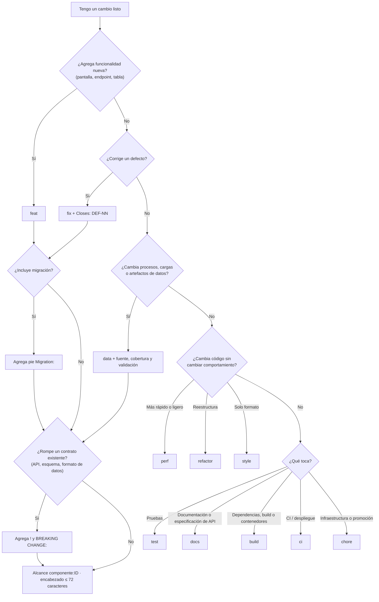

# 📐 Estándar de Mensajes de Commit

## 🎯 Propósito

Este estándar define el formato obligatorio de los mensajes de commit y de los títulos de pull request en todos los repositorios de MIWA, con base en **Conventional Commits 1.0.0**.

Es necesario por tres razones: **trazabilidad**, porque cada cambio en el frontend, el backend, la base de datos o los datos debe poder rastrearse hasta el elemento de trabajo que lo originó y hasta el componente que modifica; **versionamiento predecible**, porque el tipo de commit determina qué parte de la versión SemVer se incrementa en cada release; y **revisión eficiente**, porque un historial uniforme permite al revisor par entender qué cambió, dónde y por qué sin abrir cada archivo, y permite generar las notas de versión automáticamente.

> *Este estándar define los criterios obligatorios de formato y contenido mínimo que deben cumplir todos los mensajes de commit y títulos de pull request que llegan a un repositorio remoto de MIWA.*
>

---

## 🔍 Alcance

- **Aplica a:** Todos los integrantes de MIWA y colaboradores externos que hagan commits en un repositorio de la organización, en cualquier proyecto y componente (frontend, backend/API, base de datos, procesos de datos, infraestructura, documentación técnica). Cubre todos los commits que llegan al remoto, los títulos de pull request y los commits de fusión generados en las promociones entre ramas permanentes.
- **No aplica a:** Commits locales que se reescriben antes de subirse (por ejemplo, con `git commit --amend` o un `rebase` interactivo en una rama propia que aún no está en el remoto), ni a repositorios personales de experimentación que no se despliegan.
- **Ámbito geográfico/organizacional:** Toda la organización MIWA y todos sus proyectos, actuales y futuros.

---

## 📖 Definiciones y Terminología

| Término | Definición |
| --- | --- |
| **Commit** | Registro inmutable de un cambio en el repositorio Git, identificado por un hash. |
| **Encabezado (header)** | Primera línea del mensaje: `<tipo>(<alcance>): <descripción>`. |
| **Tipo** | Palabra controlada que clasifica la naturaleza del cambio (ver Tabla 1). |
| **Alcance (scope)** | Texto entre paréntesis que liga el commit a un elemento de trabajo y, opcionalmente, al componente que modifica (ver Tabla 2). |
| **Elemento de trabajo** | Unidad registrada en el backlog o en la bitácora del proyecto: historia de usuario (`US-NN`), tarea (`TSK-NN`) o defecto (`DEF-NN`). El formato exacto lo fija el Plan de CM del proyecto. |
| **Componente** | Parte del producto que se construye y despliega como unidad, por ejemplo `web`, `api`, `db`, `data` o `infra`. La lista de cada repositorio la fija el Plan de CM del proyecto. |
| **Descripción** | Resumen breve del cambio, después de los dos puntos. |
| **Cuerpo (body)** | Texto libre, separado del encabezado por una línea en blanco, que explica qué cambió y por qué. |
| **Pie (footer)** | Líneas `Clave: valor` al final del mensaje, con referencias y metadatos. |
| **Cambio incompatible (breaking change)** | Cambio que rompe un contrato existente: un endpoint o campo de API, el esquema de la base de datos, el formato de un archivo de datos o una URL pública. Se marca con `!` y con el pie `BREAKING CHANGE:`. |
| **Migración** | Script versionado que cambia el esquema o los datos de referencia de una base de datos. |
| **Commit atómico** | Commit que contiene un solo cambio lógico y deja el proyecto en un estado que compila y pasa sus pruebas. |
| **commitlint** | Herramienta que valida automáticamente los mensajes contra este estándar. |

---

## 👥 Roles y Responsabilidades

| Rol | Responsabilidad |
| --- | --- |
| **Dueño del estándar** | Architecture owner de MIWA. Mantener, actualizar y difundir el estándar y la configuración de referencia de commitlint. |
| **Aplicador** | Todo integrante que haga commits. Redactar cada commit y cada título de PR conforme a este estándar. |
| **Revisor/Auditor** | Revisor par del PR, siempre distinto del autor, y Revisor/Auditor asignado en el Plan de CM. Rechazar el PR si el título o los commits no cumplen y verificar el cumplimiento en cada corte. |
| **Administrador del repositorio** | Rol de Gestión de Configuración del proyecto. Instalar commitlint en el repositorio, configurarlo como check obligatorio y registrar en él los componentes y prefijos de ID del proyecto. |
| **Quien fusiona el PR** | Confirmar que el mensaje del commit resultante (squash o merge) cumple el formato antes de fusionar. |

---

## 📏 Especificaciones del Estándar

1. **Estructura del mensaje:** Todo mensaje sigue la estructura `<tipo>(<alcance>)[!]: <descripción>`, seguida opcionalmente de una línea en blanco, el cuerpo, otra línea en blanco y los pies (ver Formato de referencia). El encabezado es obligatorio; el cuerpo y los pies lo son en los casos de la especificación 7.
2. **Tipos permitidos:** Solo se aceptan, en minúsculas, los tipos de la Tabla 1. `data` es una extensión propia de MIWA, permitida por Conventional Commits, para separar los cambios en procesos y artefactos de datos de los cambios de código de aplicación.
3. **Alcance obligatorio:** El alcance siempre se indica con alguno de los formatos de la Tabla 2. El identificador del elemento de trabajo va en mayúsculas, igual que en el backlog y en la bitácora, para que la búsqueda sea directa (`git log --grep "US-12"`).
4. **Componente en el alcance:** En repositorios con más de un componente (monorepos o repositorios con frontend y backend), el alcance incluye el componente antes del identificador, separado por dos puntos: `feat(api:US-12)`. En repositorios de un solo componente, el componente se omite. Los nombres de componente van en minúsculas y son los registrados en el Plan de CM del proyecto.
5. **Descripción:** Se escribe en español, con el verbo en presente y en tercera persona, como si completara la frase "Este commit…" (*agrega*, *corrige*, *elimina*, *actualiza*). Inicia con minúscula, no termina en punto, describe el resultado y no la actividad, y el encabezado completo no excede **72 caracteres**.
6. **Cuerpo:** Se separa del encabezado con una línea en blanco, explica **qué** cambió y **por qué** (el **cómo** ya está en el diff) y ninguna línea excede **100 caracteres**.
7. **Cuerpo y pies obligatorios:** Los casos de la Tabla 3 incluyen el contenido mínimo indicado.
8. **Pies permitidos:** Se usan con el formato `Clave: valor`, uno por línea, y solo con las claves `Refs`, `Closes`, `BREAKING CHANGE`, `Migration`, `Reverts` y `Co-authored-by` (ver Tabla 4).
9. **Commits atómicos:** Cada commit contiene un solo cambio lógico y deja el proyecto compilando y con sus pruebas en verde. Una migración y el código que la necesita pueden ir en el mismo commit; un `feat` y un `refactor` ajeno, no.
10. **Título de PR:** El título de todo PR cumple la especificación 1, porque al hacer *squash and merge* se convierte en el encabezado del commit que queda en la rama permanente.
11. **Commits de promoción:** Los PR entre ramas permanentes definidos en `STD-ESTRATEGIA-RAMAS` usan los títulos `chore(release): vX.Y.Z-rc.N` (`develop` → `staging`), `chore(release): vX.Y.Z` (`staging` → `main`) y `chore(release): back-merge vX.Y.Z a develop` (integración de vuelta). En monorepos con despliegue independiente, la versión incluye el componente: `chore(release): api/v1.4.0`.
12. **Contenido prohibido:** Ningún mensaje contiene credenciales, cadenas de conexión, tokens, datos personales, lenguaje ofensivo ni opiniones políticas o partidistas. Tampoco se aceptan mensajes genéricos como `cambios`, `wip`, `fix`, `update`, `asdf` o `.`.
13. **Validación automática:** Todo repositorio incluye commitlint con la Configuración de referencia de este estándar, ajustada solo en las listas de componentes y prefijos de ID del proyecto. Se ejecuta en local (hook `commit-msg`) y como check obligatorio en cada PR. commitlint valida las especificaciones 1 a 6; los pies obligatorios de la especificación 7 se verifican en la revisión par.

> 💡 *Ejemplos de cumplimiento y no cumplimiento, tablas de referencia, configuración de commitlint y árbol de decisión para elegir el tipo.*
>

**Formato de referencia**

```text
<tipo>(<componente>:<ID>)[!]: <descripción>

[cuerpo]

[pie(s)]
```

**Tabla 1 · Tipos permitidos**

| Tipo | Uso | Efecto en SemVer |
| --- | --- | --- |
| `feat` | Funcionalidad nueva en cualquier componente: pantalla, endpoint, tabla o migración que la soporta | MINOR |
| `fix` | Corrección de un defecto | PATCH |
| `data` | Procesos de datos (ETL, cargas), datos de referencia o artefactos de datos derivados | PATCH (MINOR si agrega un conjunto o indicador nuevo) |
| `perf` | Mejora de rendimiento (tiempo de respuesta, consultas, peso de carga) sin cambiar el comportamiento | PATCH |
| `refactor` | Reestructuración de código sin cambiar el comportamiento | — |
| `style` | Formato, espacios o punto y coma; sin cambio de lógica ni de estilos visuales | — |
| `test` | Pruebas nuevas o corregidas | — |
| `docs` | Documentación versionada en el repositorio, incluida la especificación de la API | — |
| `build` | Sistema de construcción, imágenes de contenedor o dependencias | — |
| `ci` | Configuración de integración o despliegue continuo | — |
| `chore` | Mantenimiento que no encaja en los anteriores, incluidas infraestructura como código y promociones | — |
| `revert` | Reversión de un commit previo | Según lo revertido |

Todo cambio marcado con `!` incrementa MAJOR a partir de la versión `1.0.0`; antes de ella, incrementa MINOR.

**Tabla 2 · Formatos de alcance permitidos**

| Formato | Cuándo | Ejemplo |
| --- | --- | --- |
| `<ID>` | Repositorio de un solo componente | `feat(US-12)` |
| `<componente>:<ID>` | Repositorio con varios componentes | `feat(api:US-12)` · `fix(web:DEF-04)` · `feat(db:US-15)` |
| `release` | Commits de promoción y back-merge entre ramas permanentes | `chore(release)` |
| `deps` | Actualización de dependencias sin elemento de trabajo asociado | `build(deps)` |

**Tabla 3 · Cuerpo y pies obligatorios**

| Caso | Contenido mínimo obligatorio |
| --- | --- |
| `fix` | Causa del defecto y pie `Closes: DEF-NN`. |
| Commit que agrega una migración | Qué tablas o columnas cambia, si es reversible y pie `Migration: <identificador de la migración>`. |
| `data` | Fuente, periodo y cobertura de los datos, y resultado de su validación o referencia al reporte de validación. |
| Cambio incompatible | `!` después del alcance y pie `BREAKING CHANGE: <qué se rompe y cómo migrar>`. En APIs, indica la versión de la ruta afectada. |
| `revert` | Pie `Reverts: <hash>` y motivo de la reversión en el cuerpo. |
| Trabajo en pareja | Pie `Co-authored-by: Nombre <correo>` por cada coautor. |

**Tabla 4 · Pies permitidos**

| Pie | Uso |
| --- | --- |
| `Refs: <ID>` | Referencia adicional a otro elemento de trabajo. |
| `Closes: DEF-NN` | El commit cierra el defecto. |
| `BREAKING CHANGE: <descripción>` | Cambio incompatible y cómo migrar. |
| `Migration: <identificador>` | Migración de base de datos incluida en el commit. |
| `Reverts: <hash>` | Commit revertido. |
| `Co-authored-by: Nombre <correo>` | Coautoría. |

**Ejemplos de cumplimiento**

```text
feat(api:US-12): agrega endpoint de participación por entidad
```

```text
fix(web:DEF-04): corrige contraste del botón primario

El texto blanco sobre #4FA3A5 daba 2.9:1 y WCAG 2.2 AA exige 4.5:1.
Se oscurece el fondo a #2F6F71 (5.8:1).

Closes: DEF-04
```

```text
feat(db:US-15): agrega índice por sección y año en participación

Las consultas por sección tardaban más de 2 s con 50 M de filas.
Migración reversible; no cambia columnas existentes.

Migration: 20261012_001_idx_participacion_seccion_anio
```

```text
data(data:TSK-30): carga conteos de participación 2024

Fuente: datos abiertos oficiales, elección federal 2024.
Cobertura: nacional, 32 entidades.
Validación: diferencia máxima 0.3 pp contra cifras publicadas.
```

```text
feat(api:US-20)!: cambia participación a respuesta paginada

BREAKING CHANGE: GET /v1/participacion devuelve { items, next } en lugar de
un arreglo. Se publica como /v2/participacion; /v1 se retira en la release
siguiente, cuando el frontend migre (expandir y contraer).
```

**Ejemplos de no cumplimiento**

| Mensaje | Incumple |
| --- | --- |
| `cambios en el endpoint` | Sin tipo ni alcance (especificaciones 1, 2 y 3) |
| `feat: agrega endpoint` | Sin alcance (especificación 3) |
| `feat(US-12): agrega endpoint` en un repositorio con frontend y backend | Sin componente (especificación 4) |
| `Feat(API:us-12): Agregué el endpoint.` | Tipo y componente en mayúscula, ID en minúscula, verbo en pasado, mayúscula inicial y punto final (especificaciones 2, 4 y 5) |
| `feat(db:US-15): agrega índice` | Sin cuerpo ni pie `Migration` (especificación 7) |
| `fix(web:DEF-04): arregla bug` | Sin cuerpo ni pie `Closes` y descripción genérica (especificaciones 5 y 7) |

**Configuración de referencia de commitlint**

```js
// commitlint.config.js
// Ajustar solo COMPONENTES e ID_PREFIJOS según el Plan de CM del proyecto.
const COMPONENTES = ['web', 'api', 'db', 'data', 'infra'];
const ID_PREFIJOS = ['US', 'TSK', 'DEF'];

const scopeRegex = new RegExp(
  `^((${COMPONENTES.join('|')}):)?(${ID_PREFIJOS.join('|')})-\\d+$|^(release|deps)$`
);

module.exports = {
  extends: ['@commitlint/config-conventional'],
  plugins: [
    {
      rules: {
        'scope-miwa': ({ scope }) => [
          scopeRegex.test(scope ?? ''),
          `el alcance debe ser [componente:]ID (${ID_PREFIJOS.join(', ')}), release o deps`,
        ],
      },
    },
  ],
  rules: {
    'type-enum': [2, 'always', [
      'feat', 'fix', 'data', 'perf', 'refactor', 'style',
      'test', 'docs', 'build', 'ci', 'chore', 'revert',
    ]],
    'scope-empty': [2, 'never'],
    'scope-case': [0],
    'scope-miwa': [2, 'always'],
    'header-max-length': [2, 'always', 72],
    'body-max-line-length': [2, 'always', 100],
    'subject-full-stop': [2, 'never', '.'],
  },
};
```

**Árbol de decisión · ¿Qué tipo uso?**



---

## 🧩 Elementos Afectados

| Tipo de Elemento | Aplicación del Estándar |
| --- | --- |
| Código fuente de frontend | Formato de commits con componente `web` (o el definido por el proyecto). |
| Código fuente de backend / API | Componente `api`; `!` y `BREAKING CHANGE` ante cambios incompatibles de contrato. |
| Esquema y migraciones de base de datos | Componente `db`; pie `Migration` obligatorio. |
| Procesos y artefactos de datos | Tipo `data`; fuente, cobertura y validación obligatorias. |
| Infraestructura como código, CI y configuración de despliegue | Tipos `chore`, `ci` y `build`. |
| Documentación técnica en el repositorio | Tipo `docs`; la versión documental del archivo sigue `STD-VERSIONAMIENTO`. |
| Títulos de pull request | Mismo formato que el encabezado del commit (especificación 10). |
| Commits de promoción y back-merge | Formato `chore(release)` (especificación 11). |
| Notas de versión | Se generan agrupando commits por tipo y componente desde el último tag. |

---

## 📊 Criterios de Cumplimiento y Verificación

- **Método de verificación:** commitlint en el hook `commit-msg` (preventivo) y como check obligatorio en cada PR; revisión par del título del PR y de los pies obligatorios con el checklist de DoD; muestreo del historial de las ramas permanentes en cada corte.
- **Criterio de aceptación:** 100 % de los commits en `develop`, `staging` y `main` conformes · 0 PR fusionados con el check de commitlint en rojo · 100 % de commits `fix` con `Closes` · 100 % de commits con migración con pie `Migration` · 100 % de commits `data` con fuente y validación · 0 mensajes con secretos o datos personales.
- **Frecuencia:** En cada commit y en cada PR (automática); en cada corte de seguimiento del proyecto y antes de establecer cada línea base (auditoría).
- **Responsable de verificación:** Revisor par del PR y Revisor/Auditor asignado en el Plan de CM del proyecto, siempre distinto del autor de los commits revisados.

---

## ⚠️ Excepciones y No Cumplimiento

- **Proceso de excepción:** Se solicita en el canal oficial del proyecto, indicando el commit o el repositorio, la especificación que no se cumple y el motivo. La aprueba el Dueño del estándar y se registra en el Plan de CM del proyecto. Los commits generados automáticamente por herramientas (por ejemplo, bots de dependencias o generadores de código) quedan exceptuados si se fusionan con un título de PR conforme. Un proyecto puede agregar componentes o prefijos de ID a la configuración de referencia sin solicitar excepción, siempre que los registre en su Plan de CM.
- **Consecuencias de incumplimiento:**
  - Commit no conforme en una rama de trabajo: el check falla y el PR no puede fusionarse hasta corregirlo; se reescribe la rama de trabajo, nunca una permanente.
  - Commit no conforme que llegó a una rama permanente: se registra como no conformidad en la bitácora; no se reescribe la historia y el siguiente commit relacionado documenta la referencia faltante.
  - Migración o cambio incompatible sin declarar: no conformidad crítica; bloquea la promoción a `staging` hasta documentarlo y evaluar su impacto en los demás componentes.
  - Secreto o dato personal en un mensaje: no conformidad crítica; se rota la credencial y se aplica el procedimiento de `STD-ESTRATEGIA-RAMAS`.

---

## ⚖️ Marco Normativo y Estándares de Referencia

- CMMI-DEV v1.3, Nivel de Madurez 2 — **CM** SP 2.1 (Rastrear solicitudes de cambio), SP 3.1 (Establecer registros de gestión de configuración) · **GP 2.6** (Controlar productos de trabajo)
- ISO/IEC/IEEE 12207:2017 — Proceso de gestión de configuración · Conventional Commits 1.0.0 (https://www.conventionalcommits.org/es/v1.0.0/) · Semantic Versioning 2.0.0 (https://semver.org/lang/es/)
- Normativa legal y regulatoria de protección de datos personales aplicable a cada proyecto (en México, la Ley Federal de Protección de Datos Personales en Posesión de los Particulares)
- Políticas y estándares internos relacionados: `POL-GESTION-CONFIGURACION` · `POL-REVISION-TRABAJO` · `STD-VERSIONAMIENTO` · `STD-ESTRATEGIA-RAMAS`

---

## 🔗 Related Resources

- `POL-GESTION-CONFIGURACION` — Política de Gestión de Configuración · `STD-ESTRATEGIA-RAMAS` — Estándar de Estrategia de Ramas (`STD-ESTRATEGIA-RAMAS-v0.3.md`)
- `TPL-ESTANDAR` — Plantilla de Estándar · Plan de CM de cada proyecto (componentes y prefijos de ID)
- commitlint — https://commitlint.js.org/ (configuración de referencia en este documento)
- Ejemplos de cumplimiento y no cumplimiento en las Especificaciones del Estándar

---

## 🔄 Vigencia y Revisión

Este estándar será revisado **cada seis meses y al cierre de cada proyecto** o ante cambios significativos en la tecnología, el proceso o el marco normativo aplicable. Toda modificación debe ser aprobada por el CCB antes de su publicación.

---

## 📝 Control de Modificaciones

| # | Autor(es) | Modificación Realizada | Fecha |
| --- | --- | --- | --- |
| 1 | Angel Mauricio Ramirez | Creación inicial del documento | 08/10/2026 |
| 2 | Angel Mauricio Ramirez | Reestructuración conforme a la plantilla de estándar | 08/10/2026 |
| 3 | Angel Mauricio Ramirez | Generalización a toda la organización MIWA: alcance con componente (web, api, db, data, infra), prefijos de ID configurables, pie Migration y ejemplos para backend y base de datos | 08/10/2026 |
