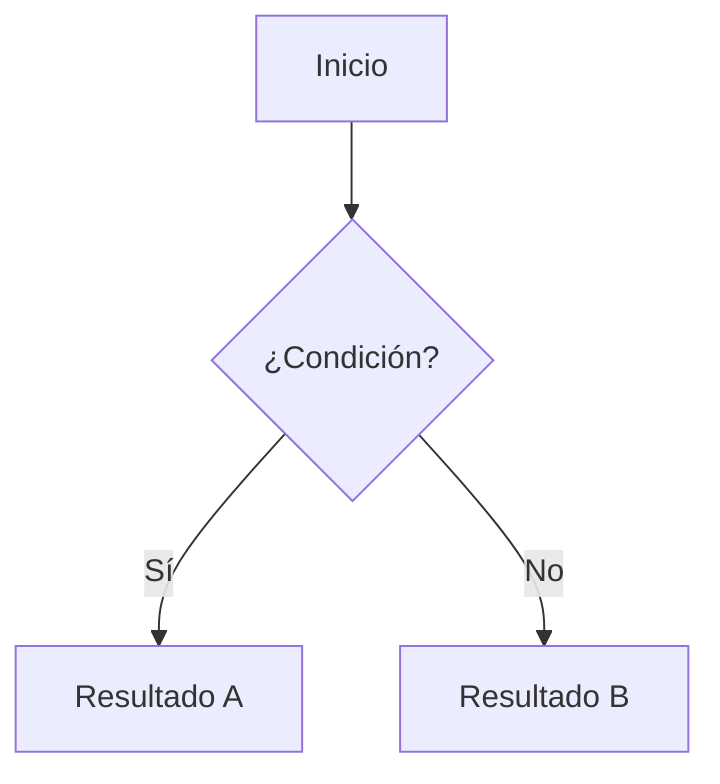

# 📐 [Nombre del Estándar]

<!--
  CÓMO USAR ESTA PLANTILLA (borra este bloque al instanciarla)
  1. El documento generado NO conserva el prefijo TPL: adopta STD (STD-NOMENCLATURA, regla 9).
  2. Inicia en versión 0.1 y estado Borrador; solo alcanza 1.0 al ser aprobado (STD-VERSIONAMIENTO, regla 3).
  3. El título de la página es el nombre legible; el Código CM va en la ficha, no en el título (STD-NOMENCLATURA, regla 7).
  4. El nombre de archivo es [Código CM].md (STD-NOMENCLATURA, regla 12).
  5. Reemplaza todo texto entre [corchetes]. No dejes placeholders en una versión que se envíe a revisión.
  6. Una sección que no aplique se conserva con la leyenda "No aplica" y el motivo; no se elimina.
  7. Nunca incluyas credenciales, tokens ni datos personales (POL-GESTION-CONFIGURACION, Clasificación de Confidencialidad).
-->

## 🪪 Ficha de Configuración

| Campo | Valor |
| --- | --- |
| **Código CM** | `STD-[SLUG]-v[MAYOR].[MENOR]` |
| **Prefijo** | `STD` |
| **Nombre del Documento (Slug)** | `[SLUG]` <!-- MAYÚSCULAS, guion medio, sin conectores, ≤ 5 palabras / 40 caracteres --> |
| **Versión** | `0.1` |
| **Estado del documento** | Borrador · En revisión · Aprobado · Vigente · Obsoleto |
| **Nivel de control (POL CM)** | ⚪ Uncontrolled · 🟡 Work in Progress · 🟢 Released / Active · 🔴 Baseline · ⚫ Archived / Obsolete |
| **Confidencialidad** | 🟢 Pública · 🟡 Interna · 🔴 Confidencial |
| **Propietario** | [Persona] |
| **Aprobador** | [Propietario (cambio menor) / CCB (versión mayor)] |
| **Línea base** | [BL-AAAA.N o "No incorporado"] |
| **Fecha de vigencia** | [DD/MM/AAAA] |
| **Repositorio oficial** | [Notion / GitHub · ruta] |

> 🔁 **Equivalencia de estados.** Borrador y En revisión → 🟡 Work in Progress · Aprobado y Vigente → 🟢 Released / Active · Vigente incorporado a una línea base → 🔴 Baseline · Obsoleto → ⚫ Archived / Obsolete.

---

## 🎯 Propósito

[Qué define este estándar, qué problema concreto resuelve y por qué es obligatorio. Máximo 2 párrafos.]

[Práctica de CMMI-DEV v1.3 que institucionaliza o soporta, ej. CM SP 1.2 · GP 2.6.]

---

## 🔍 Alcance

- **Aplica a:** [Elementos, equipos o proyectos cubiertos.]
- **No aplica a:** [Exclusiones explícitas.]
- **Ámbito geográfico/organizacional:** Toda la organización MIWA. <!-- o el proyecto específico -->

---

## 📖 Definiciones y Terminología

| Término | Definición |
| --- | --- |
| **[Término]** | [Definición.] |

---

## 👥 Roles y Responsabilidades

| Rol | Responsabilidad |
| --- | --- |
| **Dueño del estándar** | Mantener, actualizar y difundir este estándar. |
| **Aplicador** | Cumplir con las especificaciones definidas en su trabajo diario. |
| **Revisor/Auditor** | Verificar el cumplimiento del estándar en los productos de trabajo. No puede verificar trabajo propio. |
| **CCB (Comité de Control de Cambios)** | Aprobar versiones mayores y su incorporación a líneas base. |
| **[Rol específico]** | [Responsabilidad específica.] |

---

## 📏 Especificaciones del Estándar

<!-- Reglas numeradas, verificables y en modo imperativo ("debe", "no se permite"). Una regla = un criterio auditable. -->

1. **[Nombre de la regla]:** [Especificación verificable.]
2. **[Nombre de la regla]:** [Especificación verificable.]

> 💡 *Ejemplo: [ejemplo concreto de aplicación correcta].*

---

## 🧭 Diagramas

<!-- Al menos un diagrama Mermaid que explique el flujo o la estructura principal. Sugeridos: ciclo de vida (stateDiagram-v2), árbol de decisión (flowchart TD), relación entre elementos (flowchart LR). -->

---

## 🧩 Elementos Afectados

| Tipo de Elemento | Aplicación del Estándar |
| --- | --- |
| [Tipo] | [Cómo aplica.] |

---

## 📊 Criterios de Cumplimiento y Verificación

| Aspecto | Definición |
| --- | --- |
| **Método de verificación** | [Auditoría, revisión de registros, inspección automatizada…] |
| **Criterio de aceptación** | [Umbral medible, ej. 100 % de elementos conformes.] |
| **Métricas** | [Indicador · meta.] |
| **Frecuencia** | [Por evento / semanal / por línea base.] |
| **Responsable de verificación** | [Rol, distinto de quien produjo el elemento.] |
| **Evidencia** | [Registros que demuestran el cumplimiento.] |

---

## ⚠️ Excepciones y No Cumplimiento

- **Proceso de excepción:** [Quién la solicita, por qué medio, quién la aprueba y dónde se registra.]
- **Consecuencias de incumplimiento:**

| Situación | Consecuencia |
| --- | --- |
| [Incumplimiento] | [Acción correctiva.] |

---

## ⚖️ Marco Normativo y Estándares de Referencia

- CMMI-DEV v1.3 — Área de Proceso: [PA] · [SP / GP]
- [Norma ISO/IEEE aplicable, si aplica]
- [Políticas y estándares internos por Código CM]

---

## 🔗 Related Resources

- [Código CM o nombre del recurso relacionado]

---

## 🔄 Vigencia y Revisión

Este estándar será revisado **[frecuencia concreta]** o ante [evento disparador]. Los cambios menores los aprueba el Propietario del documento; las versiones mayores, el CCB (STD-VERSIONAMIENTO, reglas 4 y 5).

---

## 📝 Control de Modificaciones

<!-- Ninguna fila se elimina. Tipo: Creación · Menor · Mayor · Errata (la errata no incrementa versión). -->

| # | Versión | Tipo | Autor(es) | Modificación Realizada | Aprobó | Fecha |
| --- | --- | --- | --- | --- | --- | --- |
| 1 | 0.1 | Creación | [Autor] | Creación inicial del documento | — | [DD/MM/AAAA] |
