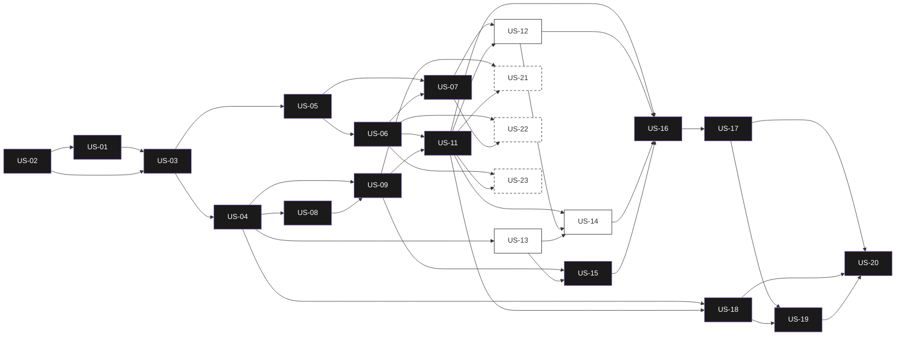

# Historias de usuario · ReVoto

Un archivo por historia del **User Story Backlog** de Notion. Cada archivo sigue la plantilla del equipo y enlaza SRS-01, entregable, actividad del PVG, rama, dependencias y DoD (READY-DONE).

## Matriz de trazabilidad

| US | Historia | Épica | Prioridad | SP | Sprint | Resp. | Vence | Estado | SRS | Entregable | PVG |
| --- | --- | --- | --- | --- | --- | --- | --- | --- | --- | --- | --- |
| [US-01](./US-01-vision-objetivos.md) | Definir visión, objetivos y criterios de éxito del MVP | E-01 | Must | 1 | Sprint 1 (3-9 oct) | Angel | 04/10/2026 | Done | SRS §3 Necesidad | D01 | 1.1 |
| [US-02](./US-02-alcance-riesgos-supuestos.md) | Delimitar alcance, riesgos y supuestos del proyecto | E-01 | Must | 1 | Sprint 1 (3-9 oct) | Kira | 05/10/2026 | Done | SRS §1.2 | D01 | 1.2 |
| [US-03](./US-03-backlog-moscow.md) | Refinar y priorizar el backlog con MoSCoW | E-01 | Must | 1 | Sprint 1 (3-9 oct) | Angel | 05/10/2026 | In Progress | SRS §5.1 Reconciliación del backlog | D02 | 2.1 |
| [US-04](./US-04-arquitectura-wireframes.md) | Diseñar la arquitectura de información y los wireframes | E-01 | Must | 1 | Sprint 1 (3-9 oct) | Angel | 06/10/2026 | Done | SRS §9.1 RIU-01 a RIU-10 | D03 | 2.2 |
| [US-05](./US-05-auditoria-fuentes.md) | Auditar las fuentes oficiales disponibles | E-02 | Must | 1 | Sprint 1 (3-9 oct) | Kira | 08/10/2026 | In Progress | SRS §8.1 Capas L0–L4 | D04 | 3.1 |
| [US-06](./US-06-dataset-homologado.md) | Generar el dataset homologado y agregado del MVP | E-02 | Must | 3 | Sprint 1 (3-9 oct) | Kira | 09/10/2026 | In progress | HU-19, HU-20, HU-21 → RF-20, RF-21, RF-22, RF-23 | D05 | 3.2 |
| [US-07](./US-07-diccionario-datos.md) | Publicar el diccionario de datos y las fuentes citadas | E-02 | Must | 1 | Sprint 2 (10-16 oct) | Kira | 10/10/2026 | In progress | SRS §8.4 Atributos | D06 | 3.3 |
| [US-08](./US-08-esqueleto-despliegue.md) | Levantar el esqueleto del proyecto y el despliegue continuo | E-03 | Must | 1 | Sprint 2 (10-16 oct) | Angel | 10/10/2026 | Not started | RNF-05, RNF-11, RNF-17 | D08 | 4.1 |
| [US-09](./US-09-motor-secuencia.md) | Construir el motor de secuencia de pantallas | E-03 | Must | 5 | Sprint 2 (10-16 oct) | Angel | 15/10/2026 | In progress | HU-31 → RF-01, RF-02, RF-03 | D08 | 4.2 |
| [US-11](./US-11-pantallas-cifras.md) | Implementar las pantallas de cifras y comparativos | E-03 | Must | 3 | Sprint 3 (17-23 oct) | Angel | 18/10/2026 | In progress | HU-28, HU-07, HU-01, HU-29 → RF-05, RF-06, RF-07, RF-08, RF-09 | D09 | 4.3 |
| [US-12](./US-12-arquetipo-ficha-fuente.md) | Implementar el arquetipo cívico y la ficha de fuente | E-03 | Should | 1 | Sprint 3 (17-23 oct) | Angel | 19/10/2026 | In progress | HU-03 → RF-11 | D09 | 4.4 |
| [US-13](./US-13-sistema-visual.md) | Definir el sistema visual y las plantillas compartibles | E-04 | Should | 3 | Sprint 2 (10-16 oct) | Kira | 16/10/2026 | Not started | RIU-01 a RIU-10 | D07 | 2.3 |
| [US-14](./US-14-tarjeta-compartible.md) | Generar y descargar la tarjeta compartible | E-04 | Should | 3 | Sprint 4 (24-31 oct) | Angel | 24/10/2026 | In progress | HU-02 → RF-15 | D10 | 4.5 |
| [US-15](./US-15-accesibilidad-version-ligera.md) | Implementar accesibilidad, lectura fácil y versión ligera | E-05 | Must | 3 | Sprint 3 (17-23 oct) | Kira | 21/10/2026 | In progress | HU-10 → RF-16 | D11 | 4.6 |
| [US-16](./US-16-pruebas-funcionales-accesibilidad.md) | Ejecutar las pruebas funcionales y la auditoría de accesibilidad | E-06 | Must | 1 | Sprint 4 (24-31 oct) | Angel | 26/10/2026 | Not started | SRS §11 Verificación y validación | D12 | 5.1 |
| [US-17](./US-17-pruebas-dispositivos.md) | Probar en dispositivos reales y cerrar defectos | E-06 | Must | 1 | Sprint 4 (24-31 oct) | Angel | 27/10/2026 | Not started | RNF-02, RNF-06 | D12 | 5.2 |
| [US-18](./US-18-guion-difusion.md) | Redactar el guion narrativo y la propuesta de difusión | E-07 | Must | 3 | Sprint 3 (17-23 oct) | Angel | 22/10/2026 | Not started | REF-03 Base Séptima de la convocatoria | D13 | 6.1 |
| [US-19](./US-19-video-demostrativo.md) | Producir el video demostrativo | E-07 | Must | 3 | Sprint 4 (24-31 oct) | Kira | 26/10/2026 | Not started | REF-03 Base Séptima de la convocatoria | D14 | 6.2 |
| [US-20](./US-20-paquete-envio-final.md) | Empaquetar, verificar y enviar la entrega final | E-07 | Must | 1 | Sprint 4 (24-31 oct) | Angel | 30/10/2026 | Not started | REF-03 Base Séptima de la convocatoria | D15 | 6.4 |
| [US-21](./US-21-resumen-cifras.md) | Ver el resumen de cifras en una sola vista | E-03 | Could | 1 | Backlog sin capacidad | Sin asignar | — | In progress | HU-06 → RF-04 | — | Sin |
| [US-22](./US-22-descarga-datos-abiertos.md) | Descargar los agregados en formato abierto | E-08 | Could | 1 | Backlog sin capacidad | Sin asignar | — | In progress | HU-17 → RF-14 | — | Sin |
| [US-23](./US-23-urbano-rural.md) | Comparar secciones urbanas y rurales | E-03 | Could | 1 | Backlog sin capacidad | Sin asignar | — | Not started | HU-30 → RF-10 | — | Sin |

## Cobertura HU (SRS) → US

| HU | Prioridad SRS | US que la implementa |
| --- | --- | --- |
| HU-31 | Must | US-09 |
| HU-28 | Must | US-11 |
| HU-07 | Must | US-11 |
| HU-01 | Must | US-11 |
| HU-18 | Must | US-12 ⚠️ Should |
| HU-02 | Must | US-14 ⚠️ Should |
| HU-10 | Must | US-15 |
| HU-14 | Must | US-15 |
| HU-15 | Must | US-15 |
| HU-03 | Should | US-12 |
| HU-29 | Should | US-11 |
| HU-06 | Should | US-21 ⚠️ Could |
| HU-11 | Should | US-15 |
| HU-17 | Should | US-22 ⚠️ Could |
| HU-30 | Could | US-23 |
| HU-19/20/21 (RF-20…24) | Must | US-06, US-07 |

## Grafo de dependencias

**Leyenda:** negro = Must · borde sólido = Should · punteado = Could. La flecha va de la historia que bloquea a la bloqueada.

