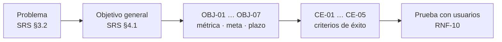

# US-01 · Definir visión, objetivos y criterios de éxito del MVP

| Campo | Valor |
| --- | --- |
| **Épica** | [E-01 Fundamentos del proyecto](https://app.notion.com/p/3efa4b89591481aa8a2bd295f7a69c9b) |
| **Prioridad (MoSCoW)** | Must |
| **Story Points** | 1 |
| **Sprint** | Sprint 1 (3-9 oct) |
| **Responsable** | Angel |
| **Revisor (D3)** | Kira |
| **Fecha compromiso** | 04/10/2026 |
| **Estado** | Done |
| **Ficha en Notion** | [User Story Backlog · US-01](https://app.notion.com/p/3efa4b89591481a6aa34eec3cd8ced61) |

## 🎯 Objetivo

> **Como** equipo del proyecto,
> **quiero** dejar por escrito el problema, el público, los objetivos medibles y los criterios de éxito,
> **para** que todas las decisiones posteriores (alcance, backlog, diseño) se evalúen contra una meta común.

## 🔗 Trazabilidad

| Artefacto | Referencia |
| --- | --- |
| SRS | SRS-01 · SRS §3 Necesidad · §4 Objetivo (OBJ-01 a OBJ-07, CE-01 a CE-05) |
| Objetivos del producto | OBJ-01 a OBJ-07 |
| Requisitos no funcionales | — |
| Pantallas / interfaz | — |
| Casos de uso | — |
| Entregable | [D01 - Project Scope & Vision](https://app.notion.com/p/3efa4b89591481fdb599c320134966f2) en la base de Deliverables |
| Actividad del PVG | 1.1 Antecedentes, objetivos del MVP y criterios de éxito en la hoja PVG general |
| Rama de GitHub | `feat/US-01-vision-objetivos` |
| Pull request | [liga] |
| Diseño en Figma | No aplica |
| Depende de | [US-02 Delimitar alcance, riesgos y supuestos del proyecto](./US-02-alcance-riesgos-supuestos.md) |
| Bloquea a | [US-03 Refinar y priorizar el backlog con MoSCoW](./US-03-backlog-moscow.md) |
| Prácticas CMMI-DEV v1.3 | PP SP 1.1 (alcance) · RD SP 1.1 (necesidades de stakeholders) · MA SP 1.1 (objetivos de medición) |

## ✅ Criterios de aceptación

| # | Criterio | Verificación / evidencia | Resultado |
| --- | --- | --- | --- |
| CA-01 | **Dado** el plan maestro, **cuando** se publique el documento, **entonces** contiene problema, público objetivo, objetivos con métrica y meta, y criterios de éxito observables. | Inspección del PLAN-MAESTRO-INE §1–§3 y SRS §4.2 / §4.4 | ✅ Cumple |
| CA-02 | **Dado** el documento, **cuando** lo revise el otro integrante, **entonces** queda aprobado sin no conformidades críticas. | Nota fechada en bitácora de defectos (revisor: Kira) | ✅ Cumple |

## 🧭 Diagrama

## 📋 Definition of Done aplicable

[READY-DONE](https://app.notion.com/p/3efa4b895914805c8f93e8d584df38a2) · EST-01: lista universal D1 a D7 + sección específica **C3 · Documento (sin texto de relleno, control de modificaciones actualizado, publicado en Notion / repo)**.

**Definition of Ready**

- [ ] R1 · Entregable identificable
- [ ] R2 · Criterios de aceptación Dado / Cuando / Entonces
- [ ] R3 · Dimensionada (AP), responsable y fecha planeada
- [ ] R4 · Dependencias disponibles hoy

**Definition of Done**

- [ ] D1 · Entregable existe y está terminado
- [ ] D2 · Todos los CA se cumplen (tabla de arriba con ✅)
- [ ] D3 · Revisado por Kira (PR o bitácora)
- [ ] D4 · Versionado y accesible
- [ ] D5 · Sin no conformidades críticas abiertas
- [ ] D6 · PVG actualizado (Toggl, fecha real)
- [ ] D7 · Sin datos personales ni credenciales

## 📝 Notas y decisiones

- Evidencia: PLAN-MAESTRO-INE (control de modificaciones #1 y #2, 04/10/2026) y SRS §3–§4.
- La dependencia con US-02 se conserva como está registrada en Notion; ambas se cerraron en paralelo (04–05/10).

---

| # | Autor | Modificación | Fecha |
| --- | --- | --- | --- |
| 1 | Angel | Creación del archivo a partir del User Story Backlog de Notion y SRS-01 | 06/10/2026 |
