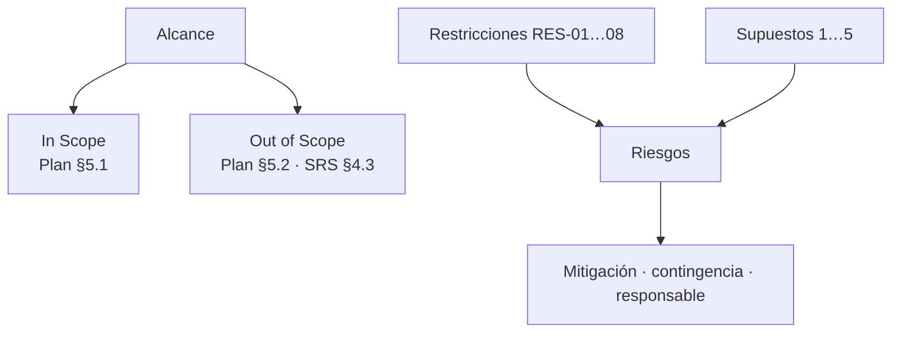

# US-02 · Delimitar alcance, riesgos y supuestos del proyecto

| Campo | Valor |
| --- | --- |
| **Épica** | [E-01 Fundamentos del proyecto](https://app.notion.com/p/3efa4b89591481aa8a2bd295f7a69c9b) |
| **Prioridad (MoSCoW)** | Must |
| **Story Points** | 1 |
| **Sprint** | Sprint 1 (3-9 oct) |
| **Responsable** | Kira |
| **Revisor (D3)** | Angel |
| **Fecha compromiso** | 05/10/2026 |
| **Estado** | Done |
| **Ficha en Notion** | [User Story Backlog · US-02](https://app.notion.com/p/3efa4b89591481968904cb91d92231ae) |

## 🎯 Objetivo

> **Como** equipo del proyecto,
> **quiero** delimitar qué entra y qué no entra en el MVP, junto con restricciones, supuestos y riesgos,
> **para** evitar el *scope creep* y anticipar lo que podría impedir la entrega del 31/10.

## 🔗 Trazabilidad

| Artefacto | Referencia |
| --- | --- |
| SRS | SRS-01 · SRS §1.2 · §2.5 Restricciones (RES-01 a RES-08) · §2.6 Supuestos · §4.3 Non-goals |
| Objetivos del producto | OBJ-07 |
| Requisitos no funcionales | RNF-13, RNF-15 |
| Pantallas / interfaz | — |
| Casos de uso | — |
| Entregable | [D01 - Project Scope & Vision](https://app.notion.com/p/3efa4b89591481fdb599c320134966f2) en la base de Deliverables |
| Actividad del PVG | 1.2 Alcance, riesgos, supuestos y plan de proyecto en la hoja PVG general |
| Rama de GitHub | `feat/US-02-alcance-riesgos-supuestos` |
| Pull request | [liga] |
| Diseño en Figma | No aplica |
| Depende de | — |
| Bloquea a | [US-01 Definir visión, objetivos y criterios de éxito del MVP](./US-01-vision-objetivos.md) [US-03 Refinar y priorizar el backlog con MoSCoW](./US-03-backlog-moscow.md) |
| Prácticas CMMI-DEV v1.3 | PP SP 1.1 (alcance) · PP SP 2.2 (riesgos del proyecto) · RSKM SP 2.1 / SP 3.1 (identificar y mitigar riesgos) |

## ✅ Criterios de aceptación

| # | Criterio | Verificación / evidencia | Resultado |
| --- | --- | --- | --- |
| CA-01 | **Dado** el alcance, **cuando** se publique, **entonces** existe lista explícita de *In Scope* y *Out of Scope*. | PLAN-MAESTRO-INE §5.1 / §5.2 | ✅ Cumple |
| CA-02 | **Dada** cada restricción y supuesto, **cuando** se documente, **entonces** tiene identificador y consecuencia declarada. | PLAN-MAESTRO-INE §6 (RES-xx) y §7 (impacto si no se cumple) | ✅ Cumple |
| CA-03 | **Dado** cada riesgo identificado, **cuando** se registre, **entonces** tiene plan de mitigación, contingencia y responsable de monitoreo. | Matriz de riesgos del proyecto | ✅ Cumple |

## 🧭 Diagrama

## 📋 Definition of Done aplicable

[READY-DONE](https://app.notion.com/p/3efa4b895914805c8f93e8d584df38a2) · EST-01: lista universal D1 a D7 + sección específica **C3 · Documento (sin texto de relleno, control de modificaciones actualizado, publicado en Notion / repo)**.

**Definition of Ready**

- [ ] R1 · Entregable identificable
- [ ] R2 · Criterios de aceptación Dado / Cuando / Entonces
- [ ] R3 · Dimensionada (AP), responsable y fecha planeada
- [ ] R4 · Dependencias disponibles hoy

**Definition of Done**

- [ ] D1 · Entregable existe y está terminado
- [ ] D2 · Todos los CA se cumplen (tabla de arriba con ✅)
- [ ] D3 · Revisado por Angel (PR o bitácora)
- [ ] D4 · Versionado y accesible
- [ ] D5 · Sin no conformidades críticas abiertas
- [ ] D6 · PVG actualizado (Toggl, fecha real)
- [ ] D7 · Sin datos personales ni credenciales

## 📝 Notas y decisiones

- Revisar que la matriz de riesgos (CA-03) esté enlazada desde D01; el SRS solo lista supuestos y restricciones.
- Se registra como bloqueante de US-01 para mantener la relación bidireccional que ya existe en Notion.

---

| # | Autor | Modificación | Fecha |
| --- | --- | --- | --- |
| 1 | Angel | Creación del archivo a partir del User Story Backlog de Notion y SRS-01 | 06/10/2026 |
