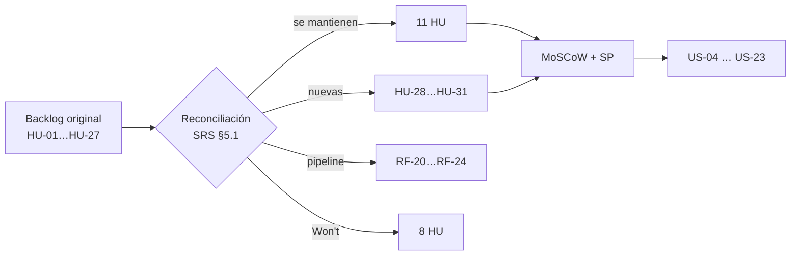

# US-03 · Refinar y priorizar el backlog con MoSCoW

| Campo | Valor |
| --- | --- |
| **Épica** | [E-01 Fundamentos del proyecto](https://app.notion.com/p/3efa4b89591481aa8a2bd295f7a69c9b) |
| **Prioridad (MoSCoW)** | Must |
| **Story Points** | 1 |
| **Sprint** | Sprint 1 (3-9 oct) |
| **Responsable** | Angel |
| **Revisor (D3)** | Kira |
| **Fecha compromiso** | 05/10/2026 |
| **Estado** | In Progress |
| **Ficha en Notion** | [User Story Backlog · US-03](https://app.notion.com/p/3efa4b895914819f86e1ffa326fc918d) |

## 🎯 Objetivo

> **Como** Product Owner,
> **quiero** que cada historia del SRS tenga una prioridad MoSCoW acordada y un esfuerzo estimado,
> **para** construir primero lo que hace demostrable el MVP sin exceder la capacidad de 4.5 h diarias.

## 🔗 Trazabilidad

| Artefacto | Referencia |
| --- | --- |
| SRS | SRS-01 · SRS §5.1 Reconciliación del backlog · §10 Tabla de prioridad |
| Objetivos del producto | OBJ-01 a OBJ-06 |
| Requisitos no funcionales | — |
| Pantallas / interfaz | — |
| Casos de uso | — |
| Entregable | [D02 - Backlog priorizado del MVP](https://app.notion.com/p/3efa4b89591481e0a953fd04ea8a7a8d) en la base de Deliverables |
| Actividad del PVG | 2.1 Refinamiento de historias de usuario y priorización MoSCoW en la hoja PVG general |
| Rama de GitHub | `feat/US-03-backlog-moscow` |
| Pull request | [liga] |
| Diseño en Figma | No aplica |
| Depende de | [US-01 Definir visión, objetivos y criterios de éxito del MVP](./US-01-vision-objetivos.md) [US-02 Delimitar alcance, riesgos y supuestos del proyecto](./US-02-alcance-riesgos-supuestos.md) |
| Bloquea a | [US-04 Diseñar la arquitectura de información y los wireframes](./US-04-arquitectura-wireframes.md) [US-05 Auditar las fuentes oficiales disponibles](./US-05-auditoria-fuentes.md) |
| Prácticas CMMI-DEV v1.3 | REQM SP 1.1 / 1.2 (entender y comprometer requisitos) · PP SP 1.4 (estimaciones) · REQM SP 1.4 (trazabilidad) |

## ✅ Criterios de aceptación

| # | Criterio | Verificación / evidencia | Resultado |
| --- | --- | --- | --- |
| CA-01 | **Dadas** las historias del SRS, **cuando** se priorice, **entonces** cada una tiene Must, Should, Could o Won't acordado por ambos. | SRS §10.2 + propiedad *Priority* en Notion | ⬜ Pendiente |
| CA-02 | **Dado** el resultado, **cuando** se revise, **entonces** ninguna historia Must depende de una Won't. | Grafo de dependencias de esta carpeta (README) sin aristas Must → Won't | ⬜ Pendiente |
| CA-03 | **Dado** el esfuerzo total, **cuando** se sume, **entonces** los Must no superan el presupuesto del PVG. | Suma de Story Points Must vs. capacidad en hoja PVG general | ⬜ Pendiente |

## 🧭 Diagrama

## 📋 Definition of Done aplicable

[READY-DONE](https://app.notion.com/p/3efa4b895914805c8f93e8d584df38a2) · EST-01: lista universal D1 a D7 + sección específica **C3 · Documento (sin texto de relleno, control de modificaciones actualizado, publicado en Notion / repo)**.

**Definition of Ready**

- [ ] R1 · Entregable identificable
- [ ] R2 · Criterios de aceptación Dado / Cuando / Entonces
- [ ] R3 · Dimensionada (AP), responsable y fecha planeada
- [ ] R4 · Dependencias disponibles hoy

**Definition of Done**

- [ ] D1 · Entregable existe y está terminado
- [ ] D2 · Todos los CA se cumplen (tabla de arriba con ✅)
- [ ] D3 · Revisado por Kira (PR o bitácora)
- [ ] D4 · Versionado y accesible
- [ ] D5 · Sin no conformidades críticas abiertas
- [ ] D6 · PVG actualizado (Toggl, fecha real)
- [ ] D7 · Sin datos personales ni credenciales

## 📝 Notas y decisiones

- **Hallazgos de priorización a resolver antes de cerrar (CA-01):**
- HU-18 es *Must* en SRS §10.2 pero vive en US-12 (*Should*).
- HU-02 es *Must* en el SRS pero US-14 es *Should*.
- HU-06 y HU-17 son *Should* en el SRS y sus historias (US-21, US-22) son *Could* sin capacidad.
- HU-29 (*Should*) y HU-11 (*Should*) están dentro de historias *Must* (US-11, US-15): aceptable, pero declararlo.
- No existe US-10 en el backlog: confirmar si se eliminó o se fusionó, para no dejar un hueco sin explicación.

---

| # | Autor | Modificación | Fecha |
| --- | --- | --- | --- |
| 1 | Angel | Creación del archivo a partir del User Story Backlog de Notion y SRS-01 | 06/10/2026 |
