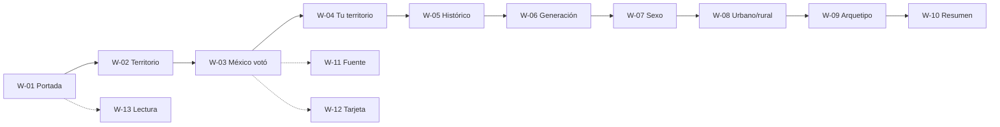

# US-04 · Diseñar la arquitectura de información y los wireframes

| Campo | Valor |
| --- | --- |
| **Épica** | [E-01 Fundamentos del proyecto](https://app.notion.com/p/3efa4b89591481aa8a2bd295f7a69c9b) |
| **Prioridad (MoSCoW)** | Must |
| **Story Points** | 1 |
| **Sprint** | Sprint 1 (3-9 oct) |
| **Responsable** | Angel |
| **Revisor (D3)** | Kira |
| **Fecha compromiso** | 06/10/2026 |
| **Estado** | Done |
| **Ficha en Notion** | [User Story Backlog · US-04](https://app.notion.com/p/3efa4b89591481ba990cf27f85095ca4) |

## 🎯 Objetivo

> **Como** equipo de diseño,
> **quiero** un mapa de navegación y wireframes lo-fi mobile-first de todo el recorrido,
> **para** construir las pantallas sin ambigüedad y verificar que cada historia Must tenga su lugar.

## 🔗 Trazabilidad

| Artefacto | Referencia |
| --- | --- |
| SRS | SRS-01 · SRS §9.1 RIU-01 a RIU-10 · §9.2 Mapa de navegación · §9.3 Estándares |
| Objetivos del producto | OBJ-01, OBJ-03, OBJ-06 |
| Requisitos no funcionales | RNF-07, RNF-08 |
| Pantallas / interfaz | W-01 a W-17 |
| Casos de uso | CU-01, CU-02 |
| Entregable | [D03 - Arquitectura de información y wireframes](https://app.notion.com/p/3efa4b89591481fda286f4d5c940ce57) en la base de Deliverables |
| Actividad del PVG | 2.2 Arquitectura de información y flujo de pantallas en la hoja PVG general |
| Rama de GitHub | `feat/US-04-arquitectura-wireframes` |
| Pull request | [liga] |
| Diseño en Figma | `design/wireframes/index.html` (lo-fi) · [frame de Figma pendiente] |
| Depende de | [US-03 Refinar y priorizar el backlog con MoSCoW](./US-03-backlog-moscow.md) |
| Bloquea a | [US-08 Levantar el esqueleto del proyecto y el despliegue continuo](./US-08-esqueleto-despliegue.md) [US-09 Construir el motor de secuencia de pantallas](./US-09-motor-secuencia.md) [US-13 Definir el sistema visual y las plantillas compartibles](./US-13-sistema-visual.md) [US-18 Redactar el guion narrativo y la propuesta de difusión](./US-18-guion-difusion.md) |
| Prácticas CMMI-DEV v1.3 | RD SP 3.1 (conceptos operativos) · TS SP 2.1 (diseño) · REQM SP 1.4 (matriz HU ↔ RIU ↔ W) · VER SP 2.2 (revisión por pares) |

## ✅ Criterios de aceptación

| # | Criterio | Verificación / evidencia | Resultado |
| --- | --- | --- | --- |
| CA-01 | **Dado** el flujo principal, **cuando** se publique, **entonces** existe mapa de navegación completo de portada a cierre. | `docs/diseno/arquitectura-informacion.md` §3 | ✅ Cumple |
| CA-02 | **Dadas** las historias Must, **cuando** se revisen los wireframes, **entonces** cada una tiene al menos una pantalla representada. | Matriz §5: 9 de 9 HU Must → W-xx | ✅ Cumple |
| CA-03 | **Dado** el enfoque mobile-first, **cuando** se diseñen, **entonces** parten de 360 px de ancho. | Marcos `.wf-frame` de 360 px verificados con Chromium | ✅ Cumple |

## 🧭 Diagrama

## 📋 Definition of Done aplicable

[READY-DONE](https://app.notion.com/p/3efa4b895914805c8f93e8d584df38a2) · EST-01: lista universal D1 a D7 + sección específica **C3 · Documento (sin texto de relleno, control de modificaciones actualizado, publicado en Notion / repo)**.

**Definition of Ready**

- [ ] R1 · Entregable identificable
- [ ] R2 · Criterios de aceptación Dado / Cuando / Entonces
- [ ] R3 · Dimensionada (AP), responsable y fecha planeada
- [ ] R4 · Dependencias disponibles hoy

**Definition of Done**

- [ ] D1 · Entregable existe y está terminado
- [ ] D2 · Todos los CA se cumplen (tabla de arriba con ✅)
- [ ] D3 · Revisado por Kira (PR o bitácora)
- [ ] D4 · Versionado y accesible
- [ ] D5 · Sin no conformidades críticas abiertas
- [ ] D6 · PVG actualizado (Toggl, fecha real)
- [ ] D7 · Sin datos personales ni credenciales

## 📝 Notas y decisiones

- Evidencia: `docs/diseno/arquitectura-informacion.md`, `docs/diseno/manual-de-diseno-wireframes.md`, `design/wireframes/index.html`.
- Decisiones D-01 (portada y selector cuentan en las 10 pantallas), D-02 (resumen = cierre) y D-03 (hojas inferiores no cuentan).
- Pendiente D3: registrar la revisión de Kira (VER SP 2.2) en la bitácora antes de considerar el DoD completo.

---

| # | Autor | Modificación | Fecha |
| --- | --- | --- | --- |
| 1 | Angel | Creación del archivo a partir del User Story Backlog de Notion y SRS-01 | 06/10/2026 |
