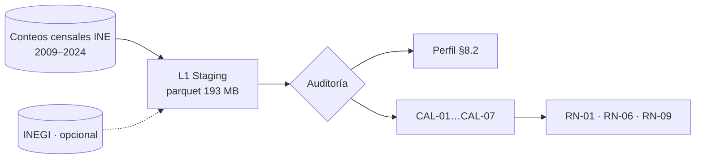

# US-05 · Auditar las fuentes oficiales disponibles

| Campo | Valor |
| --- | --- |
| **Épica** | [E-02 Plataforma de datos](https://app.notion.com/p/3efa4b8959148170be0fed4a2b4b80b2) |
| **Prioridad (MoSCoW)** | Must |
| **Story Points** | 1 |
| **Sprint** | Sprint 1 (3-9 oct) |
| **Responsable** | Kira |
| **Revisor (D3)** | Angel |
| **Fecha compromiso** | 08/10/2026 |
| **Estado** | In Progress |
| **Ficha en Notion** | [User Story Backlog · US-05](https://app.notion.com/p/3efa4b89591481499d19c69a0da3fb25) |

## 🎯 Objetivo

> **Como** equipo de datos,
> **quiero** conocer cobertura, granularidad, formato y calidad de cada fuente oficial,
> **para** decidir con evidencia qué indicadores son construibles y qué tratamiento necesita cada hallazgo.

## 🔗 Trazabilidad

| Artefacto | Referencia |
| --- | --- |
| SRS | SRS-01 · SRS §8.1 Capas L0–L4 · §8.2 Perfil de la fuente · §8.6 CAL-01 a CAL-07 · REF-01, REF-02 |
| Objetivos del producto | OBJ-02 |
| Requisitos no funcionales | RNF-14 |
| Pantallas / interfaz | — |
| Casos de uso | CU-09 |
| Entregable | [D04 - Inventario y auditoría de fuentes](https://app.notion.com/p/3efa4b895914814e9d9bf314fdad0cad) en la base de Deliverables |
| Actividad del PVG | 3.1 Fuentes abiertas del INE y verificación de calidad en la hoja PVG general |
| Rama de GitHub | `feat/US-05-auditoria-fuentes` |
| Pull request | [liga] |
| Diseño en Figma | No aplica |
| Depende de | [US-03 Refinar y priorizar el backlog con MoSCoW](./US-03-backlog-moscow.md) |
| Bloquea a | [US-06 Generar el dataset homologado y agregado del MVP](./US-06-dataset-homologado.md) [US-07 Publicar el diccionario de datos y las fuentes citadas](./US-07-diccionario-datos.md) |
| Prácticas CMMI-DEV v1.3 | RD SP 1.1 (obtener necesidades) · MA SP 1.3 (procedimientos de recolección) · RSKM SP 2.1 (riesgos de datos) |

## ✅ Criterios de aceptación

| # | Criterio | Verificación / evidencia | Resultado |
| --- | --- | --- | --- |
| CA-01 | **Dadas** las fuentes candidatas, **cuando** se documenten, **entonces** cada una tiene liga, cobertura, granularidad, formato y fecha de corte. | Inventario de fuentes en D04 (REF-01, REF-02) | ⬜ Pendiente |
| CA-02 | **Dado** el dataset consolidado, **cuando** se audite, **entonces** se registran volumen, esquema y hallazgos de calidad. | SRS §8.2: 54,872,712 filas · 18 columnas · 193 MB | ⬜ Pendiente |
| CA-03 | **Dada** cada limitación detectada, **cuando** se publique, **entonces** tiene tratamiento propuesto. | SRS §8.6: CAL-01…CAL-07 con regla asociada | ⬜ Pendiente |

## 🧭 Diagrama

## 📋 Definition of Done aplicable

[READY-DONE](https://app.notion.com/p/3efa4b895914805c8f93e8d584df38a2) · EST-01: lista universal D1 a D7 + sección específica **C3 · Documento (sin texto de relleno, control de modificaciones actualizado, publicado en Notion / repo)**.

**Definition of Ready**

- [ ] R1 · Entregable identificable
- [ ] R2 · Criterios de aceptación Dado / Cuando / Entonces
- [ ] R3 · Dimensionada (AP), responsable y fecha planeada
- [ ] R4 · Dependencias disponibles hoy

**Definition of Done**

- [ ] D1 · Entregable existe y está terminado
- [ ] D2 · Todos los CA se cumplen (tabla de arriba con ✅)
- [ ] D3 · Revisado por Angel (PR o bitácora)
- [ ] D4 · Versionado y accesible
- [ ] D5 · Sin no conformidades críticas abiertas
- [ ] D6 · PVG actualizado (Toggl, fecha real)
- [ ] D7 · Sin datos personales ni credenciales

## 📝 Notas y decisiones

- AP-03 (fórmula RN-01 dentro de ±1 pp) y AP-07 (catálogo de sexo) se cierran con esta auditoría; fecha compromiso 12/10.
- AP-04: decidir si se integra INEGI; si no, documentarlo como fuente descartada con su motivo.
- SRS §11 asigna el pipeline a Angel y Notion asigna esta historia a Kira: alinear responsable y revisor.

---

| # | Autor | Modificación | Fecha |
| --- | --- | --- | --- |
| 1 | Angel | Creación del archivo a partir del User Story Backlog de Notion y SRS-01 | 06/10/2026 |
