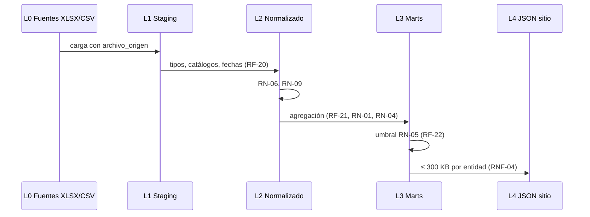

# US-06 · Generar el dataset homologado y agregado del MVP

| Campo | Valor |
| --- | --- |
| **Épica** | [E-02 Plataforma de datos](https://app.notion.com/p/3efa4b8959148170be0fed4a2b4b80b2) |
| **Prioridad (MoSCoW)** | Must |
| **Story Points** | 3 |
| **Sprint** | Sprint 1 (3-9 oct) |
| **Responsable** | Kira |
| **Revisor (D3)** | Angel |
| **Fecha compromiso** | 09/10/2026 |
| **Estado** | In progress |
| **Ficha en Notion** | [User Story Backlog · US-06](https://app.notion.com/p/3efa4b89591481ed81f2f75f4258a43c) |

## 🎯 Objetivo

> **Como** equipo de datos,
> **quiero** un pipeline reproducible que transforme las hojas de cálculo en un modelo normalizado y en agregados publicables,
> **para** que el sitio consuma cifras correctas, ligeras y sin riesgo de reidentificación.

## 🔗 Trazabilidad

| Artefacto | Referencia |
| --- | --- |
| SRS | SRS-01 · HU-19, HU-20, HU-21 → RF-20, RF-21, RF-22, RF-23 · RN-01, RN-02, RN-04, RN-05, RN-06, RN-09 · RI-01 a RI-09 |
| Objetivos del producto | OBJ-02 |
| Requisitos no funcionales | RNF-04, RNF-14, RNF-16 |
| Pantallas / interfaz | — |
| Casos de uso | CU-09, CU-10, CU-11 |
| Entregable | [D05 - Dataset procesado del MVP](https://app.notion.com/p/3efa4b895914819496f5d3387b0abc54) en la base de Deliverables |
| Actividad del PVG | 3.2 Limpieza y agregación de indicadores del MVP en la hoja PVG general |
| Rama de GitHub | `feat/US-06-dataset-pipeline` |
| Pull request | [liga] |
| Diseño en Figma | No aplica |
| Depende de | [US-05 Auditar las fuentes oficiales disponibles](./US-05-auditoria-fuentes.md) |
| Bloquea a | [US-07 Publicar el diccionario de datos y las fuentes citadas](./US-07-diccionario-datos.md) [US-11 Implementar las pantallas de cifras y comparativos](./US-11-pantallas-cifras.md) [US-22 Descargar los agregados en formato abierto](./US-22-descarga-datos-abiertos.md) [US-23 Comparar secciones urbanas y rurales](./US-23-urbano-rural.md) |
| Prácticas CMMI-DEV v1.3 | TS SP 3.1 (implementar) · VER SP 3.1 (verificar contra cifras oficiales) · CM SP 1.3 (artefactos versionados) · MA SP 2.1 |

## ✅ Criterios de aceptación

| # | Criterio | Verificación / evidencia | Resultado |
| --- | --- | --- | --- |
| CA-01 | **Dados** los archivos por entidad y año, **cuando** corra el pipeline, **entonces** produce un modelo normalizado con tipos correctos y catálogos separados. | Esquema L2 = SRS §8.5 (1 hecho + 6 catálogos), prueba automatizada | ⬜ Pendiente |
| CA-02 | **Dado** el indicador de participación, **cuando** se calcule, **entonces** usa SV / (LN − NS) conforme a RN-01. | Prueba unitaria sobre la tabla §8.2 (2024 = 59.7 %) | ⬜ Pendiente |
| CA-03 | **Dadas** las cifras generadas, **cuando** se comparen con las oficiales, **entonces** ninguna difiere más de 1 punto porcentual. | Reporte de validación RF-23 | ⬜ Pendiente |
| CA-04 | **Dados** los agregados por debajo del umbral, **cuando** se publiquen, **entonces** se elevan al nivel geográfico superior. | Prueba automatizada RF-22 / RN-05 | ⬜ Pendiente |
| CA-05 | **Dado** el pipeline, **cuando** se ejecute en una máquina limpia, **entonces** es reproducible con un solo comando. | RNF-16: ejecución en entorno limpio documentada | ⬜ Pendiente |

## 🧭 Diagrama

## 📋 Definition of Done aplicable

[READY-DONE](https://app.notion.com/p/3efa4b895914805c8f93e8d584df38a2) · EST-01: lista universal D1 a D7 + sección específica **C2 · Dataset (pipeline reproducible, reporte de validación y de calidad versionados)**.

**Definition of Ready**

- [ ] R1 · Entregable identificable
- [ ] R2 · Criterios de aceptación Dado / Cuando / Entonces
- [ ] R3 · Dimensionada (AP), responsable y fecha planeada
- [ ] R4 · Dependencias disponibles hoy

**Definition of Done**

- [ ] D1 · Entregable existe y está terminado
- [ ] D2 · Todos los CA se cumplen (tabla de arriba con ✅)
- [ ] D3 · Revisado por Angel (PR o bitácora)
- [ ] D4 · Versionado y accesible
- [ ] D5 · Sin no conformidades críticas abiertas
- [ ] D6 · PVG actualizado (Toggl, fecha real)
- [ ] D7 · Sin datos personales ni credenciales

## 📝 Notas y decisiones

- **Bloqueo DoR (R4):** el umbral de RN-05 no está fijado (AP-02, compromiso 12/10) y la historia vence el 09/10. Proponer mover a Sprint 2 o fijar un umbral provisional.
- 3 SP en un día al final del Sprint 1 con US-05 aún abierta: riesgo de SPI < 0.90 en el corte del 19/10.
- El reporte de validación (CU-11) debe bloquear la publicación si hay diferencias > 1 pp.

### Avance al 18/10/2026

- El pipeline completo y los JSON *frontend v2* viven en `feat/US-06-dataset-pipeline`; el PR a `develop` está abierto y todavía no se fusiona.
- Mientras `exportar.py` (L3 → L4) no esté listo, `apps/pipeline/revoto_pipeline/convertir_v2.py` (rama `feat/US-11-adaptadores-datos`) convierte esa salida v2 al contrato L4. Ver ADR-0005 y DIS v0.4 §4.7.
- Al fusionar este PR: los archivos v2 no deben quedar dentro de `apps/web/public/data/` (solo publica el contrato L4 y `npm run check:data` fallaría) y `convertir_v2.py` debe integrarse como último paso del pipeline.
- Pendiente: RF-23 (`cifras_oficiales.csv` sin filas, `max_diferencia_pp = null`) y desglose de edad y sexo por municipio.

---

| # | Autor | Modificación | Fecha |
| --- | --- | --- | --- |
| 1 | Angel | Creación del archivo a partir del User Story Backlog de Notion y SRS-01 | 06/10/2026 |
| 2 | Angel | Avance de implementación, rama y pendientes | 18/10/2026 |
