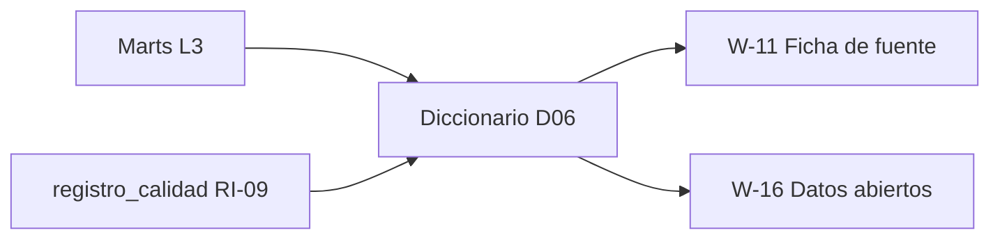

# US-07 · Publicar el diccionario de datos y las fuentes citadas

| Campo | Valor |
| --- | --- |
| **Épica** | [E-02 Plataforma de datos](https://app.notion.com/p/3efa4b8959148170be0fed4a2b4b80b2) |
| **Prioridad (MoSCoW)** | Must |
| **Story Points** | 1 |
| **Sprint** | Sprint 2 (10-16 oct) |
| **Responsable** | Kira |
| **Revisor (D3)** | Angel |
| **Fecha compromiso** | 10/10/2026 |
| **Estado** | Not started |
| **Ficha en Notion** | [User Story Backlog · US-07](https://app.notion.com/p/3efa4b89591481519731f74a75d3674a) |

## 🎯 Objetivo

> **Como** investigador o periodista,
> **quiero** un diccionario con la definición, fórmula y fuente de cada indicador,
> **para** verificar y citar las cifras con precisión.

## 🔗 Trazabilidad

| Artefacto | Referencia |
| --- | --- |
| SRS | SRS-01 · SRS §8.4 Atributos · §8.6 Reglas de calidad · RF-24 · RN-01, RN-10 |
| Objetivos del producto | OBJ-02, OBJ-04 |
| Requisitos no funcionales | RNF-18 |
| Pantallas / interfaz | RIU-06, RIU-09 |
| Casos de uso | CU-05 |
| Entregable | [D06 - Diccionario de datos y fuentes](https://app.notion.com/p/3efa4b89591481539745eca2dfdbdc7b) en la base de Deliverables |
| Actividad del PVG | 3.3 Diccionario de datos y fuentes citadas en la hoja PVG general |
| Rama de GitHub | `feat/US-07-diccionario-datos` |
| Pull request | [liga] |
| Diseño en Figma | No aplica |
| Depende de | [US-05 Auditar las fuentes oficiales disponibles](./US-05-auditoria-fuentes.md) [US-06 Generar el dataset homologado y agregado del MVP](./US-06-dataset-homologado.md) |
| Bloquea a | [US-12 Implementar el arquetipo cívico y la ficha de fuente](./US-12-arquetipo-ficha-fuente.md) [US-22 Descargar los agregados en formato abierto](./US-22-descarga-datos-abiertos.md) |
| Prácticas CMMI-DEV v1.3 | MA SP 1.2 (especificar medidas) · MA SP 2.4 (comunicar resultados) · OPD SP 1.6 (repositorio de activos) |

## ✅ Criterios de aceptación

| # | Criterio | Verificación / evidencia | Resultado |
| --- | --- | --- | --- |
| CA-01 | **Dado** cada indicador del MVP, **cuando** se consulte el diccionario, **entonces** tiene definición, fórmula, unidad, cobertura, fuente y fecha de corte. | Inspección del diccionario D06 | ⬜ Pendiente |
| CA-02 | **Dadas** las reglas de calidad aplicadas, **cuando** se documenten, **entonces** se indica cuántos registros afectó cada una. | Reporte de calidad RF-24 (CAL-01…CAL-07) | ⬜ Pendiente |
| CA-03 | **Dado** el porcentaje de registros sin dato, **cuando** se publique, **entonces** aparece por elección. | Tabla SRS §8.2 columna «% sin dato» | ⬜ Pendiente |

## 🧭 Diagrama

## 📋 Definition of Done aplicable

[READY-DONE](https://app.notion.com/p/3efa4b895914805c8f93e8d584df38a2) · EST-01: lista universal D1 a D7 + sección específica **C3 · Documento (sin texto de relleno, control de modificaciones actualizado, publicado en Notion / repo)**.

**Definition of Ready**

- [ ] R1 · Entregable identificable
- [ ] R2 · Criterios de aceptación Dado / Cuando / Entonces
- [ ] R3 · Dimensionada (AP), responsable y fecha planeada
- [ ] R4 · Dependencias disponibles hoy

**Definition of Done**

- [ ] D1 · Entregable existe y está terminado
- [ ] D2 · Todos los CA se cumplen (tabla de arriba con ✅)
- [ ] D3 · Revisado por Angel (PR o bitácora)
- [ ] D4 · Versionado y accesible
- [ ] D5 · Sin no conformidades críticas abiertas
- [ ] D6 · PVG actualizado (Toggl, fecha real)
- [ ] D7 · Sin datos personales ni credenciales

## 📝 Notas y decisiones

- El diccionario es insumo directo de la ficha de fuente (US-12) y de los datos abiertos (US-22): mismo texto, una sola fuente de verdad.

---

| # | Autor | Modificación | Fecha |
| --- | --- | --- | --- |
| 1 | Angel | Creación del archivo a partir del User Story Backlog de Notion y SRS-01 | 06/10/2026 |
