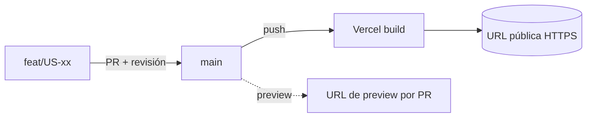

# US-08 · Levantar el esqueleto del proyecto y el despliegue continuo

| Campo | Valor |
| --- | --- |
| **Épica** | [E-03 Experiencia narrativa](https://app.notion.com/p/3efa4b89591481b68f41f2f07d9e03b2) |
| **Prioridad (MoSCoW)** | Must |
| **Story Points** | 1 |
| **Sprint** | Sprint 2 (10-16 oct) |
| **Responsable** | Angel |
| **Revisor (D3)** | Kira |
| **Fecha compromiso** | 10/10/2026 |
| **Estado** | Not started |
| **Ficha en Notion** | [User Story Backlog · US-08](https://app.notion.com/p/3efa4b89591481da9685dda91a72998c) |

## 🎯 Objetivo

> **Como** equipo de desarrollo,
> **quiero** un repositorio con estructura base que se publique solo al hacer push a la rama principal,
> **para** integrar y mostrar avances desde el primer día sin depender de despliegues manuales.

## 🔗 Trazabilidad

| Artefacto | Referencia |
| --- | --- |
| SRS | SRS-01 · RNF-05, RNF-11, RNF-17 · RIE-03 (Vercel) |
| Objetivos del producto | OBJ-03 |
| Requisitos no funcionales | RNF-05, RNF-06, RNF-11, RNF-17 |
| Pantallas / interfaz | — |
| Casos de uso | — |
| Entregable | [D08 - MVP web desplegado](https://app.notion.com/p/3efa4b8959148179bc29da7e92155fc9) en la base de Deliverables |
| Actividad del PVG | 4.1 Esqueleto del proyecto y despliegue continuo en la hoja PVG general |
| Rama de GitHub | `feat/US-08-esqueleto-despliegue` |
| Pull request | [liga] |
| Diseño en Figma | No aplica |
| Depende de | [US-04 Diseñar la arquitectura de información y los wireframes](./US-04-arquitectura-wireframes.md) |
| Bloquea a | [US-09 Construir el motor de secuencia de pantallas](./US-09-motor-secuencia.md) |
| Prácticas CMMI-DEV v1.3 | CM SP 1.1 / 1.2 (elementos y sistema de configuración) · TS SP 2.4 (decisiones de reutilización) · PI SP 1.2 (entorno de integración) |

## ✅ Criterios de aceptación

| # | Criterio | Verificación / evidencia | Resultado |
| --- | --- | --- | --- |
| CA-01 | **Dado** el repositorio, **cuando** se haga push a la rama principal, **entonces** el sitio se publica automáticamente en una URL accesible. | Log de despliegue en Vercel enlazado al commit | ⬜ Pendiente |
| CA-02 | **Dada** la URL, **cuando** se abra desde un dispositivo externo, **entonces** carga sin errores de consola. | Captura de consola en Motorola G82 / iPhone 17 Pro Max | ⬜ Pendiente |
| CA-03 | **Dado** el sitio, **cuando** se inspeccione, **entonces** se sirve por HTTPS sin contenido mixto. | Inspección de red: 0 recursos HTTP | ⬜ Pendiente |

## 🧭 Diagrama

## 📋 Definition of Done aplicable

[READY-DONE](https://app.notion.com/p/3efa4b895914805c8f93e8d584df38a2) · EST-01: lista universal D1 a D7 + sección específica **C1 · Historia implementada (código en `main` vía PR aprobado, desplegado en Vercel, probado en 360 px)**.

**Definition of Ready**

- [ ] R1 · Entregable identificable
- [ ] R2 · Criterios de aceptación Dado / Cuando / Entonces
- [ ] R3 · Dimensionada (AP), responsable y fecha planeada
- [ ] R4 · Dependencias disponibles hoy

**Definition of Done**

- [ ] D1 · Entregable existe y está terminado
- [ ] D2 · Todos los CA se cumplen (tabla de arriba con ✅)
- [ ] D3 · Revisado por Kira (PR o bitácora)
- [ ] D4 · Versionado y accesible
- [ ] D5 · Sin no conformidades críticas abiertas
- [ ] D6 · PVG actualizado (Toggl, fecha real)
- [ ] D7 · Sin datos personales ni credenciales

## 📝 Notas y decisiones

- Definir aquí la protección de `main` (PR obligatorio + 1 aprobación) para que D3 del DoD sea verificable en todo el proyecto.
- Si Vercel falla, RIE-03 prevé una alternativa estática gratuita equivalente.

---

| # | Autor | Modificación | Fecha |
| --- | --- | --- | --- |
| 1 | Angel | Creación del archivo a partir del User Story Backlog de Notion y SRS-01 | 06/10/2026 |
