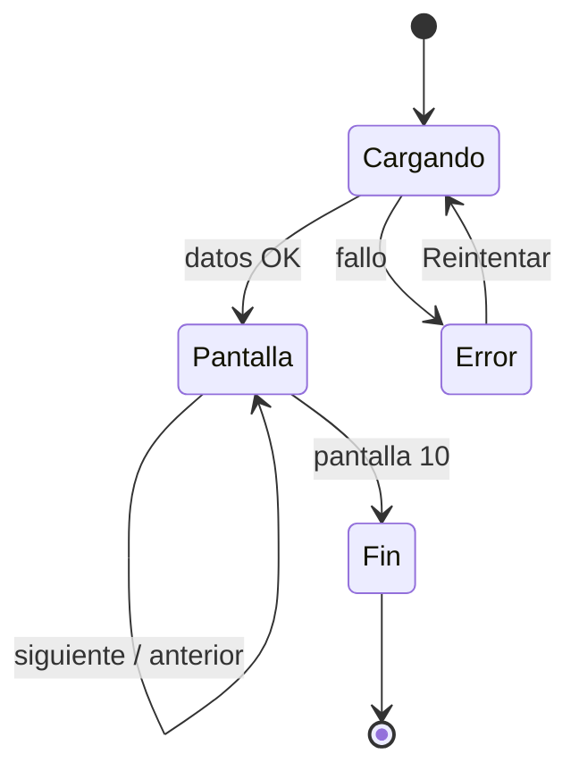

# US-09 · Construir el motor de secuencia de pantallas

| Campo | Valor |
| --- | --- |
| **Épica** | [E-03 Experiencia narrativa](https://app.notion.com/p/3efa4b89591481b68f41f2f07d9e03b2) |
| **Prioridad (MoSCoW)** | Must |
| **Story Points** | 5 |
| **Sprint** | Sprint 2 (10-16 oct) |
| **Responsable** | Angel |
| **Revisor (D3)** | Kira |
| **Fecha compromiso** | 15/10/2026 |
| **Estado** | Not started |
| **Ficha en Notion** | [User Story Backlog · US-09](https://app.notion.com/p/3efa4b895914818795c8df064a5a5285) |

## 🎯 Objetivo

> **Como** ciudadano o ciudadana,
> **quiero** avanzar por una secuencia de pantallas con una idea cada una,
> **para** entender la información sin tener que interpretar una tabla o un tablero.

## 🔗 Trazabilidad

| Artefacto | Referencia |
| --- | --- |
| SRS | SRS-01 · HU-31 → RF-01, RF-02, RF-03 · HU-31 ALT-01 |
| Objetivos del producto | OBJ-01, OBJ-03 |
| Requisitos no funcionales | RNF-03, RNF-09 |
| Pantallas / interfaz | RIU-01, RIU-03 · W-01, W-03…W-10, W-17 |
| Casos de uso | CU-01 |
| Entregable | [D08 - MVP web desplegado](https://app.notion.com/p/3efa4b8959148179bc29da7e92155fc9) en la base de Deliverables |
| Actividad del PVG | 4.2 Motor de secuencia de pantallas (stories) en la hoja PVG general |
| Rama de GitHub | `feat/US-09-motor-secuencia` |
| Pull request | [liga] |
| Diseño en Figma | [liga al frame W-03 Pantalla narrativa] |
| Depende de | [US-04 Diseñar la arquitectura de información y los wireframes](./US-04-arquitectura-wireframes.md) [US-08 Levantar el esqueleto del proyecto y el despliegue continuo](./US-08-esqueleto-despliegue.md) |
| Bloquea a | [US-11 Implementar las pantallas de cifras y comparativos](./US-11-pantallas-cifras.md) [US-15 Implementar accesibilidad, lectura fácil y versión ligera](./US-15-accesibilidad-version-ligera.md) [US-21 Ver el resumen de cifras en una sola vista](./US-21-resumen-cifras.md) |
| Prácticas CMMI-DEV v1.3 | TS SP 3.1 (implementar diseño) · PI SP 3.1 (confirmar componentes listos) · VER SP 3.2 (verificar productos) |

## ✅ Criterios de aceptación

| # | Criterio | Verificación / evidencia | Resultado |
| --- | --- | --- | --- |
| CA-01 | **Dado** que abro el sitio, **cuando** carga la primera pantalla, **entonces** veo una sola idea principal, su cifra y un control visible para avanzar. | Prueba manual en 360 px | ⬜ Pendiente |
| CA-02 | **Dado** que estoy en cualquier pantalla, **cuando** deslizo, presiono el control o uso las flechas, **entonces** avanzo o retrocedo una pantalla. | Prueba con gesto, botón y teclado (← →) | ⬜ Pendiente |
| CA-03 | **Dado** el recorrido completo, **cuando** llegue al final, **entonces** no supera 10 pantallas. | Conteo en configuración de la narrativa (RF-01) | ⬜ Pendiente |
| CA-04 | **Dado** que avanzo, **cuando** cambia la pantalla, **entonces** el indicador de progreso refleja mi posición. | Inspección del indicador «N de 10» | ⬜ Pendiente |
| CA-05 | **Dado** un fallo de carga, **cuando** ocurra, **entonces** se muestra el motivo y un control para reintentar. | Simulación de red caída → W-17 Error | ⬜ Pendiente |

## 🧭 Diagrama

## 📋 Definition of Done aplicable

[READY-DONE](https://app.notion.com/p/3efa4b895914805c8f93e8d584df38a2) · EST-01: lista universal D1 a D7 + sección específica **C1 · Historia implementada (código en `main` vía PR aprobado, desplegado en Vercel, probado en 360 px)**.

**Definition of Ready**

- [ ] R1 · Entregable identificable
- [ ] R2 · Criterios de aceptación Dado / Cuando / Entonces
- [ ] R3 · Dimensionada (AP), responsable y fecha planeada
- [ ] R4 · Dependencias disponibles hoy

**Definition of Done**

- [ ] D1 · Entregable existe y está terminado
- [ ] D2 · Todos los CA se cumplen (tabla de arriba con ✅)
- [ ] D3 · Revisado por Kira (PR o bitácora)
- [ ] D4 · Versionado y accesible
- [ ] D5 · Sin no conformidades críticas abiertas
- [ ] D6 · PVG actualizado (Toggl, fecha real)
- [ ] D7 · Sin datos personales ni credenciales

## 📝 Notas y decisiones

- El cambio entre pantallas debe medir ≤ 300 ms (RNF-03).
- Si W-07, W-08 o W-09 salen del MVP, la barra de progreso se recalcula (degradación prevista en US-04).

---

| # | Autor | Modificación | Fecha |
| --- | --- | --- | --- |
| 1 | Angel | Creación del archivo a partir del User Story Backlog de Notion y SRS-01 | 06/10/2026 |
