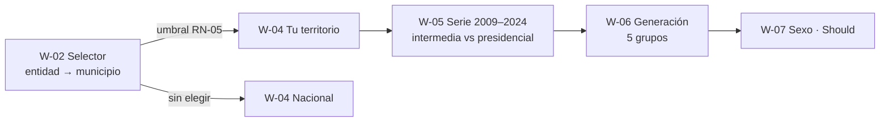

# US-11 · Implementar las pantallas de cifras y comparativos

| Campo | Valor |
| --- | --- |
| **Épica** | [E-03 Experiencia narrativa](https://app.notion.com/p/3efa4b89591481b68f41f2f07d9e03b2) |
| **Prioridad (MoSCoW)** | Must |
| **Story Points** | 3 |
| **Sprint** | Sprint 3 (17-23 oct) |
| **Responsable** | Angel |
| **Revisor (D3)** | Kira |
| **Fecha compromiso** | 18/10/2026 |
| **Estado** | Not started |
| **Ficha en Notion** | [User Story Backlog · US-11](https://app.notion.com/p/3efa4b89591481969af3c9c48f8952fc) |

## 🎯 Objetivo

> **Como** ciudadano o ciudadana,
> **quiero** elegir mi territorio y ver su participación en el tiempo, por generación y por sexo junto al promedio nacional,
> **para** entender cómo participa el lugar donde vivo comparado con el país.

## 🔗 Trazabilidad

| Artefacto | Referencia |
| --- | --- |
| SRS | SRS-01 · HU-28, HU-07, HU-01, HU-29 → RF-05, RF-06, RF-07, RF-08, RF-09 · RN-01, RN-02, RN-03, RN-04, RN-05, RN-06, RN-10 |
| Objetivos del producto | OBJ-01, OBJ-02 |
| Requisitos no funcionales | RNF-04, RNF-10 |
| Pantallas / interfaz | RIU-02, RIU-04, RIU-05 · W-02, W-04, W-05, W-06, W-07, W-17 |
| Casos de uso | CU-02, CU-03, CU-04 |
| Entregable | [D09 - Visualizaciones y comparativos del MVP](https://app.notion.com/p/3efa4b89591481e68928d9c13625489a) en la base de Deliverables |
| Actividad del PVG | 4.3 Pantallas de cifras nacionales y comparativo por estado en la hoja PVG general |
| Rama de GitHub | `feat/US-11-pantallas-cifras` |
| Pull request | [liga] |
| Diseño en Figma | [liga a frames W-02, W-04 a W-07] |
| Depende de | [US-06 Generar el dataset homologado y agregado del MVP](./US-06-dataset-homologado.md) [US-09 Construir el motor de secuencia de pantallas](./US-09-motor-secuencia.md) |
| Bloquea a | [US-12 Implementar el arquetipo cívico y la ficha de fuente](./US-12-arquetipo-ficha-fuente.md) [US-14 Generar y descargar la tarjeta compartible](./US-14-tarjeta-compartible.md) [US-16 Ejecutar las pruebas funcionales y la auditoría de accesibilidad](./US-16-pruebas-funcionales-accesibilidad.md) [US-18 Redactar el guion narrativo y la propuesta de difusión](./US-18-guion-difusion.md) [US-21 Ver el resumen de cifras en una sola vista](./US-21-resumen-cifras.md) [US-23 Comparar secciones urbanas y rurales](./US-23-urbano-rural.md) |
| Prácticas CMMI-DEV v1.3 | TS SP 3.1 · REQM SP 1.4 (HU-28/07/01/29 → pantalla) · VER SP 3.1 (CA ejecutados) |

## ✅ Criterios de aceptación

| # | Criterio | Verificación / evidencia | Resultado |
| --- | --- | --- | --- |
| CA-01 | **Dado** el selector territorial, **cuando** elija una entidad, **entonces** la lista de municipios se limita a los de esa entidad. | Prueba RF-06 con 3 entidades | ⬜ Pendiente |
| CA-02 | **Dado** un territorio elegido, **cuando** avance, **entonces** todas las pantallas muestran sus cifras junto al promedio nacional. | Recorrido W-04 a W-07 | ⬜ Pendiente |
| CA-03 | **Dada** la serie histórica, **cuando** se presente, **entonces** incluye las seis elecciones de 2009 a 2024 y distingue intermedias de presidenciales. | Inspección W-05 (RN-03) | ⬜ Pendiente |
| CA-04 | **Dada** la pantalla generacional, **cuando** se presente, **entonces** muestra los grupos 18-24, 25-34, 35-44, 45-59 y 60 o más. | Inspección W-06 (RN-04) | ⬜ Pendiente |
| CA-05 | **Dada** cualquier cifra, **cuando** se muestre, **entonces** va acompañada de su territorio y su periodo. | Checklist RN-10 por pantalla | ⬜ Pendiente |

## 🧭 Diagrama

## 📋 Definition of Done aplicable

[READY-DONE](https://app.notion.com/p/3efa4b895914805c8f93e8d584df38a2) · EST-01: lista universal D1 a D7 + sección específica **C1 · Historia implementada (código en `main` vía PR aprobado, desplegado en Vercel, probado en 360 px)**.

**Definition of Ready**

- [ ] R1 · Entregable identificable
- [ ] R2 · Criterios de aceptación Dado / Cuando / Entonces
- [ ] R3 · Dimensionada (AP), responsable y fecha planeada
- [ ] R4 · Dependencias disponibles hoy

**Definition of Done**

- [ ] D1 · Entregable existe y está terminado
- [ ] D2 · Todos los CA se cumplen (tabla de arriba con ✅)
- [ ] D3 · Revisado por Kira (PR o bitácora)
- [ ] D4 · Versionado y accesible
- [ ] D5 · Sin no conformidades críticas abiertas
- [ ] D6 · PVG actualizado (Toggl, fecha real)
- [ ] D7 · Sin datos personales ni credenciales

## 📝 Notas y decisiones

- HU-28 CA-03 (continuar sin elegir), CA-04 (umbral) y ALT-01 (periodo faltante) deben probarse aunque no estén en la lista de CA de esta US.
- HU-29 es *Should* en el SRS; si se degrada (SRS §10.3), CA de sexo sale de esta historia sin afectar el resto.
- Texto de apoyo sin juicio sobre grupos de edad (HU-01 CA-03, RNF-15).

---

| # | Autor | Modificación | Fecha |
| --- | --- | --- | --- |
| 1 | Angel | Creación del archivo a partir del User Story Backlog de Notion y SRS-01 | 06/10/2026 |
