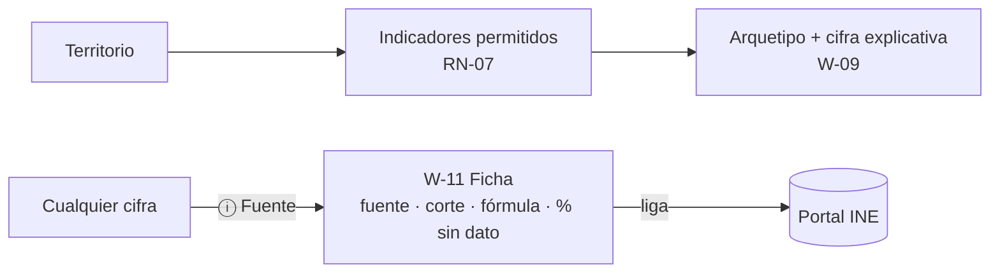

# US-12 · Implementar el arquetipo cívico y la ficha de fuente

| Campo | Valor |
| --- | --- |
| **Épica** | [E-03 Experiencia narrativa](https://app.notion.com/p/3efa4b89591481b68f41f2f07d9e03b2) |
| **Prioridad (MoSCoW)** | Should |
| **Story Points** | 1 |
| **Sprint** | Sprint 3 (17-23 oct) |
| **Responsable** | Angel |
| **Revisor (D3)** | Kira |
| **Fecha compromiso** | 19/10/2026 |
| **Estado** | In progress |
| **Ficha en Notion** | [User Story Backlog · US-12](https://app.notion.com/p/3efa4b89591481219636dc0d83087dc3) |

## 🎯 Objetivo

> **Como** persona que consulta una cifra,
> **quiero** recibir un arquetipo de mi zona y poder abrir la fuente de cada dato,
> **para** tener algo memorable que compartir y, a la vez, poder verificarlo.

## 🔗 Trazabilidad

| Artefacto | Referencia |
| --- | --- |
| SRS | SRS-01 · HU-03 → RF-11 · HU-18 → RF-12, RF-13 · RN-07, RN-10 |
| Objetivos del producto | OBJ-01, OBJ-04, OBJ-05 |
| Requisitos no funcionales | RNF-15 |
| Pantallas / interfaz | RIU-06 · W-09, W-11 |
| Casos de uso | CU-05 |
| Entregable | [D09 - Visualizaciones y comparativos del MVP](https://app.notion.com/p/3efa4b89591481e68928d9c13625489a) en la base de Deliverables |
| Actividad del PVG | 4.4 Arquetipo cívico por zona y sección de fuentes en la hoja PVG general |
| Rama de GitHub | `feat/US-11-adaptadores-datos` |
| Pull request | [liga] |
| Diseño en Figma | [liga a frames W-09 y W-11] |
| Depende de | [US-07 Publicar el diccionario de datos y las fuentes citadas](./US-07-diccionario-datos.md) [US-11 Implementar las pantallas de cifras y comparativos](./US-11-pantallas-cifras.md) |
| Bloquea a | [US-14 Generar y descargar la tarjeta compartible](./US-14-tarjeta-compartible.md) [US-16 Ejecutar las pruebas funcionales y la auditoría de accesibilidad](./US-16-pruebas-funcionales-accesibilidad.md) |
| Prácticas CMMI-DEV v1.3 | TS SP 3.1 · RD SP 3.5 (validar requisitos de neutralidad) · PPQA SP 1.2 (revisión editorial RNF-15) |

## ✅ Criterios de aceptación

| # | Criterio | Verificación / evidencia | Resultado |
| --- | --- | --- | --- |
| CA-01 | **Dado** un territorio seleccionado, **cuando** llegue a la pantalla de arquetipo, **entonces** recibo uno calculado solo con métricas de participación, variación histórica o composición etaria. | Revisión de reglas contra RN-07 | ⬜ Pendiente |
| CA-02 | **Dado** el arquetipo, **cuando** lo lea, **entonces** el texto explica con qué cifra se calculó. | Inspección W-09 | ⬜ Pendiente |
| CA-03 | **Dado** cualquier arquetipo, **cuando** se revise, **entonces** no alude a partidos ni emite juicio sobre los habitantes. | Revisión por pares POL-01 (RNF-15) | ⬜ Pendiente |
| CA-04 | **Dada** cualquier cifra del sitio, **cuando** presione Fuente, **entonces** veo fuente, periodo, fecha de corte, fórmula y liga al portal oficial. | Prueba W-11 desde W-03…W-09 | ⬜ Pendiente |

## 🧭 Diagrama

## 📋 Definition of Done aplicable

[READY-DONE](https://app.notion.com/p/3efa4b895914805c8f93e8d584df38a2) · EST-01: lista universal D1 a D7 + sección específica **C1 · Historia implementada (código en `main` vía PR aprobado, desplegado en Vercel, probado en 360 px)**.

**Definition of Ready**

- [ ] R1 · Entregable identificable
- [ ] R2 · Criterios de aceptación Dado / Cuando / Entonces
- [ ] R3 · Dimensionada (AP), responsable y fecha planeada
- [ ] R4 · Dependencias disponibles hoy

**Definition of Done**

- [ ] D1 · Entregable existe y está terminado
- [ ] D2 · Todos los CA se cumplen (tabla de arriba con ✅)
- [ ] D3 · Revisado por Kira (PR o bitácora)
- [ ] D4 · Versionado y accesible
- [ ] D5 · Sin no conformidades críticas abiertas
- [ ] D6 · PVG actualizado (Toggl, fecha real)
- [ ] D7 · Sin datos personales ni credenciales

## 📝 Notas y decisiones

- **Inconsistencia de prioridad:** HU-18 (fuente) es *Must* en el SRS y CE-03 depende de ella; esta US es *Should*. Recomendación: separar la ficha de fuente en su propia US *Must* o subir esta a *Must*.
- AP-05 (catálogo de arquetipos y umbrales, 17/10) es dependencia DoR R4.
- Por SRS, HU-18 pertenece a la épica E-08 Transparencia; aquí está en E-03.

### Avance al 18/10/2026

- El arquetipo de cada municipio sale de `apps/pipeline/insumos/arquetipos_municipales.csv` y viaja en `municipio/<ent>-<mun>.json`; es `null` con menos de 5 elecciones o si el municipio está suprimido (RN-05).
- Solo usa participación y variación histórica (RN-07).
- Pendiente: revisar el texto de W-11 (ficha de fuente) contra RN-10.

---

| # | Autor | Modificación | Fecha |
| --- | --- | --- | --- |
| 1 | Angel | Creación del archivo a partir del User Story Backlog de Notion y SRS-01 | 06/10/2026 |
| 2 | Angel | Avance de implementación, rama y pendientes | 18/10/2026 |
