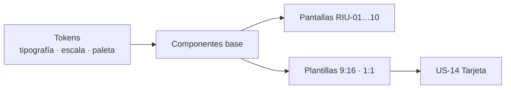

# US-13 · Definir el sistema visual y las plantillas compartibles

| Campo | Valor |
| --- | --- |
| **Épica** | [E-04 Diseño y piezas compartibles](https://app.notion.com/p/3efa4b89591481e2aed4d580dd039ef6) |
| **Prioridad (MoSCoW)** | Should |
| **Story Points** | 3 |
| **Sprint** | Sprint 2 (10-16 oct) |
| **Responsable** | Kira |
| **Revisor (D3)** | Angel |
| **Fecha compromiso** | 16/10/2026 |
| **Estado** | Not started |
| **Ficha en Notion** | [User Story Backlog · US-13](https://app.notion.com/p/3efa4b89591481d4832cc4f57ef2d280) |

## 🎯 Objetivo

> **Como** equipo de diseño,
> **quiero** un sistema visual con tipografía, paleta, componentes y plantillas 9:16 y 1:1,
> **para** que todas las pantallas y tarjetas sean consistentes, legibles y accesibles.

## 🔗 Trazabilidad

| Artefacto | Referencia |
| --- | --- |
| SRS | SRS-01 · RIU-01 a RIU-10 · SRS §9.3 Estándares de interfaz |
| Objetivos del producto | OBJ-05, OBJ-06 |
| Requisitos no funcionales | RNF-07, RNF-08 |
| Pantallas / interfaz | RIU-01 a RIU-10 |
| Casos de uso | — |
| Entregable | [D07 - Sistema visual y plantillas compartibles](https://app.notion.com/p/3efa4b89591481d59956c9105108116c) en la base de Deliverables |
| Actividad del PVG | 2.3 Diseño visual: sistema de estilos y tarjetas compartibles en la hoja PVG general |
| Rama de GitHub | `feat/US-13-sistema-visual` |
| Pull request | [liga] |
| Diseño en Figma | [liga al archivo de Figma: Design System + plantillas] |
| Depende de | [US-04 Diseñar la arquitectura de información y los wireframes](./US-04-arquitectura-wireframes.md) |
| Bloquea a | [US-14 Generar y descargar la tarjeta compartible](./US-14-tarjeta-compartible.md) [US-15 Implementar accesibilidad, lectura fácil y versión ligera](./US-15-accesibilidad-version-ligera.md) |
| Prácticas CMMI-DEV v1.3 | TS SP 2.1 (diseñar) · TS SP 2.3 (interfaces) · OPD SP 1.6 (activo reutilizable) |

## ✅ Criterios de aceptación

| # | Criterio | Verificación / evidencia | Resultado |
| --- | --- | --- | --- |
| CA-01 | **Dado** el sistema visual, **cuando** se publique en Figma, **entonces** define tipografía, escala, paleta y componentes base. | Inspección del archivo de Figma | ⬜ Pendiente |
| CA-02 | **Dado** el contraste, **cuando** se mida, **entonces** cumple 4.5:1 en texto normal y 3:1 en texto grande y gráficos. | Herramienta de contraste (RNF-08) | ⬜ Pendiente |
| CA-03 | **Dadas** las plantillas, **cuando** se entreguen, **entonces** existen en 9:16 y 1:1 y son reutilizables. | Componentes de Figma con variantes | ⬜ Pendiente |

## 🧭 Diagrama

## 📋 Definition of Done aplicable

[READY-DONE](https://app.notion.com/p/3efa4b895914805c8f93e8d584df38a2) · EST-01: lista universal D1 a D7 + sección específica **C3 · Documento (sin texto de relleno, control de modificaciones actualizado, publicado en Notion / repo)**.

**Definition of Ready**

- [ ] R1 · Entregable identificable
- [ ] R2 · Criterios de aceptación Dado / Cuando / Entonces
- [ ] R3 · Dimensionada (AP), responsable y fecha planeada
- [ ] R4 · Dependencias disponibles hoy

**Definition of Done**

- [ ] D1 · Entregable existe y está terminado
- [ ] D2 · Todos los CA se cumplen (tabla de arriba con ✅)
- [ ] D3 · Revisado por Angel (PR o bitácora)
- [ ] D4 · Versionado y accesible
- [ ] D5 · Sin no conformidades críticas abiertas
- [ ] D6 · PVG actualizado (Toggl, fecha real)
- [ ] D7 · Sin datos personales ni credenciales

## 📝 Notas y decisiones

- Escala mínima 16 px; 20 px o más en lectura fácil (SRS §9.3).
- Ningún significado solo por color; toda serie lleva etiqueta de valor.
- AP-01 (nombre del producto) condiciona la portada y la tarjeta; se usa «ReVoto» como provisional.

---

| # | Autor | Modificación | Fecha |
| --- | --- | --- | --- |
| 1 | Angel | Creación del archivo a partir del User Story Backlog de Notion y SRS-01 | 06/10/2026 |
