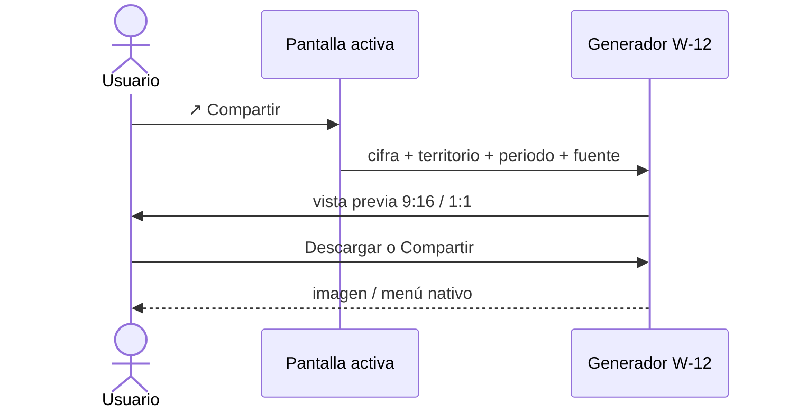

# US-14 · Generar y descargar la tarjeta compartible

| Campo | Valor |
| --- | --- |
| **Épica** | [E-04 Diseño y piezas compartibles](https://app.notion.com/p/3efa4b89591481e2aed4d580dd039ef6) |
| **Prioridad (MoSCoW)** | Should |
| **Story Points** | 3 |
| **Sprint** | Sprint 4 (24-31 oct) |
| **Responsable** | Angel |
| **Revisor (D3)** | Kira |
| **Fecha compromiso** | 24/10/2026 |
| **Estado** | In progress |
| **Ficha en Notion** | [User Story Backlog · US-14](https://app.notion.com/p/3efa4b89591481408175fbb13c015458) |

## 🎯 Objetivo

> **Como** adulto joven,
> **quiero** descargar una tarjeta con el dato que me llamó la atención,
> **para** publicarla en mis redes.

## 🔗 Trazabilidad

| Artefacto | Referencia |
| --- | --- |
| SRS | SRS-01 · HU-02 → RF-15 · RN-08, RN-10 |
| Objetivos del producto | OBJ-05 |
| Requisitos no funcionales | RNF-13 |
| Pantallas / interfaz | RIU-07 · W-12 |
| Casos de uso | CU-06 |
| Entregable | [D10 - Tarjetas visuales compartibles](https://app.notion.com/p/3efa4b89591481f680efeac6e4ddb0f7) en la base de Deliverables |
| Actividad del PVG | 4.5 Generación y descarga de tarjeta compartible en la hoja PVG general |
| Rama de GitHub | `feat/US-11-adaptadores-datos` |
| Pull request | [liga] |
| Diseño en Figma | [liga al frame W-12 y plantillas 9:16 / 1:1] |
| Depende de | [US-11 Implementar las pantallas de cifras y comparativos](./US-11-pantallas-cifras.md) [US-12 Implementar el arquetipo cívico y la ficha de fuente](./US-12-arquetipo-ficha-fuente.md) [US-13 Definir el sistema visual y las plantillas compartibles](./US-13-sistema-visual.md) |
| Bloquea a | [US-16 Ejecutar las pruebas funcionales y la auditoría de accesibilidad](./US-16-pruebas-funcionales-accesibilidad.md) |
| Prácticas CMMI-DEV v1.3 | TS SP 3.1 · VER SP 3.1 · PPQA SP 1.2 (sin datos personales) |

## ✅ Criterios de aceptación

| # | Criterio | Verificación / evidencia | Resultado |
| --- | --- | --- | --- |
| CA-01 | **Dado** que estoy en una pantalla compartible, **cuando** presione Compartir, **entonces** puedo descargar la imagen en 9:16 o 1:1. | Prueba en ambos dispositivos | ⬜ Pendiente |
| CA-02 | **Dada** la tarjeta generada, **cuando** la revise, **entonces** incluye cifra, territorio, periodo, fuente y liga del sitio. | Inspección de imagen (RN-10) | ⬜ Pendiente |
| CA-03 | **Dada** cualquier tarjeta, **cuando** se inspeccione, **entonces** no contiene ningún dato que identifique a una persona. | Revisión RN-08 / RNF-13 | ⬜ Pendiente |
| CA-04 | **Dado** un dispositivo compatible, **cuando** presione Compartir, **entonces** se ofrece el menú nativo del sistema. | Prueba Web Share API en iOS y Android | ⬜ Pendiente |

## 🧭 Diagrama

## 📋 Definition of Done aplicable

[READY-DONE](https://app.notion.com/p/3efa4b895914805c8f93e8d584df38a2) · EST-01: lista universal D1 a D7 + sección específica **C1 · Historia implementada (código en `main` vía PR aprobado, desplegado en Vercel, probado en 360 px)**.

**Definition of Ready**

- [ ] R1 · Entregable identificable
- [ ] R2 · Criterios de aceptación Dado / Cuando / Entonces
- [ ] R3 · Dimensionada (AP), responsable y fecha planeada
- [ ] R4 · Dependencias disponibles hoy

**Definition of Done**

- [ ] D1 · Entregable existe y está terminado
- [ ] D2 · Todos los CA se cumplen (tabla de arriba con ✅)
- [ ] D3 · Revisado por Kira (PR o bitácora)
- [ ] D4 · Versionado y accesible
- [ ] D5 · Sin no conformidades críticas abiertas
- [ ] D6 · PVG actualizado (Toggl, fecha real)
- [ ] D7 · Sin datos personales ni credenciales

## 📝 Notas y decisiones

- **Inconsistencia de prioridad:** HU-02 es *Must* en el SRS (riesgo Alto) y OBJ-05 exige 100 % de descargas correctas; esta US es *Should*.
- Riesgo de calendario: vence el 24/10 y US-16 (pruebas) empieza el 26/10; poco margen para corregir.
- OBJ-05 tiene fecha meta 26/10/2026.

### Avance al 18/10/2026

- W-12 genera las tarjetas de arquetipo, insignia y ambas con datos reales y las descarga en PNG (1080 × 1920 y 1080 × 1080). Commit `3618c21`.
- «Compartir arquetipo» preselecciona el arquetipo y «Compartir insignia» la insignia.
- La exportación usa `html-to-image` en carga diferida para no afectar los 500 KB iniciales (ADR-0006).
- Los PNG de referencia de `design/tarjetas/png/` no se versionan (49 MB); se regeneran con `design/tarjetas/tarjetas.html`.

---

| # | Autor | Modificación | Fecha |
| --- | --- | --- | --- |
| 1 | Angel | Creación del archivo a partir del User Story Backlog de Notion y SRS-01 | 06/10/2026 |
| 2 | Angel | Avance de implementación, rama y pendientes | 18/10/2026 |
