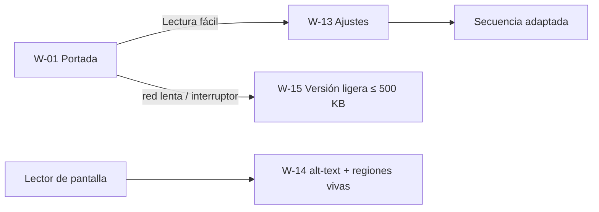

# US-15 · Implementar accesibilidad, lectura fácil y versión ligera

| Campo | Valor |
| --- | --- |
| **Épica** | [E-05 Accesibilidad y acceso equitativo](https://app.notion.com/p/3efa4b89591481d08e4bc005bc475f66) |
| **Prioridad (MoSCoW)** | Must |
| **Story Points** | 3 |
| **Sprint** | Sprint 3 (17-23 oct) |
| **Responsable** | Kira |
| **Revisor (D3)** | Angel |
| **Fecha compromiso** | 21/10/2026 |
| **Estado** | In progress |
| **Ficha en Notion** | [User Story Backlog · US-15](https://app.notion.com/p/3efa4b8959148161aff9d52c709d0972) |

## 🎯 Objetivo

> **Como** persona adulta mayor, con discapacidad visual o con conexión limitada,
> **quiero** leer con comodidad, navegar con lector de pantalla y abrir una versión ligera,
> **para** acceder a la misma información que cualquier otra persona.

## 🔗 Trazabilidad

| Artefacto | Referencia |
| --- | --- |
| SRS | SRS-01 · HU-10 → RF-16 · HU-14 → RF-17 · HU-15 → RF-18 · HU-11 → RF-19 |
| Objetivos del producto | OBJ-03, OBJ-04, OBJ-06 |
| Requisitos no funcionales | RNF-01, RNF-02, RNF-07, RNF-08, RNF-13 |
| Pantallas / interfaz | RIU-01, RIU-10 · W-01, W-13, W-14, W-15 |
| Casos de uso | CU-08 |
| Entregable | [D11 - Accesibilidad y lectura sencilla](https://app.notion.com/p/3efa4b895914818785cdc574887505af) en la base de Deliverables |
| Actividad del PVG | 4.6 Modo lectura fácil, accesibilidad y versión ligera en la hoja PVG general |
| Rama de GitHub | `feat/US-09-motor-secuencia` y `feat/US-11-adaptadores-datos` |
| Pull request | [liga] |
| Diseño en Figma | [liga a frames W-13, W-14, W-15] |
| Depende de | [US-09 Construir el motor de secuencia de pantallas](./US-09-motor-secuencia.md) [US-13 Definir el sistema visual y las plantillas compartibles](./US-13-sistema-visual.md) |
| Bloquea a | [US-16 Ejecutar las pruebas funcionales y la auditoría de accesibilidad](./US-16-pruebas-funcionales-accesibilidad.md) |
| Prácticas CMMI-DEV v1.3 | TS SP 3.1 · VER SP 3.1 · VAL SP 2.1 (validar con usuarios reales) |

## ✅ Criterios de aceptación

| # | Criterio | Verificación / evidencia | Resultado |
| --- | --- | --- | --- |
| CA-01 | **Dada** la primera pantalla, **cuando** se presente, **entonces** la opción de lectura fácil está visible antes de iniciar el recorrido. | Inspección W-01 | ⬜ Pendiente |
| CA-02 | **Dado** el modo lectura fácil activo, **cuando** recorra el sitio, **entonces** aumenta el texto, se desactiva el avance automático y se reducen las animaciones. | Prueba + `prefers-reduced-motion` | ⬜ Pendiente |
| CA-03 | **Dado** un lector de pantalla, **cuando** recorra una visualización, **entonces** escucho la cifra explícita, el territorio y el periodo. | Prueba con VoiceOver (iPhone) y TalkBack (Motorola) | ⬜ Pendiente |
| CA-04 | **Dada** la navegación por teclado, **cuando** recorra la secuencia, **entonces** alcanzo todos los controles con foco visible. | Prueba solo teclado | ⬜ Pendiente |
| CA-05 | **Dada** una conexión lenta, **cuando** abra el sitio, **entonces** la carga inicial no supera 500 KB. | DevTools sin caché, perfil 3G rápido (RNF-01) | ⬜ Pendiente |
| CA-06 | **Dada** la portada, **cuando** se presente, **entonces** declara autoría, origen de los datos y que no se solicita ningún dato personal. | Inspección W-01 (RF-19) | ⬜ Pendiente |

## 🧭 Diagrama

## 📋 Definition of Done aplicable

[READY-DONE](https://app.notion.com/p/3efa4b895914805c8f93e8d584df38a2) · EST-01: lista universal D1 a D7 + sección específica **C1 · Historia implementada (código en `main` vía PR aprobado, desplegado en Vercel, probado en 360 px)**.

**Definition of Ready**

- [ ] R1 · Entregable identificable
- [ ] R2 · Criterios de aceptación Dado / Cuando / Entonces
- [ ] R3 · Dimensionada (AP), responsable y fecha planeada
- [ ] R4 · Dependencias disponibles hoy

**Definition of Done**

- [ ] D1 · Entregable existe y está terminado
- [ ] D2 · Todos los CA se cumplen (tabla de arriba con ✅)
- [ ] D3 · Revisado por Angel (PR o bitácora)
- [ ] D4 · Versionado y accesible
- [ ] D5 · Sin no conformidades críticas abiertas
- [ ] D6 · PVG actualizado (Toggl, fecha real)
- [ ] D7 · Sin datos personales ni credenciales

## 📝 Notas y decisiones

- HU-14 CA-03 (anuncio del cambio de pantalla con región viva) no está en la lista de CA de esta US: agregarlo o probarlo en US-16.
- HU-11 es *Should* en el SRS y aquí queda dentro de una US *Must* (CA-06).

### Avance al 18/10/2026

- Versión ligera W-15 completa por pantalla (commit `0eebab6`).
- Mapas de W-02, W-03 y W-04 dibujados en SVG desde TopoJSON proyectado; el tooltip es `aria-hidden` y la cifra va en texto accesible. Ver ADR-0004.
- Peso inicial medido en build: 398.3 KB de 500 KB (CA-05, por confirmar en DevTools con 3G rápido). El mapa municipal nacional (559 KB, 152 KB con gzip) solo se pide en W-03 y no entra en la versión ligera.
- CA-01 a CA-04 y CA-06 pendientes de verificar en US-16.

---

| # | Autor | Modificación | Fecha |
| --- | --- | --- | --- |
| 1 | Angel | Creación del archivo a partir del User Story Backlog de Notion y SRS-01 | 06/10/2026 |
| 2 | Angel | Avance de implementación, rama y pendientes | 18/10/2026 |
