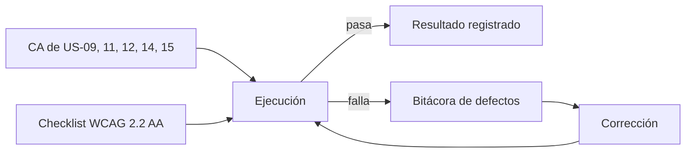

# US-16 · Ejecutar las pruebas funcionales y la auditoría de accesibilidad

| Campo | Valor |
| --- | --- |
| **Épica** | [E-06 Calidad y verificación](https://app.notion.com/p/3efa4b895914817f8eb0ebccd2e92962) |
| **Prioridad (MoSCoW)** | Must |
| **Story Points** | 1 |
| **Sprint** | Sprint 4 (24-31 oct) |
| **Responsable** | Angel |
| **Revisor (D3)** | Kira |
| **Fecha compromiso** | 26/10/2026 |
| **Estado** | Not started |
| **Ficha en Notion** | [User Story Backlog · US-16](https://app.notion.com/p/3efa4b8959148195b6d6f71167fd2f8b) |

## 🎯 Objetivo

> **Como** equipo de calidad,
> **quiero** ejecutar cada criterio de aceptación y la lista WCAG 2.2 AA,
> **para** entregar un MVP verificado y con evidencia de cada resultado.

## 🔗 Trazabilidad

| Artefacto | Referencia |
| --- | --- |
| SRS | SRS-01 · SRS §11 Verificación y validación · RF-01 a RF-19 |
| Objetivos del producto | OBJ-03, OBJ-06 |
| Requisitos no funcionales | RNF-07, RNF-08, RNF-10 |
| Pantallas / interfaz | Todas |
| Casos de uso | CU-01 a CU-08 |
| Entregable | [D12 - Reporte de pruebas y defectos](https://app.notion.com/p/3efa4b8959148160b5f0d46425cf0da1) en la base de Deliverables |
| Actividad del PVG | 5.1 Pruebas funcionales y auditoría de accesibilidad en la hoja PVG general |
| Rama de GitHub | `feat/US-16-pruebas-funcionales-accesibilidad` |
| Pull request | [liga] |
| Diseño en Figma | No aplica |
| Depende de | [US-11 Implementar las pantallas de cifras y comparativos](./US-11-pantallas-cifras.md) [US-12 Implementar el arquetipo cívico y la ficha de fuente](./US-12-arquetipo-ficha-fuente.md) [US-14 Generar y descargar la tarjeta compartible](./US-14-tarjeta-compartible.md) [US-15 Implementar accesibilidad, lectura fácil y versión ligera](./US-15-accesibilidad-version-ligera.md) |
| Bloquea a | [US-17 Probar en dispositivos reales y cerrar defectos](./US-17-pruebas-dispositivos.md) |
| Prácticas CMMI-DEV v1.3 | VER SP 1.1 / 1.3 (preparar y ejecutar verificación) · VER SP 3.2 (analizar resultados) · VAL SP 2.2 · PPQA SP 2.1 (no conformidades) |

## ✅ Criterios de aceptación

| # | Criterio | Verificación / evidencia | Resultado |
| --- | --- | --- | --- |
| CA-01 | **Dadas** las historias Must, **cuando** se prueben, **entonces** se ejecuta cada criterio de aceptación y se registra su resultado. | Reporte D12 con CA × resultado | ⬜ Pendiente |
| CA-02 | **Dado** el checklist WCAG 2.2 AA, **cuando** se aplique, **entonces** se cubren todos los criterios aplicables. | Checklist WCAG anexo a D12 | ⬜ Pendiente |
| CA-03 | **Dado** cualquier defecto encontrado, **cuando** se detecte, **entonces** queda registrado en la bitácora antes de corregirse. | Bitácora de defectos | ⬜ Pendiente |

## 🧭 Diagrama

## 📋 Definition of Done aplicable

[READY-DONE](https://app.notion.com/p/3efa4b895914805c8f93e8d584df38a2) · EST-01: lista universal D1 a D7 + sección específica **C3 · Documento (sin texto de relleno, control de modificaciones actualizado, publicado en Notion / repo)**.

**Definition of Ready**

- [ ] R1 · Entregable identificable
- [ ] R2 · Criterios de aceptación Dado / Cuando / Entonces
- [ ] R3 · Dimensionada (AP), responsable y fecha planeada
- [ ] R4 · Dependencias disponibles hoy

**Definition of Done**

- [ ] D1 · Entregable existe y está terminado
- [ ] D2 · Todos los CA se cumplen (tabla de arriba con ✅)
- [ ] D3 · Revisado por Kira (PR o bitácora)
- [ ] D4 · Versionado y accesible
- [ ] D5 · Sin no conformidades críticas abiertas
- [ ] D6 · PVG actualizado (Toggl, fecha real)
- [ ] D7 · Sin datos personales ni credenciales

## 📝 Notas y decisiones

- SRS §11 asigna RF-01 a RF-19 y RNF-07/08 a Kira; Notion asigna esta US a Angel. Como nadie acepta su propio trabajo (D3), conviene que quien prueba no sea quien implementó.
- La prueba con usuarios (RNF-10, ≥ 5 personas ajenas, > 70 %) no tiene US propia: es el criterio de éxito más importante (CE-01 a CE-03) y debería tener una.

---

| # | Autor | Modificación | Fecha |
| --- | --- | --- | --- |
| 1 | Angel | Creación del archivo a partir del User Story Backlog de Notion y SRS-01 | 06/10/2026 |
