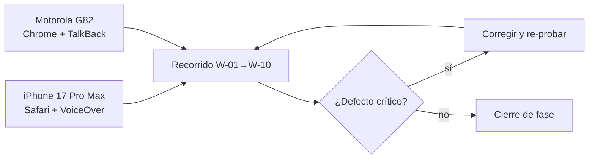

# US-17 · Probar en dispositivos reales y cerrar defectos

| Campo | Valor |
| --- | --- |
| **Épica** | [E-06 Calidad y verificación](https://app.notion.com/p/3efa4b895914817f8eb0ebccd2e92962) |
| **Prioridad (MoSCoW)** | Must |
| **Story Points** | 1 |
| **Sprint** | Sprint 4 (24-31 oct) |
| **Responsable** | Angel |
| **Revisor (D3)** | Kira |
| **Fecha compromiso** | 27/10/2026 |
| **Estado** | Not started |
| **Ficha en Notion** | [User Story Backlog · US-17](https://app.notion.com/p/3efa4b895914815e9072dae4132ddc6c) |

## 🎯 Objetivo

> **Como** equipo de calidad,
> **quiero** probar el recorrido principal en los dispositivos reales y cerrar los defectos críticos,
> **para** asegurar que el jurado pueda completar la experiencia en móvil sin errores.

## 🔗 Trazabilidad

| Artefacto | Referencia |
| --- | --- |
| SRS | SRS-01 · RNF-02, RNF-06 · CE-04 · RIE-05, RIE-06 |
| Objetivos del producto | OBJ-03 |
| Requisitos no funcionales | RNF-02, RNF-05, RNF-06 |
| Pantallas / interfaz | Todas |
| Casos de uso | CU-01 |
| Entregable | [D12 - Reporte de pruebas y defectos](https://app.notion.com/p/3efa4b8959148160b5f0d46425cf0da1) en la base de Deliverables |
| Actividad del PVG | 5.2 Pruebas en dispositivos y corrección de defectos en la hoja PVG general |
| Rama de GitHub | `feat/US-17-pruebas-dispositivos` |
| Pull request | [liga] |
| Diseño en Figma | No aplica |
| Depende de | [US-16 Ejecutar las pruebas funcionales y la auditoría de accesibilidad](./US-16-pruebas-funcionales-accesibilidad.md) |
| Bloquea a | [US-19 Producir el video demostrativo](./US-19-video-demostrativo.md) [US-20 Empaquetar, verificar y enviar la entrega final](./US-20-paquete-envio-final.md) |
| Prácticas CMMI-DEV v1.3 | VAL SP 2.1 / 2.2 (validar en entorno real) · PMC SP 2.1–2.3 (acciones correctivas hasta el cierre) |

## ✅ Criterios de aceptación

| # | Criterio | Verificación / evidencia | Resultado |
| --- | --- | --- | --- |
| CA-01 | **Dado** el flujo principal, **cuando** se pruebe en iPhone 17 Pro Max y Motorola G82, **entonces** se completa sin errores críticos. | Video o capturas por dispositivo | ⬜ Pendiente |
| CA-02 | **Dados** los defectos críticos, **cuando** se cierre la fase, **entonces** no queda ninguno abierto. | Bitácora con 0 críticos abiertos | ⬜ Pendiente |
| CA-03 | **Dada** la versión ligera, **cuando** se pruebe en red lenta simulada, **entonces** la primera pantalla aparece en 3 segundos o menos. | Medición RNF-02 | ⬜ Pendiente |

## 🧭 Diagrama

## 📋 Definition of Done aplicable

[READY-DONE](https://app.notion.com/p/3efa4b895914805c8f93e8d584df38a2) · EST-01: lista universal D1 a D7 + sección específica **C3 · Documento (sin texto de relleno, control de modificaciones actualizado, publicado en Notion / repo)**.

**Definition of Ready**

- [ ] R1 · Entregable identificable
- [ ] R2 · Criterios de aceptación Dado / Cuando / Entonces
- [ ] R3 · Dimensionada (AP), responsable y fecha planeada
- [ ] R4 · Dependencias disponibles hoy

**Definition of Done**

- [ ] D1 · Entregable existe y está terminado
- [ ] D2 · Todos los CA se cumplen (tabla de arriba con ✅)
- [ ] D3 · Revisado por Kira (PR o bitácora)
- [ ] D4 · Versionado y accesible
- [ ] D5 · Sin no conformidades críticas abiertas
- [ ] D6 · PVG actualizado (Toggl, fecha real)
- [ ] D7 · Sin datos personales ni credenciales

## 📝 Notas y decisiones

- Cada dispositivo pertenece a una sola persona (iPhone: Kira; Motorola: Angel) — coordinar la sesión de prueba conjunta.

---

| # | Autor | Modificación | Fecha |
| --- | --- | --- | --- |
| 1 | Angel | Creación del archivo a partir del User Story Backlog de Notion y SRS-01 | 06/10/2026 |
