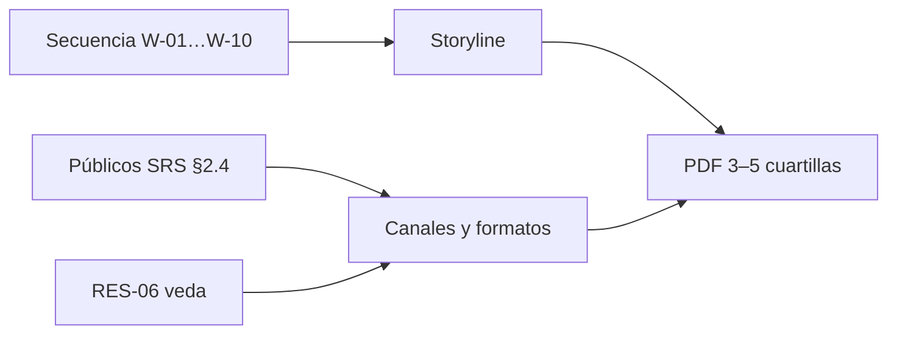

# US-18 · Redactar el guion narrativo y la propuesta de difusión

| Campo | Valor |
| --- | --- |
| **Épica** | [E-07 Entrega y difusión](https://app.notion.com/p/3efa4b89591481e2ac03eb237d82eb78) |
| **Prioridad (MoSCoW)** | Must |
| **Story Points** | 3 |
| **Sprint** | Sprint 3 (17-23 oct) |
| **Responsable** | Angel |
| **Revisor (D3)** | Kira |
| **Fecha compromiso** | 22/10/2026 |
| **Estado** | Not started |
| **Ficha en Notion** | [User Story Backlog · US-18](https://app.notion.com/p/3efa4b895914815dbed4f693285c2fe2) |

## 🎯 Objetivo

> **Como** equipo del proyecto,
> **quiero** un documento con storyline, canales, formato y público objetivo,
> **para** cumplir el entregable obligatorio de la convocatoria y orientar la difusión respetando la veda.

## 🔗 Trazabilidad

| Artefacto | Referencia |
| --- | --- |
| SRS | SRS-01 · REF-03 Base Séptima de la convocatoria · RES-06 · RNF-15 |
| Objetivos del producto | OBJ-07 |
| Requisitos no funcionales | RNF-15, RNF-18 |
| Pantallas / interfaz | — |
| Casos de uso | — |
| Entregable | [D13 - Guion narrativo y propuesta de difusión](https://app.notion.com/p/3efa4b89591481cbbe44f2639a2e4409) en la base de Deliverables |
| Actividad del PVG | 6.1 Guion narrativo y propuesta de difusión (3 a 5 cuartillas) en la hoja PVG general |
| Rama de GitHub | `feat/US-18-guion-difusion` |
| Pull request | [liga] |
| Diseño en Figma | No aplica |
| Depende de | [US-04 Diseñar la arquitectura de información y los wireframes](./US-04-arquitectura-wireframes.md) [US-11 Implementar las pantallas de cifras y comparativos](./US-11-pantallas-cifras.md) |
| Bloquea a | [US-19 Producir el video demostrativo](./US-19-video-demostrativo.md) [US-20 Empaquetar, verificar y enviar la entrega final](./US-20-paquete-envio-final.md) |
| Prácticas CMMI-DEV v1.3 | PP SP 2.7 (plan de comunicación) · PPQA SP 1.2 · VER SP 2.2 (revisión por pares) |

## ✅ Criterios de aceptación

| # | Criterio | Verificación / evidencia | Resultado |
| --- | --- | --- | --- |
| CA-01 | **Dado** el documento, **cuando** se entregue, **entonces** tiene entre 3 y 5 cuartillas en PDF. | Conteo de páginas del PDF | ⬜ Pendiente |
| CA-02 | **Dado** el contenido, **cuando** se revise, **entonces** incluye storyline, canales, formato y público objetivo. | Checklist contra la Base Séptima | ⬜ Pendiente |
| CA-03 | **Dada** la propuesta de difusión, **cuando** se revise, **entonces** considera las restricciones de veda electoral. | Sección de veda (RES-06) | ⬜ Pendiente |
| CA-04 | **Dado** el documento, **cuando** lo revise el otro integrante, **entonces** queda aprobado y es coherente con el MVP. | Nota en bitácora (revisor: Kira) | ⬜ Pendiente |

## 🧭 Diagrama

## 📋 Definition of Done aplicable

[READY-DONE](https://app.notion.com/p/3efa4b895914805c8f93e8d584df38a2) · EST-01: lista universal D1 a D7 + sección específica **C3 · Documento (sin texto de relleno, control de modificaciones actualizado, publicado en Notion / repo)**.

**Definition of Ready**

- [ ] R1 · Entregable identificable
- [ ] R2 · Criterios de aceptación Dado / Cuando / Entonces
- [ ] R3 · Dimensionada (AP), responsable y fecha planeada
- [ ] R4 · Dependencias disponibles hoy

**Definition of Done**

- [ ] D1 · Entregable existe y está terminado
- [ ] D2 · Todos los CA se cumplen (tabla de arriba con ✅)
- [ ] D3 · Revisado por Kira (PR o bitácora)
- [ ] D4 · Versionado y accesible
- [ ] D5 · Sin no conformidades críticas abiertas
- [ ] D6 · PVG actualizado (Toggl, fecha real)
- [ ] D7 · Sin datos personales ni credenciales

## 📝 Notas y decisiones

- El storyline debe coincidir con la secuencia final de pantallas; si se degradan W-07…W-09, actualizar el guion.

---

| # | Autor | Modificación | Fecha |
| --- | --- | --- | --- |
| 1 | Angel | Creación del archivo a partir del User Story Backlog de Notion y SRS-01 | 06/10/2026 |
