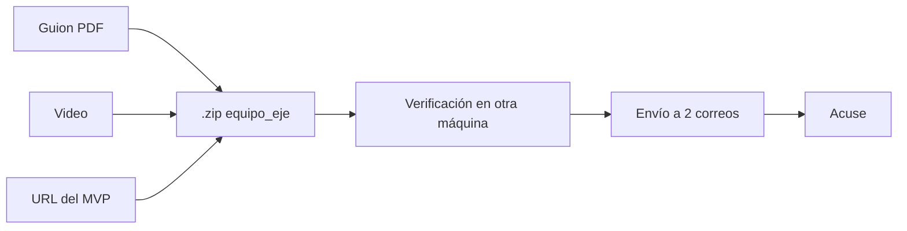

# US-20 · Empaquetar, verificar y enviar la entrega final

| Campo | Valor |
| --- | --- |
| **Épica** | [E-07 Entrega y difusión](https://app.notion.com/p/3efa4b89591481e2ac03eb237d82eb78) |
| **Prioridad (MoSCoW)** | Must |
| **Story Points** | 1 |
| **Sprint** | Sprint 4 (24-31 oct) |
| **Responsable** | Angel |
| **Revisor (D3)** | Kira |
| **Fecha compromiso** | 30/10/2026 |
| **Estado** | Not started |
| **Ficha en Notion** | [User Story Backlog · US-20](https://app.notion.com/p/3efa4b89591481b1996eebf618171412) |

## 🎯 Objetivo

> **Como** equipo del proyecto,
> **quiero** enviar un paquete completo y verificado antes del cierre,
> **para** que el proyecto sea evaluado sin riesgo de descalificación por forma.

## 🔗 Trazabilidad

| Artefacto | Referencia |
| --- | --- |
| SRS | SRS-01 · REF-03 Base Séptima de la convocatoria · RES-02 · OBJ-07 |
| Objetivos del producto | OBJ-07 |
| Requisitos no funcionales | RNF-05 |
| Pantallas / interfaz | — |
| Casos de uso | — |
| Entregable | [D15 - Paquete y envío final del hackathon](https://app.notion.com/p/3efa4b895914811d8fe9cac67ad3993e) en la base de Deliverables |
| Actividad del PVG | 6.4 Empaquetado .zip, verificación final y envío por correo en la hoja PVG general |
| Rama de GitHub | `feat/US-20-paquete-envio-final` |
| Pull request | [liga] |
| Diseño en Figma | No aplica |
| Depende de | [US-17 Probar en dispositivos reales y cerrar defectos](./US-17-pruebas-dispositivos.md) [US-18 Redactar el guion narrativo y la propuesta de difusión](./US-18-guion-difusion.md) [US-19 Producir el video demostrativo](./US-19-video-demostrativo.md) |
| Bloquea a | — |
| Prácticas CMMI-DEV v1.3 | PI SP 3.4 (empaquetar y entregar) · CM SP 3.2 (auditoría de configuración) · PMC SP 1.7 (revisión de hito) |

## ✅ Criterios de aceptación

| # | Criterio | Verificación / evidencia | Resultado |
| --- | --- | --- | --- |
| CA-01 | **Dado** el paquete, **cuando** se nombre, **entonces** incluye el nombre del equipo y el eje temático. | Nombre del .zip | ⬜ Pendiente |
| CA-02 | **Dado** el .zip, **cuando** se descomprima en otra máquina, **entonces** contiene los tres entregables obligatorios completos. | Prueba en la laptop del otro integrante | ⬜ Pendiente |
| CA-03 | **Dado** el contenido, **cuando** se verifique, **entonces** ambos integrantes lo revisaron contra las bases. | Checklist firmado por ambos | ⬜ Pendiente |
| CA-04 | **Dado** el envío, **cuando** se realice, **entonces** llega a los dos correos de la convocatoria y se conserva el acuse. | Acuse guardado en la carpeta compartida | ⬜ Pendiente |

## 🧭 Diagrama

## 📋 Definition of Done aplicable

[READY-DONE](https://app.notion.com/p/3efa4b895914805c8f93e8d584df38a2) · EST-01: lista universal D1 a D7 + sección específica **C5 · Paquete (zip verificado en otra máquina, acuse conservado)**.

**Definition of Ready**

- [ ] R1 · Entregable identificable
- [ ] R2 · Criterios de aceptación Dado / Cuando / Entonces
- [ ] R3 · Dimensionada (AP), responsable y fecha planeada
- [ ] R4 · Dependencias disponibles hoy

**Definition of Done**

- [ ] D1 · Entregable existe y está terminado
- [ ] D2 · Todos los CA se cumplen (tabla de arriba con ✅)
- [ ] D3 · Revisado por Kira (PR o bitácora)
- [ ] D4 · Versionado y accesible
- [ ] D5 · Sin no conformidades críticas abiertas
- [ ] D6 · PVG actualizado (Toggl, fecha real)
- [ ] D7 · Sin datos personales ni credenciales

## 📝 Notas y decisiones

- Fecha límite inamovible: 31/10/2026 23:59 h (RES-02); el plan deja 1 día de colchón.
- No hay actividad 6.3 en el PVG entre 6.2 y 6.4: confirmar si existe o renumerar.

---

| # | Autor | Modificación | Fecha |
| --- | --- | --- | --- |
| 1 | Angel | Creación del archivo a partir del User Story Backlog de Notion y SRS-01 | 06/10/2026 |
