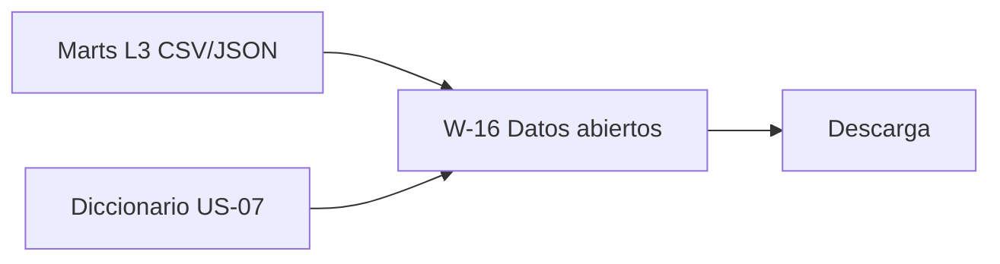

# US-22 · Descargar los agregados en formato abierto

| Campo | Valor |
| --- | --- |
| **Épica** | [E-08 Transparencia y reutilización](https://app.notion.com/p/3efa4b89591481e4aa93c292b19c49dc) |
| **Prioridad (MoSCoW)** | Could |
| **Story Points** | 1 |
| **Sprint** | Backlog sin capacidad |
| **Responsable** | Sin asignar |
| **Revisor (D3)** | Por asignar |
| **Fecha compromiso** | — |
| **Estado** | In progress |
| **Ficha en Notion** | [User Story Backlog · US-22](https://app.notion.com/p/3efa4b89591481959318ef307ca29e8b) |

## 🎯 Objetivo

> **Como** investigador o periodista,
> **quiero** descargar los agregados que alimentan el sitio,
> **para** verificarlos y hacer mis propios análisis.

## 🔗 Trazabilidad

| Artefacto | Referencia |
| --- | --- |
| SRS | SRS-01 · HU-17 → RF-14 |
| Objetivos del producto | OBJ-04 |
| Requisitos no funcionales | RNF-14 |
| Pantallas / interfaz | RIU-09 · W-16 |
| Casos de uso | CU-07 |
| Entregable | Sin entregable (backlog sin capacidad) |
| Actividad del PVG | Sin actividad en el PVG en la hoja PVG general |
| Rama de GitHub | `feat/US-09-motor-secuencia` y `feat/US-11-adaptadores-datos` |
| Pull request | [liga] |
| Diseño en Figma | [liga al frame W-16] |
| Depende de | [US-06 Generar el dataset homologado y agregado del MVP](./US-06-dataset-homologado.md) [US-07 Publicar el diccionario de datos y las fuentes citadas](./US-07-diccionario-datos.md) |
| Bloquea a | — |
| Prácticas CMMI-DEV v1.3 | REQM SP 1.3 · MA SP 2.4 (comunicar resultados de medición) |

## ✅ Criterios de aceptación

| # | Criterio | Verificación / evidencia | Resultado |
| --- | --- | --- | --- |
| CA-01 | **Dada** la sección de datos abiertos, **cuando** elija un conjunto, **entonces** puedo descargarlo en CSV y JSON. | Prueba de descarga | ⬜ Pendiente |
| CA-02 | **Dado** el archivo descargado, **cuando** lo abra, **entonces** incluye o referencia su diccionario, metodología y fecha de corte. | Inspección del archivo | ⬜ Pendiente |

## 🧭 Diagrama

## 📋 Definition of Done aplicable

[READY-DONE](https://app.notion.com/p/3efa4b895914805c8f93e8d584df38a2) · EST-01: lista universal D1 a D7 + sección específica **C1 · Historia implementada (código en `main` vía PR aprobado, desplegado en Vercel, probado en 360 px)**.

**Definition of Ready**

- [ ] R1 · Entregable identificable
- [ ] R2 · Criterios de aceptación Dado / Cuando / Entonces
- [ ] R3 · Dimensionada (AP), responsable y fecha planeada
- [ ] R4 · Dependencias disponibles hoy

**Definition of Done**

- [ ] D1 · Entregable existe y está terminado
- [ ] D2 · Todos los CA se cumplen (tabla de arriba con ✅)
- [ ] D3 · Revisado por Por asignar (PR o bitácora)
- [ ] D4 · Versionado y accesible
- [ ] D5 · Sin no conformidades críticas abiertas
- [ ] D6 · PVG actualizado (Toggl, fecha real)
- [ ] D7 · Sin datos personales ni credenciales

## 📝 Notas y decisiones

- HU-17 es *Should* en el SRS. Los artefactos L3 ya existirán por US-06: publicarlos es casi gratis si se versionan en `/public/data`.

### Avance al 18/10/2026

- W-16 enlaza `csv/participacion.csv` y `nacional.json` de la versión vigente mediante `JsonOpenDataRepository`.
- El CSV incluye conteos para que se pueda recalcular RN-01.
- Pendiente: RF-23 y desglose municipal por edad y sexo antes de declarar los datos definitivos.

---

| # | Autor | Modificación | Fecha |
| --- | --- | --- | --- |
| 1 | Angel | Creación del archivo a partir del User Story Backlog de Notion y SRS-01 | 06/10/2026 |
| 2 | Angel | Avance de implementación, rama y pendientes | 18/10/2026 |
