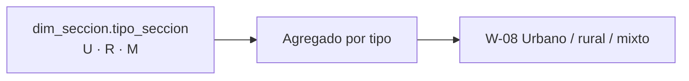

# US-23 · Comparar secciones urbanas y rurales

| Campo | Valor |
| --- | --- |
| **Épica** | [E-03 Experiencia narrativa](https://app.notion.com/p/3efa4b89591481b68f41f2f07d9e03b2) |
| **Prioridad (MoSCoW)** | Could |
| **Story Points** | 1 |
| **Sprint** | Backlog sin capacidad |
| **Responsable** | Sin asignar |
| **Revisor (D3)** | Por asignar |
| **Fecha compromiso** | — |
| **Estado** | Not started |
| **Ficha en Notion** | [User Story Backlog · US-23](https://app.notion.com/p/3efa4b895914818cb657f1b25bcec23d) |

## 🎯 Objetivo

> **Como** ciudadano o ciudadana,
> **quiero** ver si las secciones urbanas y rurales participan distinto,
> **para** entender que el territorio importa más allá del estado donde vivo.

## 🔗 Trazabilidad

| Artefacto | Referencia |
| --- | --- |
| SRS | SRS-01 · HU-30 → RF-10 |
| Objetivos del producto | OBJ-01 |
| Requisitos no funcionales | RNF-18 |
| Pantallas / interfaz | RIU-05 · W-08 |
| Casos de uso | CU-04 |
| Entregable | Sin entregable (backlog sin capacidad) |
| Actividad del PVG | Sin actividad en el PVG en la hoja PVG general |
| Rama de GitHub | `feat/US-23-urbano-rural` |
| Pull request | [liga] |
| Diseño en Figma | [liga al frame W-08] |
| Depende de | [US-06 Generar el dataset homologado y agregado del MVP](./US-06-dataset-homologado.md) [US-11 Implementar las pantallas de cifras y comparativos](./US-11-pantallas-cifras.md) |
| Bloquea a | — |
| Prácticas CMMI-DEV v1.3 | REQM SP 1.3 · TS SP 3.1 |

## ✅ Criterios de aceptación

| # | Criterio | Verificación / evidencia | Resultado |
| --- | --- | --- | --- |
| CA-01 | **Dada** la pantalla, **cuando** se presente, **entonces** muestra la participación de secciones urbanas, rurales y mixtas con su definición en lenguaje claro. | Inspección W-08 | ⬜ Pendiente |

## 🧭 Diagrama

## 📋 Definition of Done aplicable

[READY-DONE](https://app.notion.com/p/3efa4b895914805c8f93e8d584df38a2) · EST-01: lista universal D1 a D7 + sección específica **C1 · Historia implementada (código en `main` vía PR aprobado, desplegado en Vercel, probado en 360 px)**.

**Definition of Ready**

- [ ] R1 · Entregable identificable
- [ ] R2 · Criterios de aceptación Dado / Cuando / Entonces
- [ ] R3 · Dimensionada (AP), responsable y fecha planeada
- [ ] R4 · Dependencias disponibles hoy

**Definition of Done**

- [ ] D1 · Entregable existe y está terminado
- [ ] D2 · Todos los CA se cumplen (tabla de arriba con ✅)
- [ ] D3 · Revisado por Por asignar (PR o bitácora)
- [ ] D4 · Versionado y accesible
- [ ] D5 · Sin no conformidades críticas abiertas
- [ ] D6 · PVG actualizado (Toggl, fecha real)
- [ ] D7 · Sin datos personales ni credenciales

## 📝 Notas y decisiones

- Primera en salir si el plan se tensa (SRS §10.3). Si sale, la secuencia se acorta y el progreso se recalcula.

---

| # | Autor | Modificación | Fecha |
| --- | --- | --- | --- |
| 1 | Angel | Creación del archivo a partir del User Story Backlog de Notion y SRS-01 | 06/10/2026 |
